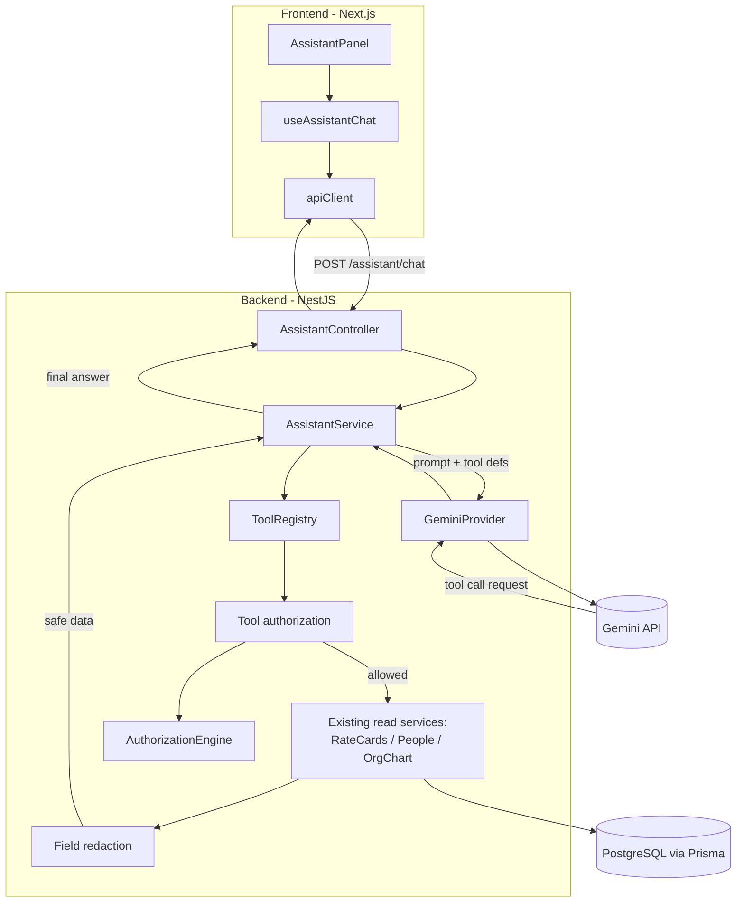
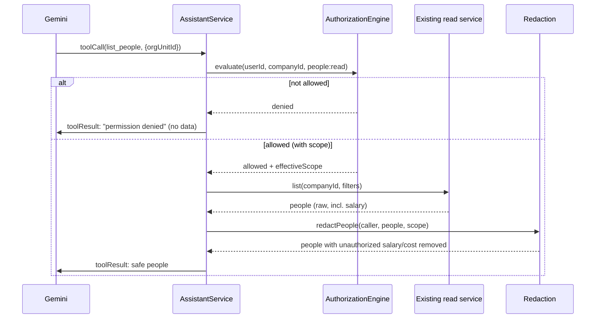

# Design Document: AI Assistant (Phase 1 — Read-Only)

## Overview

This design adds an in-app AI assistant to Strata. A user opens a chat panel, asks a natural-language question about their company's data, and the assistant answers using values pulled from Strata's own API. The intelligence comes from the Google Gemini API; the data comes only from a small set of **read-only tools** that wrap existing NestJS services.

The defining constraint is safety. The assistant is a new path to company data, so it must enforce the **same authentication, company scoping, and role/permission rules** as the rest of the app. Two enforcement layers make this concrete:

1. **Tool-level authorization** — before a tool runs, the Caller_Identity's permission for that tool is evaluated by the existing `AuthorizationEngine`. No permission, no execution.
2. **Field-level redaction** — sensitive fields (salary, day rate, annual cost) are stripped from tool results for people the caller may not see them for, **before** the data is handed to Gemini. Unauthorized data never reaches the model.

Phase 1 is read-only: the assistant answers and summarizes, but cannot create, update, or delete anything. The tool framework is built to add write tools later behind a confirmation step, but no write tool exists in this phase.

## Architecture



**Key architectural decisions:**

1. **Tools call existing services, never the DB or SQL.** Each tool is a thin wrapper over a method the UI already uses (e.g. `RateCardsService.getRateCards`, `CompanyPeopleService.list`). This inherits all existing query logic and keeps a single source of truth. The LLM only ever chooses *which* tool and *what arguments* — it never touches data directly.

2. **Server-orchestrated tool loop.** The `AssistantService` runs the multi-turn loop: send the message + tool definitions to Gemini, receive either a final answer or a tool-call request, execute the tool (after authorization + redaction), feed the result back, and repeat until Gemini returns a final answer or a call cap is hit. The client sees only the final reply.

3. **Provider abstraction.** All Gemini-specific request/response shaping lives behind an `LlmProvider` interface. Swapping to Azure OpenAI/Anthropic later means implementing that interface, not touching the tool logic or controller.

4. **Authorization reuses `AuthorizationEngine`.** Each tool declares the `feature`/`permission` it needs. Before execution, the service calls `AuthorizationEngine.evaluate(...)` for the Caller_Identity and Company_ID — identical to how UI routes are gated. Field redaction reuses the same scope resolution already proven in `OrgChartService` (`canSeeSalary`).

5. **New NestJS module** — `AssistantModule` at `apps/api/src/assistant/`, importing the existing service modules whose methods it wraps, plus the authorization module.

6. **Stateless conversation.** The client sends the prior conversation with each request; the server does not persist chat history in Phase 1 (audit logs record interactions, not full transcripts). This keeps the first version simple; a persisted `Conversation` store can be added later.

## Components and Interfaces

### Backend Components

#### `AssistantModule` (`apps/api/src/assistant/assistant.module.ts`)

Registers the controller, service, provider, and tool registry. Imports `RateCardsModule`, `PeopleModule`/`CompanyPeopleModule`, `OrgChartModule` (for their services), and `AuthorizationModule` (for `AuthorizationEngine`).

#### `AssistantController` (`apps/api/src/assistant/assistant.controller.ts`)

```typescript
@Controller('companies/:companyId/assistant')
export class AssistantController {
  // POST /companies/:companyId/assistant/chat
  chat(companyId: string, req: Request, body: ChatRequestDto): Promise<ChatResponseDto>
}
```

- Reads `request.user.sub` (Supabase user id) attached by the global `AuthGuard`.
- Resolves the Prisma user id and verifies membership in `:companyId` (403 otherwise).
- Validates the request body with Zod (message length, bounded history).
- Delegates to `AssistantService.chat(...)`.

#### `AssistantService` (`apps/api/src/assistant/assistant.service.ts`)

```typescript
@Injectable()
export class AssistantService {
  chat(ctx: AssistantContext, input: ChatInput): Promise<ChatResult>
}

interface AssistantContext {
  companyId: string;
  userId: string;        // Prisma user id (Caller_Identity)
  supabaseUserId: string;
}
```

Runs the orchestration loop:
1. Build the system instruction + Gemini contents from history and the new message.
2. Call `LlmProvider.generate(...)` with the tool definitions from `ToolRegistry`.
3. If the provider returns tool-call requests: for each, `authorizeAndExecute(...)`, collect results, loop back with the tool outputs.
4. Stop when the provider returns a text answer or `MAX_TOOL_CALLS` is reached.
5. Return the final text plus a list of tools used (for audit + optional UI display).

#### `LlmProvider` interface + `GeminiProvider` (`apps/api/src/assistant/providers/`)

```typescript
export interface LlmProvider {
  generate(input: LlmGenerateInput): Promise<LlmGenerateResult>;
}

interface LlmGenerateInput {
  systemInstruction: string;
  messages: LlmMessage[];          // prior turns + tool results
  tools: LlmToolDefinition[];      // function declarations
}

interface LlmGenerateResult {
  // Exactly one of:
  text?: string;                   // final answer
  toolCalls?: LlmToolCall[];       // { name, args }
}
```

`GeminiProvider` maps this to Gemini's `generateContent` function-calling format, reads `GEMINI_API_KEY` / `GEMINI_MODEL` from env, applies a request timeout, and normalizes errors. It never logs the key.

#### `ToolRegistry` + tool definitions (`apps/api/src/assistant/tools/`)

```typescript
export interface AssistantTool {
  name: string;
  description: string;             // shown to the LLM
  parameters: ZodType;             // arg schema (also emitted as JSON schema for the LLM)
  mode: 'read' | 'write';          // Phase 1: only 'read'
  requiredPermission: { feature: string; permission: string } | null;
  // Executes against existing services; returns already-redaction-safe data.
  run(ctx: AssistantContext, args: unknown): Promise<unknown>;
}
```

`ToolRegistry` holds the catalog and emits the LLM-facing function declarations (name, description, JSON-schema params). Phase 1 tools:

| Tool | Wraps | requiredPermission |
|------|-------|--------------------|
| `list_rate_cards` | `RateCardsService.getRateCards` | rate cards: read |
| `list_rate_card_groups` | `RateCardsService.getGroups` | rate cards: read |
| `list_rate_card_sets` | `RateCardsService.getSets` | rate cards: read |
| `list_people` | `CompanyPeopleService.list` (bounded, filterable) | people: read |
| `count_people` | derived from `CompanyPeopleService.list` | people: read |

(The exact feature/permission keys are taken from the existing feature registry during implementation; the table names the intent.)

#### Authorization + redaction helpers (`apps/api/src/assistant/authz/`)

- `authorizeTool(ctx, tool)` → calls `AuthorizationEngine.evaluate({ userId, companyId, feature, permission })`. Returns the effective scope or a denial. Unknown/unsettable requirement ⇒ deny (Req 8.7).
- `redactPeople(ctx, people, scope)` → removes/nulls compensation fields (`annualSalary`, `dayRate`, `annualCost`, and any `Annual Salary`/`Day Rate` metadata) for people the caller may not see them for, reusing the subordinate-set logic proven in `OrgChartService` (self + managed chain, or company-wide comp permission / super admin). Applied inside each people tool's `run` before returning.

### Frontend Components

#### `assistant.service.ts` (`apps/web/src/services/assistant.service.ts`)

```typescript
export interface AssistantMessage {
  role: "user" | "assistant";
  content: string;
}

export interface ChatRequest {
  message: string;
  history: AssistantMessage[];
}

export interface ChatResponse {
  reply: string;
  toolsUsed: string[];
}

export function useAssistantChat(companyId: string)  // TanStack Query mutation
```

Posts to `/companies/${companyId}/assistant/chat` via the existing `apiClient` (which already attaches the Supabase bearer token and handles 401 refresh).

#### `AssistantPanel` (`apps/web/src/components/assistant/assistant-panel.tsx`)

- A `@vkieu/mui`-based panel/drawer: scrollable message list, `TextField` input, send `Button`, in-progress indicator.
- Holds local conversation state; sends `{ message, history }` and appends the reply.
- Company_ID from `useCompanyId()`.
- Accessible: `role="log"` for the transcript, labeled input, keyboard send (Enter), disabled state while pending, error surface with retry.
- Entry point: a launcher (e.g. an icon button in the app shell) that toggles the panel.

## Data Models

### `ChatRequestDto` (validated with Zod)

| Field | Type | Rules |
|-------|------|-------|
| message | string | non-empty, max length (e.g. 2000 chars) |
| history | `{role, content}[]` | max N turns (e.g. 20); roles limited to user/assistant |

### `ChatResponseDto`

| Field | Type | Notes |
|-------|------|-------|
| reply | string | final assistant answer |
| toolsUsed | string[] | names of tools invoked (for transparency/audit) |

### Tool argument schemas

Each tool's `parameters` is a Zod schema (e.g. `list_people` accepts optional `search`, `orgUnitId`, `employmentType`, `limit`). The registry converts these to JSON schema for the Gemini function declarations. Arguments from the model are validated against the Zod schema before execution (Req 3.5).

### Environment configuration

| Var | Purpose |
|-----|---------|
| `GEMINI_API_KEY` | provider credential (server-only, never shipped to client) |
| `GEMINI_MODEL` | model name, e.g. `gemini-1.5-flash` |
| `ASSISTANT_MAX_TOOL_CALLS` | per-message tool-call cap (default e.g. 6) |
| `ASSISTANT_REQUEST_TIMEOUT_MS` | LLM call timeout |
| `ASSISTANT_RATE_LIMIT_PER_MIN` | per-user request cap |

## Authorization & Redaction Flow (the security core)



**Enforcement guarantees:**
- Permission is evaluated **server-side from the authenticated identity** — never from the request body or model output (Req 8.6).
- Redaction happens **before** data leaves the server for Gemini (Req 8.4), so the model can neither see nor "recall" withheld fields.
- Compensation visibility mirrors existing logic: a caller sees salary/cost only for themselves, people in their management scope, or with a company-wide compensation permission / super-admin (Req 8.3, 8.5).
- Denials produce a "you don't have permission" answer with no leaked values (Req 8.2).

## Correctness Properties

### Property 1: No unauthorized tool execution

*For any* tool call the model requests, IF the Caller_Identity is not granted the tool's required feature-permission by the AuthorizationEngine, THEN the tool's underlying service method SHALL NOT be invoked.

**Validates: Requirements 3.3, 3.4, 8.1, 8.2**

### Property 2: Compensation redaction

*For any* set of people returned by a people tool and any Caller_Identity, every returned compensation field (salary, day rate, annual cost) SHALL be non-null only for people the Caller_Identity is permitted to see it for; for all others it SHALL be null/absent.

**Validates: Requirements 8.3, 8.4, 8.5, 4.5**

### Property 3: Company isolation

*For any* chat request, every record referenced in any tool result SHALL belong to the request's Company_ID.

**Validates: Requirements 1.3, 4.4**

### Property 4: Unknown-tool refusal

*For any* tool name requested by the model that is not present in the ToolRegistry, the AssistantService SHALL refuse it and SHALL perform no data access for that call.

**Validates: Requirements 3.4, 6.2**

### Property 5: Bounded tool loop

*For any* single user message, the number of tool executions SHALL NOT exceed `ASSISTANT_MAX_TOOL_CALLS`.

**Validates: Requirements 3.7**

## Error Handling

| Scenario | HTTP Status | Behavior |
|----------|-------------|----------|
| Unauthenticated | 401 | via AuthGuard |
| Caller not a member of companyId | 403 | reject before any LLM call |
| Gemini key not configured | 503 | "Assistant is not available" |
| Gemini error / timeout | 502 | recoverable error, no credential/stack leak |
| Message too long / history too long | 400 | validation message |
| Rate limit exceeded | 429 | "Too many requests, try again shortly" |
| Tool permission denied | 200 | normal reply explaining no permission (not an HTTP error) |
| Unknown tool requested by model | 200 | assistant proceeds without that data / states it can't do it |

**Rationale:** provider/config failures are HTTP errors; *permission* denials are a normal conversational outcome (the assistant explains it), never a 403, so as not to leak whether data exists.

## Testing Strategy

### Property-Based Tests (fast-check, ≥100 iterations; tag: `Feature: ai-assistant, Property {N}`)

1. **No unauthorized tool execution** — random permission configs + tool calls; assert underlying service is not called when denied (spy).
2. **Compensation redaction** — random people sets + random caller scope; assert salary/cost null for everyone outside the caller's allowed set.
3. **Company isolation** — random multi-company data; assert results only reference the request company.
4. **Bounded tool loop** — provider stub that always requests a tool; assert execution count ≤ cap.

### Unit Tests

- Controller: 401 unauth, 403 non-member, 400 oversized input, 429 over rate limit.
- Service: unknown tool refused; denied tool returns no data; provider timeout surfaces as 502; loop terminates on text answer.
- `GeminiProvider`: request maps tools correctly; missing key → unavailable; key never logged.
- Redaction helper: salary visible for self/subordinates, hidden otherwise.
- Frontend: `useAssistantChat` posts correct body; panel shows pending/error; disabled while pending; accessible roles present.

### Integration Tests

- End-to-end with a stubbed `LlmProvider`: user asks "how many people in UK?" → tool executes under real authz → safe answer.
- Employee (no comp permission) asks "what is Jane's salary?" → no salary returned, assistant states it's unavailable (the headline security scenario).
- Super-admin asks the same → salary returned.

**Note:** LLM calls are stubbed in tests via the `LlmProvider` interface; no real Gemini calls in CI.

## Provider & Privacy Notes

- The Gemini free tier may process request content for model improvement. Because tool results can contain personal data (names, org info), Phase 1 should be used with that understanding; production use should move to a no-training tier (paid Gemini, or Azure OpenAI to match the org's Microsoft agreement). The `LlmProvider` abstraction makes this a config/implementation swap, not a redesign.
- Only redaction-safe data is ever sent to the provider, limiting exposure regardless of tier.

## Future Write Actions (reserved, not built)

The `AssistantTool.mode` field (`'read' | 'write'`) reserves the shape for write tools. A later phase would: (1) register write tools that wrap existing create/update services, (2) require the same `AuthorizationEngine` check for the write permission, and (3) insert a **confirmation step** — the service returns a proposed action to the client, the user confirms, then the write executes. No write tool is implemented, registered, or reachable in Phase 1.
