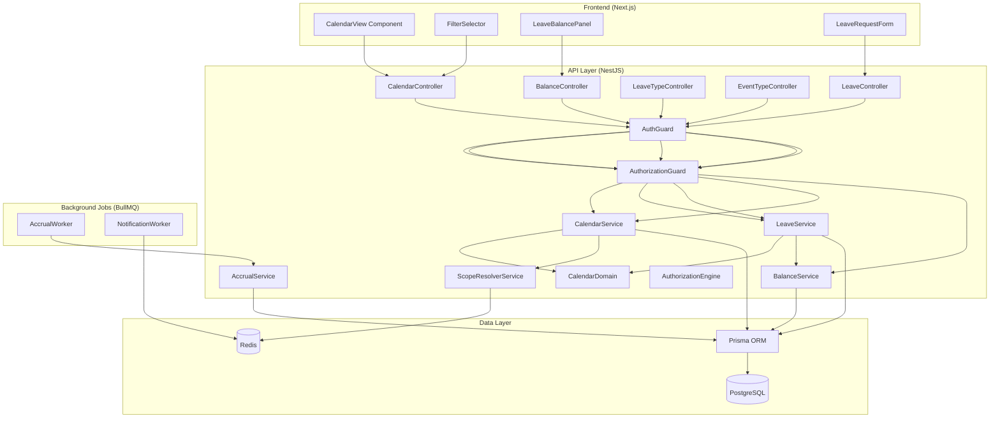
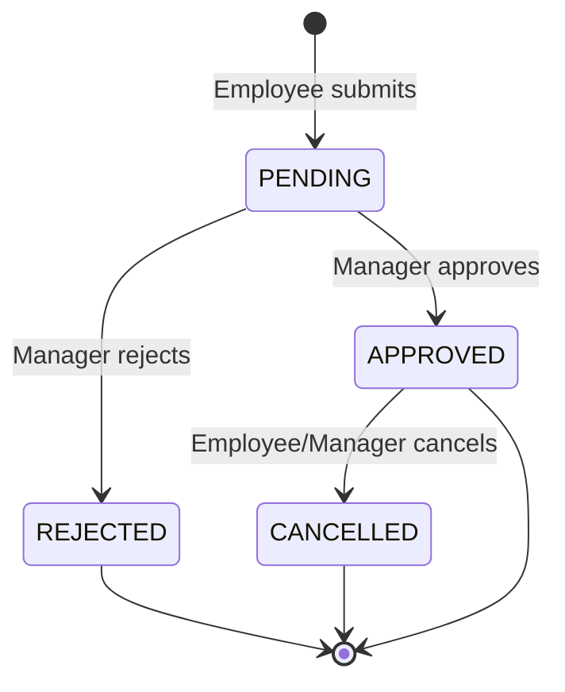
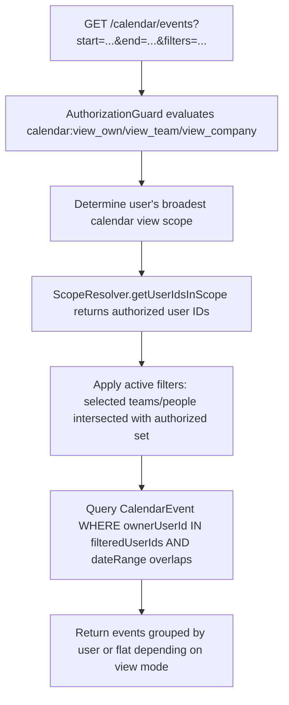
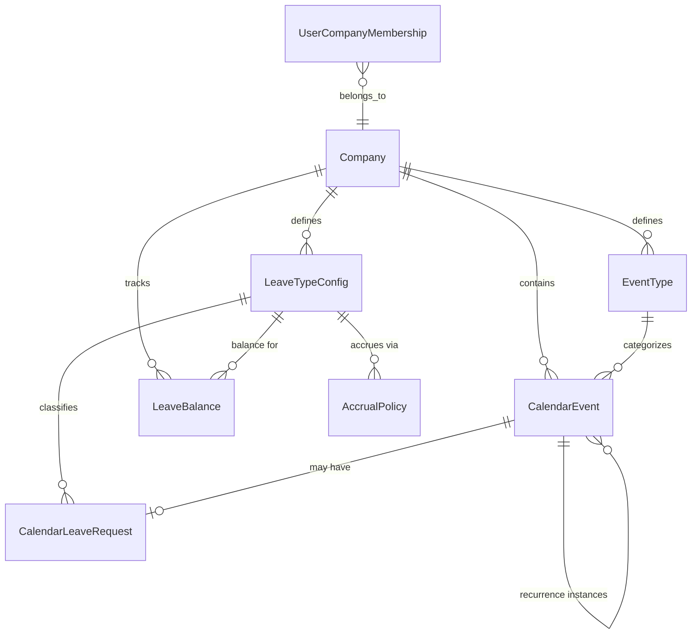

# Design Document: Calendar & Leave Module

## Overview

This design describes a unified Calendar & Leave module that replaces the existing basic leave system (`apps/api/src/leave/`) with a full-featured, calendar-first scheduling and leave management experience. The module introduces:

- **Calendar Events**: General-purpose time-bound entries (meetings, training, conferences, WFH, out-of-office)
- **Leave Requests**: Specialized calendar events with an approval workflow and balance deduction
- **Configurable Types**: Company-configurable Event Types and Leave Types
- **Scope-Based Visibility**: A single calendar view where the user's effective permission scope + active filters determine which events are visible
- **Balance & Accrual Management**: Per-employee, per-leave-type, per-year balance tracking with configurable accrual policies

### Key Design Decisions

| Decision | Rationale |
|----------|-----------|
| Single calendar view with scope-based data fetching | Eliminates separate "team calendar" / "company calendar" pages — scope + filters drive visibility |
| `CalendarEvent` is the base entity; `LeaveRequest` extends it via FK | Unified rendering — leave shows on the calendar natively without event duplication |
| Recurrence stored as pattern on a "master" event, instances materialized | Enables editing single vs. future instances without full regeneration |
| Working-day calculation excludes weekends only (no public holiday table yet) | Keeps initial scope manageable; public holidays can be layered in later |
| BullMQ for accrual jobs and notification dispatch | Non-blocking, retryable background processing consistent with platform patterns |
| Self-registration via `@RegisterFeature` decorator | Zero coupling between calendar module and authorization admin code |
| Migration utility as a CLI command (like the permissions migration) | Enables dry-run, reporting, and controlled rollout |

---

## Architecture

### High-Level Component Diagram



### Leave Request State Machine



### Scope-Based Data Fetching Strategy

When the frontend requests calendar data, the backend resolves visible events through this pipeline:



**Key rules:**
1. The frontend sends the user's active filter selections (team IDs, user IDs) with each request
2. The backend intersects those selections with the user's authorized user set (from scope resolution)
3. Any user IDs in the filter that fall outside the authorized set are silently dropped (no error, just excluded)
4. Default behavior (no explicit filters): return events for the user's own team (DIRECT_REPORTS or ORGANIZATION_UNIT depending on scope)

---

## Components and Interfaces

### 1. Calendar Module (`calendar.module.ts`)

```typescript
@RegisterFeature({
  key: 'calendar',
  displayName: 'Calendar & Leave Management',
  description: 'Unified calendar, leave requests, balance tracking, and scheduling',
  permissions: [
    { key: 'view_own', displayName: 'View Own Calendar', description: 'View own events and leave' },
    { key: 'view_team', displayName: 'View Team Calendar', description: 'View team members events' },
    { key: 'view_company', displayName: 'View Company Calendar', description: 'View all company events' },
    { key: 'submit_leave', displayName: 'Submit Leave', description: 'Submit leave requests' },
    { key: 'approve_leave', displayName: 'Approve Leave', description: 'Approve/reject leave requests' },
    { key: 'manage_balances', displayName: 'Manage Balances', description: 'Adjust leave balances' },
    { key: 'manage_policies', displayName: 'Manage Policies', description: 'Configure leave types and accrual' },
    { key: 'manage_event_types', displayName: 'Manage Event Types', description: 'Configure event types' },
  ],
})
@Module({
  imports: [AuthorizationModule, NotificationsModule, BullModule.registerQueue({ name: 'calendar' })],
  controllers: [CalendarController, LeaveController, LeaveTypeController, EventTypeController, BalanceController],
  providers: [CalendarService, LeaveService, BalanceService, AccrualService, CalendarDomain, CalendarRepository],
  exports: [CalendarService, LeaveService, BalanceService],
})
export class CalendarModule {}
```

### 2. Calendar Service (`calendar.service.ts`)

```typescript
interface CalendarEventQuery {
  companyId: string;
  startDate: Date;
  endDate: Date;
  userIds?: string[];         // explicit user filter
  orgUnitIds?: string[];      // team/org-unit filter
  eventTypeIds?: string[];    // event type filter
  leaveTypeIds?: string[];    // leave type filter
  includePersonal?: boolean;  // only for OWN scope
}

interface CalendarService {
  getEvents(actorUserId: string, companyId: string, query: CalendarEventQuery): Promise<CalendarEventDto[]>;
  createEvent(actorUserId: string, companyId: string, data: CreateCalendarEventDto): Promise<CalendarEventDto>;
  updateEvent(actorUserId: string, companyId: string, eventId: string, data: UpdateCalendarEventDto): Promise<CalendarEventDto>;
  deleteEvent(actorUserId: string, companyId: string, eventId: string, deleteMode?: RecurrenceDeleteMode): Promise<void>;
  getEventTypes(companyId: string, includeArchived?: boolean): Promise<EventTypeDto[]>;
  createEventType(companyId: string, data: CreateEventTypeDto): Promise<EventTypeDto>;
  updateEventType(companyId: string, eventTypeId: string, data: UpdateEventTypeDto): Promise<EventTypeDto>;
  archiveEventType(companyId: string, eventTypeId: string): Promise<void>;
}
```

### 3. Leave Service (`leave.service.ts`)

```typescript
interface LeaveService {
  submitRequest(actorUserId: string, companyId: string, data: SubmitLeaveRequestDto): Promise<LeaveRequestDto>;
  approveRequest(actorUserId: string, companyId: string, requestId: string, notes?: string): Promise<LeaveRequestDto>;
  rejectRequest(actorUserId: string, companyId: string, requestId: string, notes?: string): Promise<LeaveRequestDto>;
  cancelRequest(actorUserId: string, companyId: string, requestId: string): Promise<LeaveRequestDto>;
  getLeaveTypes(companyId: string, includeArchived?: boolean): Promise<LeaveTypeDto[]>;
  createLeaveType(companyId: string, data: CreateLeaveTypeDto): Promise<LeaveTypeDto>;
  updateLeaveType(companyId: string, leaveTypeId: string, data: UpdateLeaveTypeDto): Promise<LeaveTypeDto>;
  archiveLeaveType(companyId: string, leaveTypeId: string): Promise<void>;
}
```

### 4. Balance Service (`balance.service.ts`)

```typescript
interface BalanceService {
  getBalances(userId: string, companyId: string, year?: number): Promise<LeaveBalanceDto[]>;
  adjustBalance(adminUserId: string, companyId: string, targetUserId: string, leaveTypeId: string, adjustment: number, reason: string): Promise<LeaveBalanceDto>;
  deductBalance(userId: string, companyId: string, leaveTypeId: string, workingDays: number): Promise<LeaveBalanceDto>;
  restoreBalance(userId: string, companyId: string, leaveTypeId: string, workingDays: number): Promise<LeaveBalanceDto>;
  initializeBalances(companyId: string, userId: string, year: number): Promise<void>;
  getAccrualPolicies(companyId: string): Promise<AccrualPolicyDto[]>;
  createAccrualPolicy(companyId: string, data: CreateAccrualPolicyDto): Promise<AccrualPolicyDto>;
  updateAccrualPolicy(companyId: string, policyId: string, data: UpdateAccrualPolicyDto): Promise<AccrualPolicyDto>;
}
```

### 5. Calendar Domain (`calendar.domain.ts`)

Pure domain logic for validation and business rules:

```typescript
interface CalendarDomain {
  validateDateRange(startDate: Date, endDate: Date): void;
  calculateWorkingDays(startDate: Date, endDate: Date): number;
  validateStatusTransition(currentStatus: LeaveStatus, newStatus: LeaveStatus): void;
  checkOverlap(existingEvents: { startDate: Date; endDate: Date }[], newStart: Date, newEnd: Date): boolean;
  expandRecurrence(pattern: RecurrencePattern, startDate: Date, endDate: Date, maxDate: Date): Date[];
  validateBalanceSufficiency(available: number, requested: number): { sufficient: boolean; shortfall: number };
}
```

### 6. Accrual Worker (`accrual.worker.ts`)

BullMQ worker that runs on a CRON schedule (1st of each month):

```typescript
// Processes monthly accrual for all active employees with accrual policies
// Queue: 'calendar', Job name: 'process-monthly-accrual'
// Scheduled via BullMQ repeatable job: { cron: '0 0 1 * *' }
```

### 7. Frontend Components

| Component | Responsibility |
|-----------|---------------|
| `CalendarView` | Main calendar rendering (day/week/month views) using a calendar library |
| `FilterSelector` | Multi-select for teams/people within permitted scope; respects authorization |
| `LeaveBalancePanel` | Sidebar showing remaining balances per leave type |
| `LeaveRequestForm` | Modal form for submitting leave requests with balance validation |
| `EventForm` | Modal form for creating/editing general calendar events |
| `ApprovalActions` | Inline approve/reject buttons shown on pending leave for authorized managers |
| `TeamAvailabilityBar` | Daily summary showing X/Y team members available |

**FilterSelector behavior:**
- On mount, calls `GET /api/v2/calendar/accessible-scope` to get the list of teams/people the user can see
- Renders a multi-select dropdown grouped by organization unit
- Default selection: user's own org unit (team)
- User can add/remove units and individual people
- Selections are sent as query params on the events endpoint

---

## Data Models

### New Prisma Models

```prisma
// ─── Calendar Enums ─────────────────────────────────────────────────────────────

enum LeaveRequestStatus {
  PENDING
  APPROVED
  REJECTED
  CANCELLED
}

enum RecurrenceFrequency {
  DAILY
  WEEKLY
  MONTHLY
  YEARLY
}

enum EventVisibility {
  PERSONAL
  SHARED
}

// ─── Event Type (company-configurable) ──────────────────────────────────────────

model EventType {
  id          String    @id @default(cuid())
  companyId   String
  name        String
  color       String    @default("#3B82F6")
  icon        String?
  description String?
  isSystem    Boolean   @default(false)  // true for defaults seeded on enablement
  archivedAt  DateTime?
  createdAt   DateTime  @default(now())
  updatedAt   DateTime  @updatedAt

  company     Company   @relation(fields: [companyId], references: [id])
  events      CalendarEvent[]

  @@unique([companyId, name])
  @@index([companyId, archivedAt])
}

// ─── Leave Type (company-configurable) ──────────────────────────────────────────

model LeaveTypeConfig {
  id                String    @id @default(cuid())
  companyId         String
  name              String
  color             String    @default("#10B981")
  defaultAllocation Decimal   @db.Decimal(5, 1)  // e.g., 25.0 days/year
  requiresApproval  Boolean   @default(true)
  carryOver         Boolean   @default(false)
  maxCarryOverDays  Decimal?  @db.Decimal(5, 1)
  isSystem          Boolean   @default(false)
  archivedAt        DateTime?
  createdAt         DateTime  @default(now())
  updatedAt         DateTime  @updatedAt

  company           Company   @relation(fields: [companyId], references: [id])
  balances          LeaveBalance[]
  requests          CalendarLeaveRequest[]
  accrualPolicies   AccrualPolicy[]

  @@unique([companyId, name])
  @@index([companyId, archivedAt])
}

// ─── Calendar Event ─────────────────────────────────────────────────────────────

model CalendarEvent {
  id              String          @id @default(cuid())
  companyId       String
  ownerUserId     String
  eventTypeId     String
  title           String
  startDate       DateTime
  endDate         DateTime
  allDay          Boolean         @default(false)
  visibility      EventVisibility @default(SHARED)
  notes           String?
  
  // Recurrence fields
  isRecurring     Boolean         @default(false)
  recurrenceMasterId String?      // null for master, references master for instances
  recurrenceFrequency RecurrenceFrequency?
  recurrenceDaysOfWeek Int[]      // for WEEKLY: 0=Sun, 1=Mon, ..., 6=Sat
  recurrenceDayOfMonth Int?       // for MONTHLY
  recurrenceEndDate   DateTime?
  recurrenceCount     Int?
  
  createdAt       DateTime        @default(now())
  updatedAt       DateTime        @updatedAt

  company         Company         @relation(fields: [companyId], references: [id])
  eventType       EventType       @relation(fields: [eventTypeId], references: [id])
  recurrenceMaster CalendarEvent? @relation("RecurrenceInstances", fields: [recurrenceMasterId], references: [id])
  instances       CalendarEvent[] @relation("RecurrenceInstances")
  leaveRequest    CalendarLeaveRequest?

  @@index([companyId, ownerUserId, startDate, endDate])
  @@index([companyId, startDate, endDate])
  @@index([recurrenceMasterId])
}

// ─── Leave Request (extends CalendarEvent) ──────────────────────────────────────

model CalendarLeaveRequest {
  id              String             @id @default(cuid())
  calendarEventId String             @unique
  leaveTypeId     String
  status          LeaveRequestStatus @default(PENDING)
  workingDays     Decimal            @db.Decimal(4, 1)
  reviewerId      String?
  reviewNotes     String?
  reviewedAt      DateTime?
  createdAt       DateTime           @default(now())
  updatedAt       DateTime           @updatedAt

  calendarEvent   CalendarEvent      @relation(fields: [calendarEventId], references: [id], onDelete: Cascade)
  leaveType       LeaveTypeConfig    @relation(fields: [leaveTypeId], references: [id])

  @@index([leaveTypeId, status])
  @@index([calendarEventId])
}

// ─── Leave Balance ──────────────────────────────────────────────────────────────

model LeaveBalance {
  id            String   @id @default(cuid())
  companyId     String
  userId        String
  leaveTypeId   String
  year          Int
  allocated     Decimal  @db.Decimal(5, 1)  // total allocated for the year
  used          Decimal  @db.Decimal(5, 1) @default(0)
  adjustment    Decimal  @db.Decimal(5, 1) @default(0)  // manual HR adjustments
  carriedOver   Decimal  @db.Decimal(5, 1) @default(0)
  createdAt     DateTime @default(now())
  updatedAt     DateTime @updatedAt

  leaveType     LeaveTypeConfig @relation(fields: [leaveTypeId], references: [id])

  @@unique([companyId, userId, leaveTypeId, year])
  @@index([companyId, userId, year])
}

// ─── Accrual Policy ─────────────────────────────────────────────────────────────

model AccrualPolicy {
  id              String   @id @default(cuid())
  companyId       String
  leaveTypeId     String
  monthlyAccrual  Decimal  @db.Decimal(4, 2)  // days per month
  maxAccumulation Decimal? @db.Decimal(5, 1)  // cap
  isActive        Boolean  @default(true)
  createdAt       DateTime @default(now())
  updatedAt       DateTime @updatedAt

  leaveType       LeaveTypeConfig @relation(fields: [leaveTypeId], references: [id])

  @@unique([companyId, leaveTypeId])
  @@index([companyId, isActive])
}
```

### Entity Relationship Diagram



### Balance Calculation Formula

```
available = allocated + carriedOver + adjustment - used
```

Where:
- `allocated`: initial yearly allocation (from LeaveTypeConfig.defaultAllocation) + accruals applied so far
- `carriedOver`: unused days brought forward from previous year (capped by maxCarryOverDays)
- `adjustment`: manual HR adjustments (positive or negative)
- `used`: sum of working days from APPROVED leave requests in this year

---


## Correctness Properties

*A property is a characteristic or behavior that should hold true across all valid executions of a system — essentially, a formal statement about what the system should do. Properties serve as the bridge between human-readable specifications and machine-verifiable correctness guarantees.*

### Property 1: Date Range Validation

*For any* pair of dates (start, end) where start ≥ end, creating a CalendarEvent or submitting a LeaveRequest SHALL be rejected. *For any* pair where start < end, validation SHALL pass.

**Validates: Requirements 1.2**

### Property 2: Recurrence Expansion Correctness and Bounds

*For any* valid recurrence pattern (frequency, days of week, day of month, end date, count), the generated instances SHALL: (a) conform to the specified frequency and day constraints, (b) not extend beyond the specified end date or occurrence count, (c) not extend beyond 365 days from the master event's start date, whichever limit is reached first.

**Validates: Requirements 1.3, 13.2**

### Property 3: Personal Event Visibility Isolation

*For any* CalendarEvent with visibility=PERSONAL and any user U who is not the event owner, querying calendar events SHALL NOT include that event in U's results, regardless of U's permission scope.

**Validates: Requirements 1.6**

### Property 4: Type Name Uniqueness Within Company

*For any* company C and any existing EventType or LeaveTypeConfig with name N, attempting to create another EventType or LeaveTypeConfig (respectively) with the same name N in company C SHALL be rejected.

**Validates: Requirements 2.5, 10.4**

### Property 5: Archived Type Prevents New Entity Creation

*For any* archived EventType, creating a new CalendarEvent referencing that type SHALL be rejected. *For any* archived LeaveTypeConfig, submitting a new LeaveRequest of that type SHALL be rejected. In both cases, existing entities referencing the archived type SHALL remain unchanged.

**Validates: Requirements 2.4, 10.5**

### Property 6: Balance Sufficiency Validation

*For any* LeaveRequest submission where the requested working days exceed the employee's available balance (allocated + carriedOver + adjustment - used) for that LeaveType and year, the submission SHALL be rejected with an error indicating the available balance and shortfall.

**Validates: Requirements 3.3, 3.4**

### Property 7: Leave Overlap Detection

*For any* employee E with an existing APPROVED LeaveRequest covering date range [A, B], submitting a new LeaveRequest with date range [C, D] where the ranges overlap (C < B AND D > A) SHALL be rejected.

**Validates: Requirements 3.5**

### Property 8: Status Transition Validity

*For any* LeaveRequest with current status S, the only valid transitions SHALL be: PENDING→APPROVED, PENDING→REJECTED, APPROVED→CANCELLED. *For any* (S, T) pair not in this set, attempting the transition SHALL be rejected.

**Validates: Requirements 4.5, 4.6**

### Property 9: Balance Conservation Across Status Transitions

*For any* LeaveRequest with W working days: (a) when transitioned from PENDING to APPROVED, the employee's used balance SHALL increase by W; (b) when transitioned from PENDING to REJECTED, the employee's balance SHALL remain unchanged; (c) when transitioned from APPROVED to CANCELLED, the employee's used balance SHALL decrease by W (restoring the deduction).

**Validates: Requirements 4.2, 4.3, 4.8, 5.2**

### Property 10: Working Days Calculation Excludes Weekends

*For any* date range [start, end], the calculated working days SHALL equal the count of days in that range that are not Saturday or Sunday. Equivalently, for any 7-consecutive-day range starting on a Monday, the working days SHALL be exactly 5.

**Validates: Requirements 5.4**

### Property 11: Monthly Accrual Processing

*For any* active AccrualPolicy with monthlyAccrual M and optional maxAccumulation cap, processing the monthly accrual SHALL increase the employee's allocated balance by M, unless the resulting total (allocated + carriedOver) would exceed the cap, in which case it SHALL be capped at the maximum.

**Validates: Requirements 6.4, 6.5**

### Property 12: Year-End Carry-Over Logic

*For any* LeaveTypeConfig with carryOver=true and maxCarryOverDays=X, at year rollover the unused balance (available days) SHALL carry forward to the next year, capped at X. *For any* LeaveTypeConfig with carryOver=false, the balance for the new year SHALL start from the default allocation only (no carry-over).

**Validates: Requirements 6.7**

### Property 13: Scope-Based Calendar Data Fetching

*For any* user U with effective calendar view scope S, the set of events returned by the calendar events endpoint SHALL only include events owned by users within U's scope boundary as resolved by ScopeResolver.getUserIdsInScope(S, U, companyId). Events owned by users outside this scope SHALL never be returned, regardless of filter parameters.

**Validates: Requirements 8.1, 9.1, 11.4**

### Property 14: Permission Enforcement Across Calendar Operations

*For any* user U without the required `calendar:{permission}` grant for an operation, attempting that operation SHALL result in a 403 denial. Specifically: (a) without `view_team` → team calendar access denied; (b) without `submit_leave` → leave submission denied; (c) without `approve_leave` → approval/rejection denied; (d) without `manage_balances` → balance adjustment denied; (e) without `manage_policies` → leave type config denied; (f) without `manage_event_types` → event type management denied.

**Validates: Requirements 2.7, 3.7, 4.7, 6.6, 7.6, 8.6, 9.6, 10.6**

### Property 15: Auto-Approval for No-Approval Leave Types

*For any* LeaveTypeConfig with requiresApproval=false, submitting a LeaveRequest of that type SHALL result in the request being immediately set to APPROVED status and the balance being deducted, without requiring manager intervention.

**Validates: Requirements 10.3**

### Property 16: Disabled Feature Denial

*For any* company C where the `calendar` feature is disabled via CompanyFeature, and any user U in company C (who is not a GLOBAL admin), all calendar actions SHALL be denied by the AuthorizationEngine.

**Validates: Requirements 11.5**

### Property 17: Cancelled Events Excluded From Calendar Views

*For any* CalendarLeaveRequest with status=CANCELLED, the associated CalendarEvent SHALL NOT appear in any calendar query results (individual, team, or company calendar views).

**Validates: Requirements 12.4**

### Property 18: Leave-Linked Events Not Directly Editable

*For any* CalendarEvent that has an associated CalendarLeaveRequest record, attempting to directly edit the CalendarEvent (title, dates, type) through the event update endpoint SHALL be rejected. Modifications MUST go through the leave request workflow.

**Validates: Requirements 12.5**

### Property 19: No Recurrence For Leave Requests

*For any* leave request submission that includes recurrence pattern data (frequency, days, end date), the submission SHALL be rejected. Leave periods must be submitted individually.

**Validates: Requirements 13.5**

---

## Error Handling

### HTTP Error Responses

| Scenario | HTTP Status | Response Shape | Notes |
|----------|-------------|----------------|-------|
| Not authenticated | 401 | `{ error: "Unauthorized" }` | Handled by AuthGuard |
| Permission denied | 403 | `{ error: "Access denied" }` | Non-specific (security) |
| Feature disabled | 403 | `{ error: "Access denied" }` | Same as permission denial |
| Calendar event not found | 404 | `{ error: "Not found" }` | |
| Invalid date range (start ≥ end) | 400 | `{ error: "Bad Request", details: "Start date must be before end date" }` | |
| Insufficient leave balance | 422 | `{ error: "Insufficient balance", available: X, requested: Y, shortfall: Z }` | Descriptive for employee |
| Overlapping leave request | 409 | `{ error: "Conflict", conflictingRequestId: "...", conflictingDates: {...} }` | Identifies the conflict |
| Invalid status transition | 422 | `{ error: "Invalid transition", currentStatus: "...", validTransitions: [...] }` | Lists valid options |
| Duplicate type name | 409 | `{ error: "Conflict", details: "Name already exists" }` | |
| Archived type used | 422 | `{ error: "Unprocessable", details: "Type is archived" }` | |
| Leave-linked event edit | 422 | `{ error: "Unprocessable", details: "Cannot directly edit leave events" }` | |
| Recurrence on leave request | 422 | `{ error: "Unprocessable", details: "Leave requests cannot be recurring" }` | |

### Error Design Principles

1. **Authorization failures are non-specific**: The client receives "Access denied" without knowing which step or scope failed.
2. **Business rule violations are descriptive**: Balance shortfall, conflicts, and invalid transitions return actionable information.
3. **Validation errors are field-level**: DTO validation (via class-validator or Zod) returns per-field error messages.
4. **Background job failures are retried**: BullMQ workers retry failed accrual/notification jobs up to 3 times with exponential backoff, then flag as dead-letter.
5. **Audit trail never blocks the request**: If audit record creation fails, the primary operation still succeeds (fire-and-forget with error logging).

### Negative Balance Approval Flow

When a manager approves a request that would make the balance negative:
1. First attempt: returns `{ warning: "Approval would result in negative balance", currentBalance: X, postApprovalBalance: Y }`
2. Manager must re-submit with `forceApprove: true` to confirm
3. This two-step design prevents accidental negative balances while allowing intentional overrides

---

## Testing Strategy

### Property-Based Testing

This feature is well-suited for property-based testing because:
- The domain contains pure calculation functions (working days, recurrence expansion, balance arithmetic)
- State machine transitions follow strict universal rules
- Scope-based data filtering has clear invariants about inclusion/exclusion
- Type uniqueness and archival constraints are universal

**Library**: [fast-check](https://github.com/dubzzz/fast-check) (TypeScript PBT library)

**Configuration**:
- Minimum 100 iterations per property test
- Each test tagged with: `Feature: calendar-leave, Property {N}: {description}`

**Property tests to implement** (one test per correctness property):

| Property | Generator Strategy |
|----------|-------------------|
| 1: Date Range Validation | Generate random date pairs (both valid and invalid), test validation function |
| 2: Recurrence Expansion | Generate random RecurrencePattern values with varying frequencies/bounds |
| 3: Personal Event Isolation | Generate events with varying visibility, query as different users |
| 4: Type Name Uniqueness | Generate random company + name combos, attempt duplicates |
| 5: Archived Type Prevention | Generate types, archive them, attempt entity creation |
| 6: Balance Sufficiency | Generate random balance states + request amounts |
| 7: Overlap Detection | Generate random date range pairs with varying overlap scenarios |
| 8: Status Transition Validity | Generate all (current, target) status pairs |
| 9: Balance Conservation | Generate requests at various statuses, perform transitions, verify arithmetic |
| 10: Working Days Calculation | Generate random date ranges, verify count against brute-force day enumeration |
| 11: Monthly Accrual | Generate random policies + current balances, verify increment with cap |
| 12: Year-End Carry-Over | Generate random balances + carry-over configs, verify rollover logic |
| 13: Scope-Based Fetching | Generate random org trees + events, verify returned set matches scope |
| 14: Permission Enforcement | Generate users with random permission sets, verify access/denial |
| 15: Auto-Approval | Generate LeaveTypes with requiresApproval=false, submit requests |
| 16: Disabled Feature | Disable feature for company, attempt all operations |
| 17: Cancelled Event Exclusion | Generate cancelled requests, query all views |
| 18: Leave-Linked Edit Prevention | Generate events with/without leave links, attempt edits |
| 19: No Recurrence for Leave | Generate leave submissions with recurrence data |

### Unit Tests (Example-Based)

- Default EventType/LeaveType seeding on feature enablement
- Specific balance calculation scenarios (e.g., 10 allocated, 3 used, 1 adjustment = 8 available)
- Recurrence pattern edge cases (leap year, month-end, Feb 29)
- Notification payload structure
- Migration record mapping (legacy LeaveType enum → new LeaveTypeConfig records)
- Negative balance approval two-step flow
- DTO validation (missing fields, invalid formats)

### Integration Tests

- Full leave request lifecycle: submit → approve → verify event on calendar → cancel → verify removal
- Scope-based calendar query with real org tree and reporting relationships
- Accrual worker end-to-end: create policy → simulate month tick → verify balance increment
- Year-end carry-over job: setup balance → simulate year rollover → verify new year balance
- Migration utility: seed legacy data → run migration → verify new schema records
- Notification dispatch: submit leave → verify BullMQ job enqueued → process → verify notification record
- Feature self-registration: boot module → verify Feature + FeaturePermission records

### Performance Benchmarks

- Calendar event query for 30-day range with 50 team members: < 200ms
- Scope resolution for BRANCH with 10,000 org units: < 100ms (leverages existing scope cache)
- Recurrence expansion for daily pattern over 365 days: < 50ms
- Balance calculation: < 10ms

---

## API Endpoints

### Calendar Events

| Method | Path | Permission | Description |
|--------|------|------------|-------------|
| GET | `/api/v2/companies/:companyId/calendar/events` | `calendar:view_own` (minimum) | Get events for date range with scope-based filtering |
| GET | `/api/v2/companies/:companyId/calendar/accessible-scope` | `calendar:view_own` | Get teams/people the user can view (for FilterSelector) |
| POST | `/api/v2/companies/:companyId/calendar/events` | `calendar:view_own` | Create a calendar event |
| PATCH | `/api/v2/companies/:companyId/calendar/events/:id` | `calendar:view_own` | Update own event (rejects leave-linked) |
| DELETE | `/api/v2/companies/:companyId/calendar/events/:id` | `calendar:view_own` | Delete own event |

### Leave Requests

| Method | Path | Permission | Description |
|--------|------|------------|-------------|
| POST | `/api/v2/companies/:companyId/calendar/leave-requests` | `calendar:submit_leave` | Submit a leave request |
| POST | `/api/v2/companies/:companyId/calendar/leave-requests/:id/approve` | `calendar:approve_leave` | Approve a pending request |
| POST | `/api/v2/companies/:companyId/calendar/leave-requests/:id/reject` | `calendar:approve_leave` | Reject a pending request |
| POST | `/api/v2/companies/:companyId/calendar/leave-requests/:id/cancel` | `calendar:submit_leave` | Cancel own approved/pending request |
| GET | `/api/v2/companies/:companyId/calendar/leave-requests` | `calendar:view_own` | List leave requests (scope-filtered) |

### Leave Balances

| Method | Path | Permission | Description |
|--------|------|------------|-------------|
| GET | `/api/v2/companies/:companyId/calendar/balances` | `calendar:view_own` | Get own balances (or scoped) |
| GET | `/api/v2/companies/:companyId/calendar/balances/:userId` | `calendar:manage_balances` | Get specific user's balances |
| POST | `/api/v2/companies/:companyId/calendar/balances/:userId/adjust` | `calendar:manage_balances` | Manually adjust balance |

### Leave Types Configuration

| Method | Path | Permission | Description |
|--------|------|------------|-------------|
| GET | `/api/v2/companies/:companyId/calendar/leave-types` | `calendar:view_own` | List leave types |
| POST | `/api/v2/companies/:companyId/calendar/leave-types` | `calendar:manage_policies` | Create leave type |
| PATCH | `/api/v2/companies/:companyId/calendar/leave-types/:id` | `calendar:manage_policies` | Update leave type |
| POST | `/api/v2/companies/:companyId/calendar/leave-types/:id/archive` | `calendar:manage_policies` | Archive leave type |

### Event Types Configuration

| Method | Path | Permission | Description |
|--------|------|------------|-------------|
| GET | `/api/v2/companies/:companyId/calendar/event-types` | `calendar:view_own` | List event types |
| POST | `/api/v2/companies/:companyId/calendar/event-types` | `calendar:manage_event_types` | Create event type |
| PATCH | `/api/v2/companies/:companyId/calendar/event-types/:id` | `calendar:manage_event_types` | Update event type |
| POST | `/api/v2/companies/:companyId/calendar/event-types/:id/archive` | `calendar:manage_event_types` | Archive event type |

### Accrual Policies

| Method | Path | Permission | Description |
|--------|------|------------|-------------|
| GET | `/api/v2/companies/:companyId/calendar/accrual-policies` | `calendar:manage_policies` | List accrual policies |
| POST | `/api/v2/companies/:companyId/calendar/accrual-policies` | `calendar:manage_policies` | Create accrual policy |
| PATCH | `/api/v2/companies/:companyId/calendar/accrual-policies/:id` | `calendar:manage_policies` | Update accrual policy |
| DELETE | `/api/v2/companies/:companyId/calendar/accrual-policies/:id` | `calendar:manage_policies` | Delete accrual policy |

### Team Availability

| Method | Path | Permission | Description |
|--------|------|------------|-------------|
| GET | `/api/v2/companies/:companyId/calendar/availability` | `calendar:view_team` | Get daily availability counts for date range |

---

## Module File Structure

```
apps/api/src/calendar/
├── calendar.module.ts              # Module with @RegisterFeature
├── controllers/
│   ├── calendar.controller.ts      # Event CRUD + calendar queries
│   ├── leave.controller.ts         # Leave request workflow
│   ├── leave-type.controller.ts    # Leave type config
│   ├── event-type.controller.ts    # Event type config
│   └── balance.controller.ts       # Balance queries + admin adjustment
├── services/
│   ├── calendar.service.ts         # Calendar event operations
│   ├── leave.service.ts            # Leave workflow orchestration
│   ├── balance.service.ts          # Balance calculation + mutations
│   └── accrual.service.ts          # Accrual policy logic
├── domain/
│   ├── calendar.domain.ts          # Pure validation/calculation functions
│   ├── recurrence.domain.ts        # Recurrence expansion logic
│   └── working-days.domain.ts      # Working day calculation
├── dto/
│   ├── create-calendar-event.dto.ts
│   ├── update-calendar-event.dto.ts
│   ├── submit-leave-request.dto.ts
│   ├── create-event-type.dto.ts
│   ├── create-leave-type.dto.ts
│   ├── create-accrual-policy.dto.ts
│   ├── adjust-balance.dto.ts
│   └── calendar-query.dto.ts
├── workers/
│   ├── accrual.worker.ts           # Monthly accrual BullMQ processor
│   └── notification.worker.ts      # Leave notification dispatcher
├── repository/
│   └── calendar.repository.ts      # Prisma data access
└── migration/
    ├── migration.command.ts         # CLI command for legacy data migration
    └── migration.service.ts         # Migration logic
```

### Frontend Structure

```
apps/web/src/features/calendar/
├── CalendarView.tsx                 # Main calendar page component
├── components/
│   ├── CalendarGrid.tsx             # Day/week/month grid rendering
│   ├── FilterSelector.tsx           # Team/person multi-select filter
│   ├── LeaveBalancePanel.tsx        # Balance summary sidebar
│   ├── LeaveRequestForm.tsx         # Leave submission modal
│   ├── EventForm.tsx                # General event creation/edit modal
│   ├── ApprovalActions.tsx          # Approve/reject inline controls
│   ├── TeamAvailabilityBar.tsx      # Daily availability summary
│   └── EventCard.tsx                # Individual event rendering
├── hooks/
│   ├── useCalendarEvents.ts         # Data fetching hook
│   ├── useLeaveBalances.ts          # Balance data hook
│   ├── useAccessibleScope.ts        # Scope/filter options hook
│   └── useLeaveWorkflow.ts          # Submit/approve/reject mutations
├── types/
│   └── calendar.types.ts            # Shared TypeScript interfaces
└── utils/
    └── calendar.utils.ts            # Date helpers, color mapping
```

---

## Migration Strategy

### Legacy → New Schema Mapping

| Legacy Model | New Model | Mapping Logic |
|-------------|-----------|---------------|
| `LeaveRequest.type` (enum: ANNUAL, SICK, PERSONAL, PARENTAL, UNPAID) | `LeaveTypeConfig` record | Create LeaveTypeConfig for each enum value; map by name |
| `LeaveRequest.status` | `CalendarLeaveRequest.status` | Direct mapping (PENDING, APPROVED, REJECTED, CANCELLED) |
| `LeaveRequest.startDate/endDate` | `CalendarEvent.startDate/endDate` + `CalendarLeaveRequest.workingDays` | Copy dates; compute workingDays |
| `LeaveRequest.reason` | `CalendarEvent.notes` | Copy as notes |
| `LeaveRequest.employeeId` → Employee → Person → User | `CalendarEvent.ownerUserId` | Resolve through person→user chain |

### Migration Steps

1. **Seed default types**: Create EventType and LeaveTypeConfig records for the company
2. **Resolve user mapping**: Build employeeId → userId lookup via Employee → Person → User
3. **Convert LeaveRequests**: For each legacy LeaveRequest:
   a. Create a CalendarEvent (owner=resolved userId, eventType=Leave type, dates from legacy)
   b. Create a CalendarLeaveRequest (linked to event, status mapped, workingDays computed)
4. **Preserve audit records**: Existing AuditRecords referencing old LeaveRequest IDs get a mapping note
5. **Generate report**: List migrated count, unmapped employees, any data issues
6. **Backward-compatible endpoints**: Keep old `/api/leave/*` endpoints as thin proxies for 90 days

### Migration Command

```bash
npx nestjs-command calendar:migrate --companyId=<id> --dry-run
npx nestjs-command calendar:migrate --companyId=<id> --execute
```
