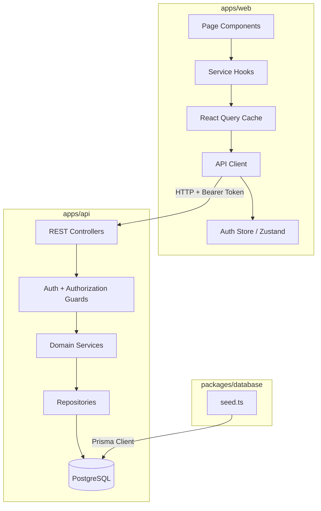
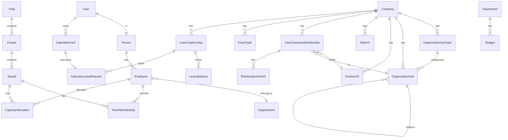

# Design Document: Frontend-Backend Integration

## Overview

This design connects the Strata frontend (Next.js at `apps/web`) to the NestJS backend (`apps/api`) by building a robust API client with automatic token refresh, domain-specific service modules wrapping TanStack React Query, and a comprehensive database seed script. The goal is to replace all mock/static data across dashboard, people, employees, calendar, leave, engineering, capacity, and budget pages with live backend data.

The architecture follows a layered approach:
1. **Transport layer** — `api-client.ts` handles HTTP concerns (auth headers, token refresh, retry, error normalization)
2. **Service layer** — Per-domain modules export typed React Query hooks
3. **UI layer** — Pages consume hooks, handle loading/error states

Additionally, a seed script provides realistic data for local development and demos.

## Architecture



### Key Design Decisions

1. **Token refresh with request queuing** — Rather than letting multiple 401s trigger parallel refresh calls, a single refresh promise is shared across all waiting requests. This prevents token rotation race conditions.

2. **Service modules per domain** — Each domain gets its own file with typed hooks. This keeps imports clean and allows tree-shaking unused domains.

3. **Seed script in `packages/database`** — The seed lives alongside the Prisma schema for co-location of data concerns. It uses `upsert` operations for idempotency.

4. **No shared types package for API contracts (yet)** — TypeScript interfaces are defined in each service module based on observed backend response shapes. A shared `@strata/shared-types` package exists but currently covers internal types; full API contract types will be added incrementally.

## Components and Interfaces

### 1. API Client (`apps/web/src/lib/api-client.ts`)

Enhanced version of the existing client with token refresh and request queuing.

```typescript
// Core interfaces
interface ApiError {
  statusCode: number;
  message: string;
  errors?: Record<string, string[]>;
}

interface RequestOptions {
  method?: "GET" | "POST" | "PUT" | "PATCH" | "DELETE";
  body?: unknown;
  headers?: Record<string, string>;
  params?: Record<string, string | number | boolean | undefined>;
}

// Token refresh state (module-level singleton)
let refreshPromise: Promise<string> | null = null;

// Exported function
async function apiClient<T>(endpoint: string, options?: RequestOptions): Promise<T>;
```

**Responsibilities:**
- Prepend `NEXT_PUBLIC_API_URL` (or `http://localhost:3001`) to all endpoints
- Attach `Authorization: Bearer <token>` header from auth store
- On 401: initiate token refresh, queue concurrent requests, replay after refresh
- On 5xx: retry once after 1 second delay
- On network error: throw structured error with "Network error. Please check your connection."
- Normalize all errors into `ApiClientError` with `statusCode`, `message`, `errors`

### 2. Auth Store Enhancement (`apps/web/src/lib/auth.ts`)

Add a `refreshAccessToken()` method to the existing Zustand store:

```typescript
interface AuthState {
  // ... existing fields
  refreshAccessToken: () => Promise<string>;
}
```

The refresh method calls `POST /auth/refresh` with the stored refresh token, updates the access token in state, and returns the new token. On failure, it calls `logout()` and throws.

### 3. Service Modules (`apps/web/src/services/`)

Each module exports:
- TypeScript interfaces for request/response shapes
- Query hooks (GET operations)
- Mutation hooks (POST/PUT/DELETE operations with cache invalidation)

```typescript
// Example: apps/web/src/services/people.service.ts
export interface Person {
  id: string;
  fullName: string;
  email: string;
  phone: string | null;
  dateOfBirth: string;
  createdAt: string;
  updatedAt: string;
}

export interface PaginatedResponse<T> {
  data: T[];
  total: number;
  page: number;
  pageSize: number;
}

export function usePeople(params?: { page?: number; pageSize?: number; search?: string });
export function usePerson(id: string);
export function useCreatePerson();
export function useUpdatePerson();
export function useDeletePerson();
```

**Domain modules:**

| Module | File | Backend Controller Path |
|--------|------|------------------------|
| People | `people.service.ts` | `GET/POST/PUT/DELETE /people` |
| Employees | `employees.service.ts` | `GET/POST/PUT/DELETE /employees` |
| Engineering | `engineering.service.ts` | `/engineering/tribes`, `/clusters`, `/squads`, `/memberships` |
| Calendar | `calendar.service.ts` | `/api/v2/companies/:companyId/calendar/events` |
| Leave | `leave.service.ts` | `/api/v2/companies/:companyId/calendar/leave-requests` |
| Budgets | `budgets.service.ts` | `GET/POST/PUT/DELETE /budgets` |
| Capacity | `capacity.service.ts` | `/capacity/allocations`, `/capacity/overview/:id` |
| Organizations | `organizations.service.ts` | `/api/v2/companies/:companyId/org-units` |
| Audit | `audit.service.ts` | `GET /audit` |
| Search | `search.service.ts` | `GET /search` |

### 4. Seed Script (`packages/database/src/seed.ts`)

```typescript
// Execution flow
async function main() {
  log("🌱 Starting seed...");
  const company = await seedCompany();
  const orgUnitTypes = await seedOrgUnitTypes(company.id);
  const orgUnits = await seedOrgUnits(company.id, orgUnitTypes);
  const positions = await seedPositions(company.id);
  const { users, people, employees } = await seedUsers(company.id, orgUnits, positions);
  const roles = await seedRoles(company.id);
  await seedRoleAssignments(company.id, users, roles);
  await seedReportingRelationships(company.id, users);
  const { tribes, clusters, squads } = await seedEngineering(company.id);
  await seedTeamMemberships(employees, squads);
  await seedCapacityAllocations(employees, squads);
  await seedBudgets(orgUnits);
  const eventTypes = await seedEventTypes(company.id);
  const leaveTypes = await seedLeaveTypes(company.id);
  await seedCalendarEvents(company.id, users, eventTypes);
  await seedLeaveBalances(company.id, users, leaveTypes);
  await seedLeaveRequests(company.id, users, leaveTypes, eventTypes);
  logSummary();
}
```

**Idempotency strategy:** All seed functions use `prisma.*.upsert()` with deterministic IDs or unique constraint fields (e.g., `slug` for Company, `[companyId, name]` for roles). This ensures repeated runs produce identical state.

### 5. Frontend Page Wiring Pattern

Each page follows a consistent pattern:

```typescript
"use client";

import { usePeople } from "@/services/people.service";

export default function PeoplePage() {
  const { data, isLoading, error, refetch } = usePeople({ page: 1, pageSize: 20 });

  if (isLoading) return <PageSkeleton />;
  if (error) return <ErrorState message={error.message} onRetry={refetch} />;

  return <DataTable data={data.data} ... />;
}
```

## Data Models

### API Response Types

```typescript
// Shared pagination wrapper
interface PaginatedResponse<T> {
  data: T[];
  total: number;
  page: number;
  pageSize: number;
}

// Person
interface Person {
  id: string;
  fullName: string;
  email: string;
  phone: string | null;
  address: string | null;
  dateOfBirth: string;
  createdAt: string;
  updatedAt: string;
}

// Employee
interface Employee {
  id: string;
  uin: string;
  personId: string;
  organizationId: string;
  departmentId: string | null;
  positionId: string | null;
  startDate: string;
  endDate: string | null;
  status: "ACTIVE" | "ON_LEAVE" | "TERMINATED" | "SUSPENDED";
  person?: Person;
  createdAt: string;
  updatedAt: string;
}

// Engineering
interface Tribe { id: string; name: string; organizationId: string; clusters?: Cluster[]; }
interface Cluster { id: string; name: string; tribeId: string; squads?: Squad[]; }
interface Squad { id: string; name: string; clusterId: string; }
interface TeamMembership { id: string; employeeId: string; squadId: string; role: string | null; }

// Capacity
interface CapacityAllocation {
  id: string;
  employeeId: string;
  squadId: string;
  percentage: number;
  employee?: Employee;
  squad?: Squad;
}

// Calendar
interface CalendarEvent {
  id: string;
  companyId: string;
  ownerUserId: string;
  eventTypeId: string;
  title: string;
  startDate: string;
  endDate: string;
  allDay: boolean;
  visibility: "PERSONAL" | "SHARED";
  notes: string | null;
  isRecurring: boolean;
  eventType?: EventType;
}

interface EventType { id: string; name: string; color: string; icon: string | null; }
interface LeaveTypeConfig { id: string; name: string; color: string; defaultAllocation: number; requiresApproval: boolean; }

// Leave
interface LeaveBalance {
  id: string;
  userId: string;
  leaveTypeId: string;
  year: number;
  allocated: number;
  used: number;
  adjustment: number;
  carriedOver: number;
  leaveType?: LeaveTypeConfig;
}

interface CalendarLeaveRequest {
  id: string;
  calendarEventId: string;
  leaveTypeId: string;
  status: "PENDING" | "APPROVED" | "REJECTED" | "CANCELLED";
  workingDays: number;
  reviewerId: string | null;
  reviewNotes: string | null;
  calendarEvent?: CalendarEvent;
  leaveType?: LeaveTypeConfig;
}

// Budget
interface Budget {
  id: string;
  departmentId: string;
  fiscalPeriod: string;
  amount: number;
}

// Auth
interface TokenResponse {
  accessToken: string;
  refreshToken: string;
}

// API Error
interface ApiError {
  statusCode: number;
  message: string;
  errors?: Record<string, string[]>;
}
```

### Seed Data Relationships



## Correctness Properties

*A property is a characteristic or behavior that should hold true across all valid executions of a system — essentially, a formal statement about what the system should do. Properties serve as the bridge between human-readable specifications and machine-verifiable correctness guarantees.*

### Property 1: Token refresh and retry

*For any* HTTP request that receives a 401 response, if the token refresh succeeds, the API client SHALL retry the original request exactly once with the new access token attached, and the final response should be equivalent to what the request would have returned with a valid token.

**Validates: Requirements 1.1, 1.2**

### Property 2: Request queueing during refresh

*For any* set of N concurrent requests where at least one triggers a 401 and initiates a token refresh, all N requests SHALL be queued and replayed exactly once after the single refresh completes — no request is lost and no duplicate refresh calls are made.

**Validates: Requirements 1.4**

### Property 3: Mutation cache invalidation

*For any* domain service mutation (create, update, delete) that resolves successfully, the corresponding React Query cache keys for that domain's list queries SHALL be invalidated.

**Validates: Requirements 2.4**

### Property 4: Base URL prepend

*For any* relative endpoint path passed to the API client, the resulting fetch URL SHALL equal `${NEXT_PUBLIC_API_URL}${endpoint}` (or `http://localhost:3001${endpoint}` when the env var is unset).

**Validates: Requirements 3.1, 3.2, 3.3**

### Property 5: Structured error object

*For any* non-2xx API response with a JSON body containing a `message` field, the thrown `ApiClientError` SHALL have `statusCode` equal to the HTTP status, `message` equal to the body's message field, and `errors` equal to the body's errors field if present.

**Validates: Requirements 4.1, 4.4**

### Property 6: 5xx retry with delay

*For any* request that receives a 5xx response on the first attempt, the API client SHALL retry exactly once after a ~1 second delay before throwing an error.

**Validates: Requirements 4.2**

### Property 7: Seed idempotency

*For any* number of consecutive seed script executions (N ≥ 2), the total record count for every entity type in the database SHALL be identical after run 1 and run N — no duplicates are created.

**Validates: Requirements 5.5**

### Property 8: Organization unit path correctness

*For any* OrganizationUnit created by the seed script, the `path` field SHALL correctly represent the materialized ancestor chain (i.e., splitting by "/" yields all ancestor unit IDs in order from root to parent).

**Validates: Requirements 5.4**

### Property 9: Seed password verification

*For any* User record created by the seed script, `bcrypt.compare("Test1234!", user.passwordHash)` SHALL return `true`.

**Validates: Requirements 6.5**

### Property 10: Leave balance completeness

*For any* (user, leaveType) pair in the seeded dataset, a corresponding LeaveBalance record for the current year SHALL exist with `allocated` equal to the leave type's `defaultAllocation`.

**Validates: Requirements 7.4**

### Property 11: Capacity allocation sum

*For any* employee who has CapacityAllocation records in the seeded dataset, the sum of their allocation percentages SHALL equal exactly 100.

**Validates: Requirements 8.3**

### Property 12: Budget amount range

*For any* Budget record created by the seed script, the amount SHALL be between 50,000 and 500,000 inclusive.

**Validates: Requirements 9.2**

### Property 13: Query parameter passthrough

*For any* combination of pagination params (`page`, `pageSize`) and filter params (`search`, domain-specific filters) passed to a service hook, the underlying API client call SHALL include those exact parameters as URL query string values.

**Validates: Requirements 12.3, 12.4**

## Error Handling

### API Client Error Strategy

| Scenario | Behavior |
|----------|----------|
| 401 Unauthorized | Attempt token refresh → retry on success, redirect to `/login` on failure |
| 4xx Client Error | Parse response body, throw `ApiClientError` with message from backend |
| 5xx Server Error | Retry once after 1s delay; if still failing, throw `ApiClientError` |
| Network failure (no response) | Throw `ApiClientError` with message "Network error. Please check your connection." and statusCode `0` |
| Token refresh fails | Clear tokens from Zustand store and localStorage, redirect to `/login` |

### React Query Error Handling

- **Query errors**: Caught by React Query and exposed via `error` property. Pages render an `<ErrorState>` component with retry button.
- **Mutation errors**: Caught in `onError` callbacks. Display toast notification with error message.
- **Global error boundary**: A React Error Boundary wraps the app to catch unhandled render errors.

### Seed Script Error Handling

- Each seed function is wrapped in try/catch
- On Prisma error: log the error with context (which entity group failed), then `process.exit(1)`
- Use transactions where atomicity matters (e.g., user + person + employee creation)

## Testing Strategy

### Unit Tests (Example-Based)

- **API Client**: Mock `fetch` to test specific scenarios (401 → refresh → retry, 5xx → retry, network error)
- **Service Modules**: Verify hook exports and that they call `apiClient` with correct endpoints/params
- **Seed Script**: Integration test against a test database verifying record counts and relationships
- **Page Components**: Render with mocked service hooks, verify loading/error/success states

### Property-Based Tests

Property-based testing applies well to the API client logic and seed script validation. We will use [fast-check](https://github.com/dubzzz/fast-check) (already available in the JS ecosystem, compatible with Jest).

**Configuration:**
- Minimum 100 iterations per property test
- Each test tagged with: `Feature: frontend-backend-integration, Property {N}: {title}`

**Properties to implement:**
1. Token refresh + retry (Property 1) — Generate random endpoints and response sequences
2. Request queueing (Property 2) — Generate random counts of concurrent requests
3. Cache invalidation (Property 3) — Generate random domain + operation combinations
4. Base URL prepend (Property 4) — Generate random endpoint paths
5. Structured error (Property 5) — Generate random status codes and response bodies
6. 5xx retry (Property 6) — Generate random 5xx status codes
7. Seed idempotency (Property 7) — Run seed twice, compare counts (integration-level PBT)
8. Org unit path (Property 8) — Verify path for all seeded org units
9. Password verification (Property 9) — Verify bcrypt for all seeded users
10. Leave balance completeness (Property 10) — Verify all (user, type) pairs
11. Capacity sum (Property 11) — Verify sum for each employee
12. Budget range (Property 12) — Verify range for all budgets
13. Query param passthrough (Property 13) — Generate random params, verify URL construction

### Integration Tests

- **CORS**: Verify preflight response headers from running API
- **Auth flow**: End-to-end login → token refresh → API call
- **Seed + Query**: Run seed, then hit API endpoints and verify response shapes

### Test File Structure

```
apps/web/src/
  lib/__tests__/
    api-client.spec.ts          # Unit + property tests for API client
    api-client.properties.ts    # Property-based tests (fast-check)
  services/__tests__/
    people.service.spec.ts      # Hook export verification
    calendar.service.spec.ts
    ...
packages/database/
  src/__tests__/
    seed.spec.ts                # Seed integration + property tests
```
