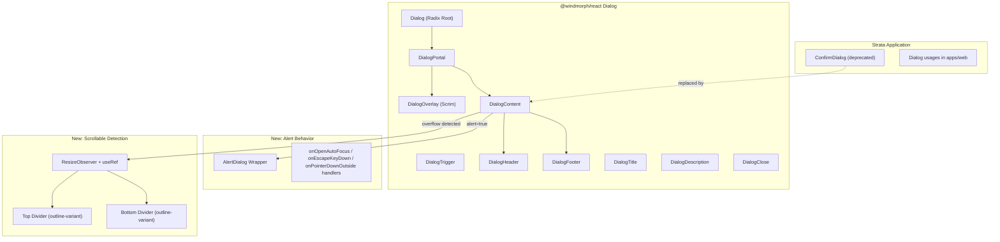

# Design Document: M3 Dialog Variants Audit

## Overview

This design describes the technical approach for achieving full Material Design 3 Expressive dialog compliance across five variants (basic, icon, full-screen, alert, scrollable) in the `@windmorph/react` component library (web/React), and the migration of the Strata application's custom `ConfirmDialog` to the library's Dialog component.

Key M3 Expressive principles applied:
- **Tonal elevation** — no drop shadows; hierarchy expressed via surface color tokens (`surface-container-high`)
- **Spring physics motion** — replaces fixed easing curves and durations with spring-based animations for natural, fluid motion
- **Semantic shape tokens** — corner radii referenced by token name (`corner-extra-large` = 28px) to support future shape morphing
- **Updated padding structure** — section-specific padding (headline, content, actions) rather than uniform padding

The existing `DialogContent` component already supports basic, icon, and full-screen variants via Radix UI's `@radix-ui/react-dialog` primitives. This audit introduces:

1. **Alert dialog variant** — an `alert` prop that switches to `role="alertdialog"` semantics with dismiss-prevention behavior
2. **Scrollable content handling** — dynamic divider visibility based on overflow detection
3. **Visual spec gaps** — minor Tailwind class adjustments to align with M3 pixel-spec values
4. **Strata migration** — replacing the custom `ConfirmDialog` (Framer Motion + manual focus trap) with the library's accessible Dialog

The design preserves the existing Radix-based architecture and Tailwind CSS styling approach already established in the library.

## Architecture



### Key Architectural Decisions

1. **Stay on Radix Dialog primitives** — The existing `@radix-ui/react-dialog` provides focus trapping, portal rendering, and accessibility out of the box. For the alert variant, we use Radix's event handlers (`onEscapeKeyDown`, `onPointerDownOutside`, `onInteractOutside`) to prevent dismissal rather than switching to a separate `@radix-ui/react-alert-dialog` package, keeping the bundle smaller and the API surface unified under one component.

2. **Overflow detection via ResizeObserver** — Rather than a scroll event listener (which fires frequently), a `ResizeObserver` on the content element detects when `scrollHeight > clientHeight` changes, updating a boolean state that controls divider visibility. This handles viewport resizes reactively without re-opening the dialog.

3. **Single component, prop-driven variants** — All five variants render through the same `DialogContent` component with props (`fullScreen`, `icon`, `alert`). This avoids API fragmentation and lets consumers compose freely.

## Components and Interfaces

### DialogContent (Enhanced)

```typescript
interface DialogContentProps extends React.ComponentPropsWithoutRef<typeof DialogPrimitive.Content> {
  /** Full-screen on mobile (0dp radius, header bar) */
  fullScreen?: boolean;
  /** Hero icon name — triggers center-aligned layout */
  icon?: string;
  /** Show close X button (default: only on fullScreen mobile) */
  showClose?: boolean;
  /** Alert dialog mode — prevents dismissal except via action buttons */
  alert?: boolean;
}
```

**New behavior when `alert={true}`:**
- Sets `role="alertdialog"` on the Radix Content element
- Attaches `onEscapeKeyDown={(e) => e.preventDefault()}` to block Escape dismissal
- Attaches `onPointerDownOutside={(e) => e.preventDefault()}` to block overlay click dismissal
- Attaches `onInteractOutside={(e) => e.preventDefault()}` as a fallback
- Sets `aria-labelledby` and `aria-describedby` pointing to DialogTitle and DialogDescription IDs
- On mount (`onOpenAutoFocus`), moves focus to the first focusable button in DialogFooter

### DialogScrollArea (New Internal Component)

```typescript
interface DialogScrollAreaProps {
  children: React.ReactNode;
  className?: string;
}
```

An internal wrapper rendered inside `DialogContent` (when not in fullScreen mode) that:
- Wraps the content between `DialogHeader` and `DialogFooter`
- Uses a `ResizeObserver` + `useRef` to track `scrollHeight > clientHeight`
- Exposes a boolean `isOverflowing` state to parent via context or direct render
- Applies `overflow-y: auto` and `max-h-[calc(90vh-<header+footer>)]` to constrain scrollable region
- Respects M3 Expressive section-specific padding (content area uses 20px top, 24px sides)

### Divider Rendering Logic

```typescript
// Inside DialogContent render:
{isOverflowing && (
  <div className="border-b border-outline-variant" /> // top divider after header
)}
{/* scrollable content */}
{isOverflowing && (
  <div className="border-t border-outline-variant" /> // bottom divider before footer
)}
```

### DialogOverlay (Updated for M3 Expressive)

The overlay renders with:
- `bg-[hsl(var(--on-surface)/0.32)]` — M3 32% on-surface scrim
- Spring-based fade animation using a JS spring interpolator (stiffness: 300, damping: 30 for open; stiffness: 400, damping: 35 for close) — replaces the previous CSS cubic-bezier transitions per M3 Expressive physics motion guidelines
- `fixed inset-0 z-50` — full viewport coverage

When `alert` is NOT true, clicking the overlay dismisses (default Radix behavior). When `alert` IS true, `onPointerDownOutside` prevents dismissal.

**Motion implementation for web/React:**
- Use `framer-motion` spring animations or a lightweight spring utility (e.g., `react-spring`) to interpolate opacity from 0→1 on open and 1→0 on close
- CSS fallback: `transition: opacity 150ms cubic-bezier(0.2, 0, 0, 1)` for browsers without JS spring support
- The dialog container itself uses a spring-based scale+fade animation: `scale(0.9, opacity: 0) → scale(1, opacity: 1)` on open

### Strata ConfirmDialog Replacement

The existing `ConfirmDialog` in `packages/ui/src/confirm-dialog.tsx` will be deprecated and replaced with a thin wrapper or direct usage pattern:

```typescript
// Before (custom ConfirmDialog):
<ConfirmDialog
  open={open}
  onClose={handleClose}
  onConfirm={handleConfirm}
  title="Delete item?"
  description="This cannot be undone."
/>

// After (using @windmorph/react Dialog with alert prop):
<Dialog open={open} onOpenChange={(o) => !o && handleClose()}>
  <DialogContent alert icon="delete">
    <DialogHeader centered>
      <DialogTitle>Delete item?</DialogTitle>
      <DialogDescription>This cannot be undone.</DialogDescription>
    </DialogHeader>
    <DialogFooter>
      <Button variant="text" onClick={handleClose}>Cancel</Button>
      <Button variant="filled" onClick={handleConfirm}>Delete</Button>
    </DialogFooter>
  </DialogContent>
</Dialog>
```

## Data Models

### Component State

```typescript
// Internal state for scroll overflow detection
interface DialogScrollState {
  /** Whether the content area is currently overflowing */
  isOverflowing: boolean;
}

// ResizeObserver callback updates this state
// Used to conditionally render top/bottom dividers
```

### Props Reference (Complete)

| Prop | Type | Default | Description |
|------|------|---------|-------------|
| `fullScreen` | `boolean` | `false` | Full-screen on mobile, centered dialog on desktop |
| `icon` | `string` | `undefined` | Material Symbol name for hero icon; triggers center-aligned layout |
| `showClose` | `boolean` | `false` | Show close X button in top-right corner |
| `alert` | `boolean` | `false` | Alert dialog mode; prevents dismissal except via action buttons |
| `className` | `string` | `undefined` | Additional Tailwind classes |
| `children` | `ReactNode` | — | Dialog body content |

### CSS Token Mapping

| M3 Expressive Spec Value | Tailwind Class / CSS Variable |
|--------------------------|-------------------------------|
| surface-container-high (tonal elevation) | `bg-surface-container-high` |
| on-surface @ 32% (scrim) | `bg-[hsl(var(--on-surface)/0.32)]` |
| on-surface-variant (supporting text) | `text-on-surface-variant` |
| outline-variant (divider) | `border-outline-variant` |
| secondary (icon color) | `text-secondary` |
| corner-extra-large (28px) | `rounded-[var(--corner-extra-large,28px)]` |
| Headline padding | `pt-[6px] px-6 pb-[13px]` |
| Content padding | `pt-5 px-6` |
| Actions padding | `pt-4 px-6 pb-6` |
| Headline Small (24/32/400) | `text-[24px] leading-8 font-normal` |
| Body Medium (14/20/400/0.25) | `text-[14px] leading-5 font-normal tracking-[0.25px]` |
| Title Large (22/28/400) | `text-[22px] leading-7 font-normal` |
| Elevation | `shadow-none` (tonal elevation via surface color only) |
| Spring motion (dialog open) | `transition: transform; spring(stiffness: 300, damping: 25)` via JS |
| Spring motion (scrim fade) | `transition: opacity; spring(stiffness: 300, damping: 30)` via JS |

## Correctness Properties

*A property is a characteristic or behavior that should hold true across all valid executions of a system — essentially, a formal statement about what the system should do. Properties serve as the bridge between human-readable specifications and machine-verifiable correctness guarantees.*

### Property 1: Alert dialog dismissal invariant

*For any* dialog rendered with `alert={true}`, regardless of content, number of action buttons, or dialog state, triggering any dismissal mechanism other than activating an action button (overlay click, Escape key, programmatic close via non-button interaction) SHALL leave the dialog open and visible.

**Validates: Requirements 4.2, 4.3, 4.4**

### Property 2: Overflow–divider biconditional

*For any* dialog content area, dividers (top and bottom) are rendered if and only if the content area's `scrollHeight` exceeds its `clientHeight`. When `scrollHeight > clientHeight`, both dividers are visible; when `scrollHeight <= clientHeight`, neither divider is rendered.

**Validates: Requirements 5.2, 5.3, 5.4, 5.6**

### Property 3: Title and actions positional invariant during scroll

*For any* scrollable dialog and any scroll position within the content area, the computed positions (relative to viewport) of the title section and action buttons section remain constant — they do not translate with the scrollable content.

**Validates: Requirements 5.5**

### Property 4: Non-alert overlay dismissal

*For any* dialog rendered without `alert={true}` (i.e., `alert` is `false` or `undefined`), clicking the scrim overlay SHALL trigger dialog dismissal (the `onOpenChange` callback receives `false`).

**Validates: Requirements 6.6**

### Property 5: Form field count triggers fullScreen

*For any* dialog in the Strata application containing 5 or more form input elements (text fields, selects, checkboxes, radio buttons, or textareas), the dialog SHALL be rendered with the `fullScreen` prop set to `true`.

**Validates: Requirements 7.3**

## Error Handling

| Scenario | Handling Strategy |
|----------|-------------------|
| `icon` prop references non-existent Material Symbol | Render empty icon container (Icon component already handles gracefully); no crash |
| `alert={true}` without action buttons in DialogFooter | Dialog renders but cannot be dismissed by user; developer warning in console via `useEffect` check |
| ResizeObserver not supported (very old browsers) | Fallback: always show dividers when content exceeds a static height threshold |
| `fullScreen` + `alert` combined | Both props apply — full-screen layout with dismiss prevention. Valid combination for mobile forms requiring explicit save/cancel |
| DialogContent rendered without Dialog parent | Radix throws context error; no additional handling needed |
| Rapid open/close toggling | CSS animations handle via `data-state` attribute; Radix manages mount/unmount lifecycle |

## Testing Strategy

### Unit Tests (Example-Based)

Unit tests cover the static styling/structure requirements and specific interaction scenarios:

- **Basic variant styling** (Req 1): Render dialog, assert container classes match M3 spec (background, radius, padding, dimensions, typography, elevation)
- **Icon variant layout** (Req 2): Render with `icon` prop, assert center-aligned layout, icon color, spacing
- **Full-screen variant** (Req 3): Render with `fullScreen`, assert mobile layout (inset-0, rounded-none, header bar) and desktop fallback (centered, rounded-[28px])
- **Alert ARIA attributes** (Req 4.6): Render with `alert`, assert `role="alertdialog"`, `aria-labelledby`, `aria-describedby`
- **Alert initial focus** (Req 4.7): Open alert dialog, verify `document.activeElement` is first footer button
- **Scrim styling** (Req 6): Assert overlay classes match M3 spec
- **Docs page completeness** (Req 8): Render docs page, verify 5 showcase sections, props table, code snippets

### Property-Based Tests

Property-based tests validate universal invariants across generated inputs. Using `fast-check` for JavaScript/TypeScript.

**Configuration:**
- Minimum 100 iterations per property test
- Each test tagged with: `Feature: m3-dialog-variants-audit, Property {N}: {description}`

**Properties to test:**

1. **Alert dismissal invariant** — Generate arbitrary dialog configurations (varying content, button counts, nested elements), render with `alert={true}`, simulate overlay clicks and Escape presses, assert dialog remains open after each.

2. **Overflow–divider biconditional** — Generate content of varying heights (from 0 to 2000px). For each height, render inside a constrained dialog, measure `scrollHeight` vs `clientHeight`, assert divider presence matches overflow state.

3. **Title/actions positional invariant** — Generate random scroll positions (0 to scrollHeight - clientHeight). For each position, programmatically scroll, read title/actions bounding rects, assert they haven't moved from initial position.

4. **Non-alert overlay dismissal** — Generate dialog configurations without `alert` prop, simulate overlay click, assert `onOpenChange(false)` was called.

5. **Form field count → fullScreen** — Generate form content with N input fields (0–20). For N >= 5, assert `fullScreen` prop is applied; for N < 5, assert it is not.

### Integration Tests

- **Migration verification**: Confirm `ConfirmDialog` from `packages/ui/` is no longer imported anywhere in `apps/web/`
- **Delete confirmation flow**: End-to-end test of delete action using the new alert dialog with icon
- **Responsive full-screen**: Viewport resize test verifying mobile → full-screen, desktop → centered behavior
- **Scroll resize reactivity** (Req 5.7): Resize viewport while dialog is open, verify dividers appear/disappear without re-opening
