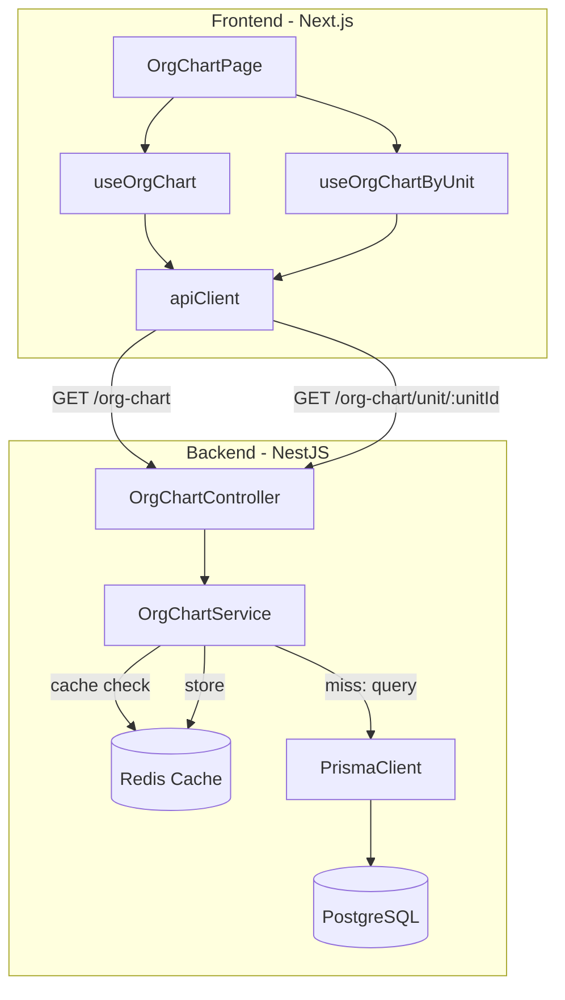

# Design Document: Org Chart Backend

## Overview

This design connects the existing org chart frontend (currently backed by `MockPersonRepository`) to real backend endpoints. The backend introduces a new `OrgChartModule` in the NestJS API that assembles the full reporting hierarchy tree server-side from a single Prisma query, caches it in Redis, and serves it as a nested JSON response. A second endpoint returns employees grouped by organizational unit for the "Teams" view. The frontend replaces its mock data layer with TanStack Query hooks that consume these endpoints.

The approach prioritizes simplicity: one flat query, in-memory tree assembly, and a cache-aside pattern with event-driven invalidation.

## Architecture



**Key architectural decisions:**

1. **Single query + in-memory tree build** — The service fetches all `ReportingRelationship` rows and `UserCompanyMembership` (with user/person includes) in one query, then assembles the tree with a O(n) hash-map pass. This avoids N+1 recursive queries and keeps DB load predictable.

2. **Cache-aside with Redis** — The assembled tree JSON is stored at `org-chart:tree:{companyId}` with a 5-minute TTL. Cache hits skip the DB entirely. Invalidation is triggered by write operations on reporting relationships and profile updates.

3. **New NestJS module** — `OrgChartModule` at `apps/api/src/org-chart/` keeps this read-optimized concern separate from the write-oriented `ReportingService` in the authorization admin module.

4. **Frontend hooks** — Two hooks in `apps/web/src/services/org-chart.service.ts` follow the existing project pattern (TanStack Query, `apiClient`, `enabled` guard).

## Components and Interfaces

### Backend Components

#### `OrgChartModule` (`apps/api/src/org-chart/org-chart.module.ts`)

NestJS module that registers the controller and service. Imports `PrismaClient` and `Redis` from existing providers.

#### `OrgChartController` (`apps/api/src/org-chart/org-chart.controller.ts`)

```typescript
@Controller('api/v2/companies/:companyId/org-chart')
@UseGuards(AuthorizationGuard)
export class OrgChartController {
  // GET /api/v2/companies/:companyId/org-chart
  getTree(companyId: string): Promise<OrgTreeNode[]>

  // GET /api/v2/companies/:companyId/org-chart/unit/:unitId
  getUnitEmployees(companyId: string, unitId: string): Promise<UnitViewResponse>
}
```

#### `OrgChartService` (`apps/api/src/org-chart/org-chart.service.ts`)

```typescript
@Injectable()
export class OrgChartService {
  // Build or retrieve cached full tree
  getTree(companyId: string): Promise<OrgTreeNode[]>

  // Get employees for a specific org unit with ancestor chain
  getUnitView(companyId: string, unitId: string): Promise<UnitViewResponse>

  // Invalidate cached tree (called by reporting/profile write hooks)
  invalidateTree(companyId: string): Promise<void>

  // Pure function: assemble tree from flat data (testable independently)
  buildTree(employees: FlatEmployee[], relationships: FlatRelationship[]): OrgTreeNode[]
}
```

The `buildTree` method is a pure function extracted specifically for testability. It takes flat arrays and returns the nested tree structure.

### Frontend Components

#### `org-chart.service.ts` (`apps/web/src/services/org-chart.service.ts`)

```typescript
// Types
export interface OrgTreeNode {
  id: string;
  fullName: string;
  email: string;
  positionTitle: string | null;
  managerId: string | null;
  departmentName: string | null;
  avatarUrl: string | null;
  directReports: OrgTreeNode[];
}

export interface UnitEmployee {
  id: string;
  fullName: string;
  positionTitle: string | null;
  status: string;
}

export interface UnitAncestor {
  id: string;
  name: string;
  typeName: string;
}

export interface UnitViewResponse {
  unit: { id: string; name: string; typeName: string; managerId: string | null };
  parentChain: UnitAncestor[];
  employees: UnitEmployee[];
}

// Hooks
export function useOrgChart(companyId: string | undefined)
export function useOrgChartByUnit(companyId: string | undefined, unitId: string | undefined)
```

### Cache Invalidation Integration

The existing `ReportingService.setManager()` and `ReportingService.removeManager()` already invalidate direct-reports caches. We extend the invalidation to also delete `org-chart:tree:{companyId}`. This is done by injecting `OrgChartService.invalidateTree` into the reporting service flow, or by having the OrgChartService subscribe to cache key patterns.

**Chosen approach:** The `OrgChartController`'s tree endpoint handles cache-aside internally. For invalidation, the `ReportingService` gains a call to `redis.del(org-chart:tree:${companyId})` alongside its existing cache invalidation. Similarly, any profile update endpoint (people/employees) calls the same invalidation.

## Data Models

### `OrgTreeNode` (API Response)

| Field | Type | Source |
|-------|------|--------|
| id | string | `User.id` (same as `ReportingRelationship.userId`) |
| fullName | string | `Person.fullName` (via User→Person) |
| email | string | `Person.email` |
| positionTitle | string \| null | `PositionV2.name` (via UserCompanyMembership→PositionV2) |
| managerId | string \| null | `ReportingRelationship.managerId` |
| departmentName | string \| null | `OrganizationUnit.name` (via UserCompanyMembership→orgUnit) |
| avatarUrl | string \| null | null (placeholder for future avatar support) |
| directReports | OrgTreeNode[] | Recursively nested children |

### `FlatEmployee` (Internal, from Prisma query)

```typescript
interface FlatEmployee {
  userId: string;
  fullName: string;
  email: string;
  positionTitle: string | null;
  departmentName: string | null;
}
```

### `FlatRelationship` (Internal, from Prisma query)

```typescript
interface FlatRelationship {
  userId: string;
  managerId: string;
}
```

### Prisma Query Strategy

A single query fetches all company members with includes:

```typescript
const members = await this.prisma.userCompanyMembership.findMany({
  where: { companyId },
  include: {
    position: { select: { name: true } },
    orgUnit: { select: { name: true } },
  },
});
```

Combined with:

```typescript
const relationships = await this.prisma.reportingRelationship.findMany({
  where: { companyId },
  select: { userId: true, managerId: true },
});
```

And user/person data:

```typescript
const users = await this.prisma.user.findMany({
  where: { id: { in: memberUserIds } },
  include: { person: { select: { fullName: true, email: true } } },
});
```

These three queries run in parallel with `Promise.all` — still constant query count (3), avoiding N+1.

### Redis Cache Key

- Key: `org-chart:tree:{companyId}`
- Value: JSON-serialized `OrgTreeNode[]`
- TTL: 300 seconds (5 minutes)

### Tree Construction Algorithm

```
Input: employees[] (flat list), relationships[] (userId → managerId pairs)
Output: OrgTreeNode[] (root nodes with nested children)

1. Create nodeMap: Map<userId, OrgTreeNode> from employees (all nodes start with empty directReports)
2. Create childMap: Map<managerId, userId[]> from relationships
3. For each relationship, push child node into parent node's directReports
4. Root nodes = all nodes whose userId is NOT in relationships as a userId (has no manager)
5. Return root nodes
```

Time complexity: O(n) where n = number of employees.

## Correctness Properties

*A property is a characteristic or behavior that should hold true across all valid executions of a system — essentially, a formal statement about what the system should do. Properties serve as the bridge between human-readable specifications and machine-verifiable correctness guarantees.*

### Property 1: Tree uniqueness invariant

*For any* set of employees and reporting relationships belonging to a company, building the org chart tree SHALL produce a result where every employee appears exactly once across all nodes in the tree.

**Validates: Requirements 7.1**

### Property 2: Tree construction round-trip

*For any* set of employees and a valid set of (userId, managerId) reporting relationship pairs, building the tree and then flattening it back to (userId, managerId) pairs SHALL produce a set equal to the original reporting relationships.

**Validates: Requirements 7.2, 7.3, 7.4**

### Property 3: Unit member retrieval correctness

*For any* organizational unit with assigned members, querying the unit view SHALL return exactly the set of employees whose `UserCompanyMembership.orgUnitId` matches the queried unit, each with id, fullName, positionTitle, and status fields present.

**Validates: Requirements 3.1, 3.2**

### Property 4: Ancestor chain correctness

*For any* organizational unit within a company hierarchy, the parentChain returned by the unit view endpoint SHALL equal the sequence of ancestor units derived by walking the unit's `parentId` chain from root to the queried unit, each containing id, name, and typeName.

**Validates: Requirements 3.3**

## Error Handling

| Scenario | HTTP Status | Response |
|----------|-------------|----------|
| Invalid/non-existent `companyId` | 404 | `{ message: "Company not found" }` |
| Invalid/non-existent `unitId` | 404 | `{ message: "Organization unit not found" }` |
| Unauthenticated request | 401 | `{ message: "Unauthorized" }` |
| Insufficient permissions | 403 | `{ message: "Forbidden" }` |
| Redis unavailable (cache miss) | — | Graceful degradation: skip cache, query DB directly |
| Redis unavailable (write) | — | Graceful degradation: log warning, don't cache |
| Database error | 500 | `{ message: "Internal server error" }` |

**Design rationale:** Redis failures should never break the feature. The cache-aside pattern treats Redis as optional — a failed `GET` is treated as a miss, and a failed `SET` is silently ignored with a log warning.

## Testing Strategy

### Property-Based Tests (PBT)

The `buildTree` pure function is the primary target for property-based testing. It takes flat arrays as input and produces a tree — perfect for generating random inputs.

**Library:** [fast-check](https://github.com/dubzzz/fast-check) (already available in the Node.js/TypeScript ecosystem, integrates with Jest)

**Configuration:**
- Minimum 100 iterations per property
- Each test tagged with: `Feature: org-chart-backend, Property {N}: {description}`

**Properties to implement:**
1. Uniqueness invariant — generate N random employees with random subset of relationships, verify every employee appears exactly once in the tree
2. Round-trip — generate random relationships, build tree, flatten, compare sets
3. Unit member retrieval — generate random unit memberships, call service logic, verify result matches input
4. Ancestor chain — generate random unit hierarchy, verify parentChain reconstruction

### Unit Tests (Example-Based)

- Controller returns 404 for non-existent company
- Controller returns 404 for non-existent unit
- Service returns cached value when Redis has data
- Service builds tree on cache miss and stores result
- Frontend hooks: correct URL called, error state propagated, disabled when params missing
- Response shape validation (all fields present)

### Integration Tests

- Cache invalidation on `setManager` / `removeManager`
- Cache invalidation on profile update
- Redis TTL correctly set to 300 seconds
- Auth guard rejects unauthenticated requests
- End-to-end: seed DB → call endpoint → verify response structure

### Test Balance

Property tests cover the tree-building and unit-retrieval logic exhaustively. Unit tests cover specific error paths and integration wiring. Integration tests verify the caching layer and auth concerns work with real infrastructure.
