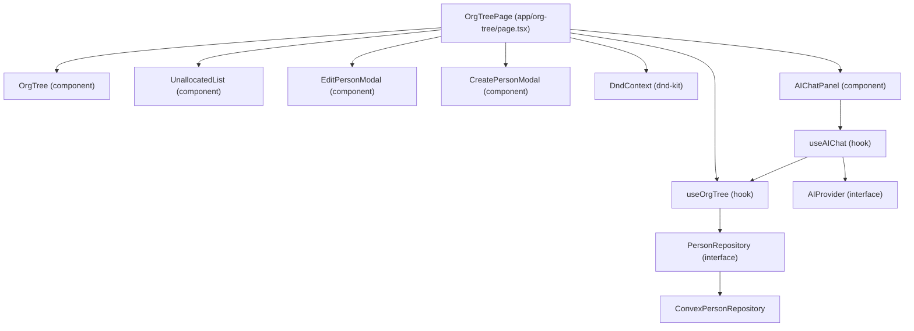

# Design Document: Org Tree

## Overview

The Org Tree feature adds a `/org-tree` page to the Next.js application. It renders a hierarchical tree of people (nodes), supports drag-and-drop reparenting via dnd-kit, inline editing and creation via modals, and an unallocated list for people with no parent. All data access is routed through a `PersonRepository` interface, with a Convex-backed implementation provided by default.

Framer Motion drives all entrance, exit, and layout animations. The tree is rendered as nested DOM components (not a canvas), which makes Framer Motion layout animations straightforward and keeps the implementation accessible.

---

## Architecture



The page is a thin orchestrator. All data-fetching and mutation logic lives in `useOrgTree`, which accepts a `PersonRepository` instance. Components receive only the data and callbacks they need — they have no direct knowledge of Convex or any other backend.

---

## Components and Interfaces

### PersonRepository Interface

```ts
export interface Person {
  id: string;
  fullName: string;
  title: string;
  squads: string[];
  salary: number;
  parentId: string | null;
}

export interface PersonRepository {
  fetchAll(): Promise<Person[]>;
  create(data: { fullName: string; title: string; squads?: string[]; salary?: number; parentId?: string | null }): Promise<Person>;
  update(id: string, data: Partial<Pick<Person, "fullName" | "title" | "squads" | "salary" | "parentId">>): Promise<Person>;
  delete(id: string): Promise<void>;
}
```

All UI components depend only on `Person` and `PersonRepository`. The concrete `ConvexPersonRepository` is injected at the page level (or via a React context provider).

### useOrgTree Hook

Centralises all state and side-effects:

- Holds the canonical `persons: Person[]` list
- Derives `tree: TreeNode[]` (nested structure) and `unallocated: Person[]` from the flat list
- Exposes: `reparent`, `editPerson`, `createPerson`, `deletePerson`
- Implements optimistic updates with rollback on repository error
- Exposes loading and error states

```ts
interface UseOrgTreeReturn {
  tree: TreeNode[];
  unallocated: Person[];
  loading: boolean;
  error: string | null;
  reparent(draggedId: string, newParentId: string | null): Promise<void>;
  editPerson(id: string, data: Partial<Pick<Person, "fullName" | "title" | "squads" | "salary">>): Promise<void>;
  createPerson(data: { fullName: string; title: string; squads?: string[]; salary?: number; parentId?: string | null }): Promise<void>;
  deletePerson(id: string): Promise<void>;
}
```

### OrgTree Component

Recursively renders `TreeNode[]`. Each node is a `motion.div` with a `layout` prop for Framer Motion layout animations. `AnimatePresence` wraps the children list to animate additions and removals.

Each node card shows fullName and title, and has an edit button that opens `EditPersonModal`.

Connector lines between parent and child are rendered as absolutely-positioned `div` elements using CSS.

### UnallocatedList Component

Renders the flat list of unallocated persons. Wrapped in `AnimatePresence` for enter/exit animations. Each item is a dnd-kit draggable.

### EditPersonModal / CreatePersonModal

Controlled modal components. Accept initial values and an `onSubmit` callback. Perform client-side validation (non-empty fullName) before calling the callback. Display repository errors inline.

`EditPersonModal` renders inputs for `fullName`, `title`, `salary`, and a multi-value input for `squads` (allowing the user to add/remove individual squad strings).

`CreatePersonModal` renders the same fields, all optional except `fullName`.

### AIProvider Interface

```ts
export interface ChatMessage {
  role: 'user' | 'assistant';
  content: string;
}

export interface AIProvider {
  chat(messages: ChatMessage[], context: { persons: Person[] }): Promise<string>;
}
```

All chat UI depends only on `AIProvider`. Concrete implementations (e.g. an OpenAI-backed provider) are injected at the page level, following the same pattern as `PersonRepository`.

### useAIChat Hook

Centralises all chat state:

- Holds `messages: ChatMessage[]` conversation history
- Holds `loading: boolean` and `error: string | null`
- Receives an `AIProvider` instance and the current `persons: Person[]` from `useOrgTree`
- Exposes `sendMessage(text: string): Promise<void>` — appends the user message, calls `provider.chat`, appends the assistant response

```ts
interface UseAIChatReturn {
  messages: ChatMessage[];
  loading: boolean;
  error: string | null;
  sendMessage(text: string): Promise<void>;
}
```

### AIChatPanel Component

A floating UI anchored to the bottom-right of the page:

- A circular toggle button is always visible; clicking it opens/closes the panel
- `AnimatePresence` from Framer Motion drives the open/close animation of the panel
- The panel contains a scrollable message history and a text input with a send button
- User messages and assistant messages are styled distinctly
- When an assistant response contains a list of persons (detected by the AI returning structured data or by parsing the response), those persons are rendered as small person cards rather than inline text
- While `loading` is true the input is disabled and a typing indicator is shown
- If `error` is non-null an error message is shown in the conversation thread

### DragAndDrop Layer

`DndContext` from dnd-kit wraps the entire page. Each `OrgNode` and `UnallocatedItem` is a `useDraggable` source. Each `OrgNode` and the `UnallocatedList` area is a `useDroppable` target.

On `onDragEnd`:
1. Identify source and target
2. Guard: if source === target, no-op
3. Guard: if target is a descendant of source, no-op (cycle prevention)
4. Call `reparent(draggedId, newParentId)`

---

## Data Models

### Person (flat, as stored/fetched)

| Field      | Type             | Notes                          |
|------------|------------------|--------------------------------|
| `id`       | `string`         | Unique identifier              |
| `fullName` | `string`         | Full display name, required    |
| `title`    | `string`         | Job position/title             |
| `squads`   | `string[]`       | Squad memberships (0 or more)  |
| `salary`   | `number`         | Salary (treat as sensitive)    |
| `parentId` | `string \| null` | null = root or unallocated     |

### TreeNode (derived, in-memory only)

```ts
interface TreeNode {
  person: Person;
  children: TreeNode[];
  depth: number;
}
```

Built by `buildTree(persons: Person[]): TreeNode[]` — a pure function that takes the flat list and returns the nested structure. This function is the primary target for property-based testing.

### Convex Schema (example)

```ts
// convex/schema.ts
defineTable({
  fullName: v.string(),
  title: v.string(),
  squads: v.array(v.string()),
  salary: v.number(),
  parentId: v.union(v.id("persons"), v.null()),
})
```

---

## Correctness Properties

*A property is a characteristic or behavior that should hold true across all valid executions of a system — essentially, a formal statement about what the system should do. Properties serve as the bridge between human-readable specifications and machine-verifiable correctness guarantees.*

### Property 1: Tree nodes display fullName and title

*For any* set of persons rendered in the org tree or unallocated list, every rendered node/item should contain both the person's `fullName` and `title` as visible text.

**Validates: Requirements 1.4, 2.4**

---

### Property 2: Root nodes have no parent

*For any* set of persons, the nodes rendered at the top level of the tree (depth 0) should be exactly those persons whose `parentId` is null.

**Validates: Requirements 1.2, 2.1**

---

### Property 3: Child depth exceeds parent depth

*For any* tree with depth > 1, every child node should have a `depth` value strictly greater than its parent node's `depth`.

**Validates: Requirements 1.3**

---

### Property 4: Unallocated list membership round-trip

*For any* person, assigning them a parent should remove them from the unallocated list, and subsequently removing that parent should return them to the unallocated list — restoring the original unallocated set.

**Validates: Requirements 2.2, 2.3**

---

### Property 5: Reparenting updates parentId

*For any* drag-drop operation where the source person is dropped onto a valid target (not itself, not a descendant), the source person's `parentId` should equal the target's `id` (or `null` if dropped onto the unallocated list) after the operation completes.

**Validates: Requirements 3.1, 3.2, 3.3**

---

### Property 6: Tree remains acyclic after any reparenting

*For any* tree and any drag-drop operation (including self-drops and drops onto descendants), the resulting tree should be acyclic — no person should be their own ancestor.

**Validates: Requirements 3.5, 3.6**

---

### Property 7: Optimistic update rollback on error

*For any* reparenting operation where the repository returns an error, the persons list after the error should be identical to the persons list before the drag began.

**Validates: Requirements 3.8**

---

### Property 8: Edit modal pre-populated with current values

*For any* person in the tree, opening their edit modal should result in the `fullName`, `title`, `squads`, and `salary` fields containing exactly that person's current values.

**Validates: Requirements 4.1**

---

### Property 9: Empty fullName is always rejected

*For any* string composed entirely of whitespace (including the empty string), submitting it as the `fullName` in either the edit or create modal should not call the repository and should display a validation error.

**Validates: Requirements 4.5, 5.6**

---

### Property 10: Valid submission calls repository with correct data

*For any* valid (non-empty) `fullName` and `title`, submitting the create modal should call `repository.create` with exactly those values; submitting the edit modal should call `repository.update` with exactly those values.

**Validates: Requirements 4.3, 5.3**

---

### Property 11: New person appears in correct location

*For any* newly created person, if no parent was specified they should appear in the unallocated list; if a parent was specified they should appear as a child of that parent in the tree.

**Validates: Requirements 5.4, 5.5**

---

### Property 12: buildTree is a pure function — round-trip

*For any* flat list of persons, `buildTree` followed by `flattenTree` should produce a list containing the same persons (same ids, same parentIds), regardless of the original ordering of the input list.

**Validates: Requirements 1.1, 1.2, 1.3** (structural correctness of the core tree-building logic)

---

### Property 13: Org data always passed as context

*For any* message sent via `useAIChat`, the `persons` array passed to `AIProvider.chat` should be referentially equal to the current persons list held by `useOrgTree` at the time of the call — never stale or empty when persons exist.

**Validates: Requirement 8.6**

---

### Property 14: Empty message is never submitted

*For any* string composed entirely of whitespace (including the empty string), calling `sendMessage` with that string should not invoke `AIProvider.chat` and should leave the message history unchanged.

**Validates: Requirement 8.5**

---

### Property 15: Error state shown on AI provider failure

*For any* `AIProvider` implementation that rejects its `chat` promise, after the rejection `useAIChat` should expose a non-null `error` string, `loading` should be false, and no assistant message should have been appended to the history.

**Validates: Requirement 8.14**

---

### Property 16: Message history grows monotonically

*For any* sequence of successful `sendMessage` calls, the `messages` array length after N calls should equal the initial length plus 2×N (one user message and one assistant message per call), and the order of messages should match the order of calls.

**Validates: Requirements 8.4, 8.8**

---

## Error Handling

| Scenario | Behaviour |
|---|---|
| Repository fetch fails | Show descriptive error message in place of tree; no crash |
| Reparent repository call fails | Optimistic update is rolled back; error toast/message shown |
| Edit repository call fails | Edit modal stays open; inline error message shown |
| Create repository call fails | Create modal stays open; inline error message shown |
| Self-drop | Silently ignored; no repository call |
| Ancestor-drop (cycle) | Silently ignored; no repository call |
| Empty fullName submitted | Client-side validation error; no repository call |
| AI provider call fails | Error message shown in chat thread; input re-enabled; no assistant message appended |
| Empty/whitespace chat message submitted | Silently ignored; no AI provider call |

All repository calls are wrapped in try/catch. Errors are surfaced as human-readable strings stored in component or hook state — never swallowed silently.

---

## Testing Strategy

### Unit / Example Tests

- `buildTree` with known inputs: verify correct nesting, depth values, root detection
- `isDescendant` utility: verify cycle detection with known trees
- `EditPersonModal`: verify pre-population of all fields (fullName, title, squads, salary), validation error on empty fullName, cancel does not call repository
- `CreatePersonModal`: verify validation error on empty fullName, cancel does not call repository
- `OrgTree` loading state: verify loading indicator shown, tree hidden
- `OrgTree` error state: verify error message shown
- `UnallocatedList` empty state: verify empty-state message shown
- Repository interface: verify `ConvexPersonRepository` satisfies the `PersonRepository` type (TypeScript compile-time check)

### Property-Based Tests

Using [fast-check](https://github.com/dubzzz/fast-check) (TypeScript-native PBT library). Each property test runs a minimum of 100 iterations.

| Property | Test description |
|---|---|
| Property 1 | Generate random persons, render, assert all fullNames and titles appear |
| Property 2 | Generate random persons, build tree, assert depth-0 nodes have null parentId |
| Property 3 | Generate random multi-level persons, build tree, assert child.depth > parent.depth |
| Property 4 | Generate person, assign parent, assert removed from unallocated; remove parent, assert re-added |
| Property 5 | Generate valid drag-drop pair, assert parentId updated correctly |
| Property 6 | Generate arbitrary drag-drop operations, assert resulting tree is acyclic |
| Property 7 | Generate drag op + mock failing repository, assert state reverts |
| Property 8 | Generate person, open edit modal, assert all fields match person data |
| Property 9 | Generate whitespace-only strings, attempt submit as fullName, assert repository not called |
| Property 10 | Generate valid fullName/title, submit modal, assert repository called with correct args |
| Property 11 | Generate person with/without parent, create, assert appears in correct location |
| Property 12 | Generate flat person list in random order, buildTree then flattenTree, assert same persons |

Tag format for each test: `// Feature: org-tree, Property N: <property text>`

### Integration Tests

- Convex repository: verify `fetchAll`, `create`, `update`, `delete` against a Convex dev instance (1-3 examples each)
- Full page smoke test: render page with mock repository, verify tree and unallocated list render without errors
- AI chat smoke test: render page with mock repository and mock AI provider, open panel, send a message, verify assistant response appears

### Property-Based Tests (additions)

| Property | Test description |
|---|---|
| Property 13 | Generate persons list + message, call sendMessage, assert AIProvider.chat received the same persons |
| Property 14 | Generate whitespace-only strings, call sendMessage, assert AIProvider.chat not called and history unchanged |
| Property 15 | Generate message + mock rejecting AIProvider, call sendMessage, assert error non-null, loading false, no assistant message |
| Property 16 | Generate N messages with mock AIProvider, call sendMessage N times, assert history length = 2N and order preserved |
