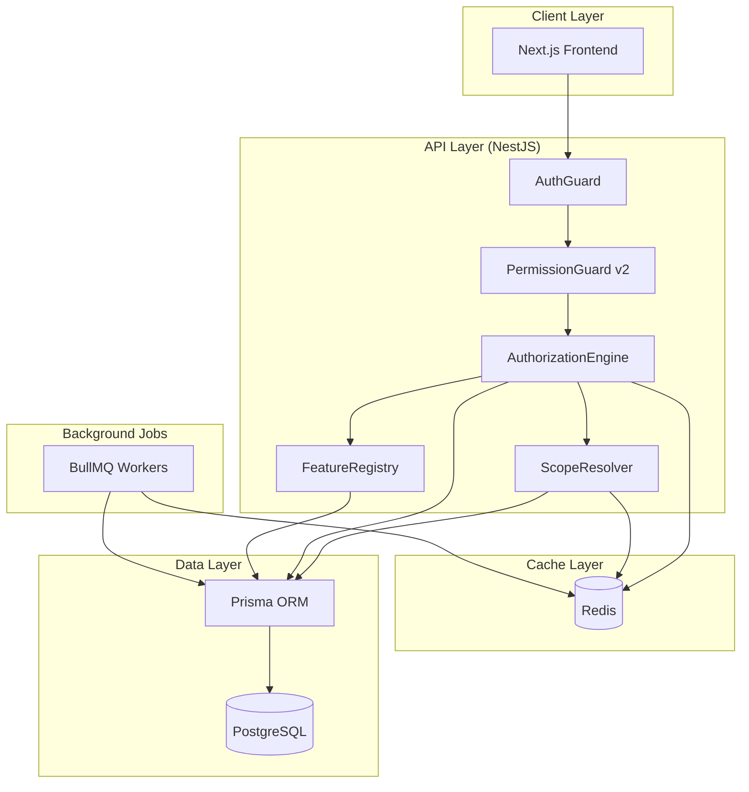
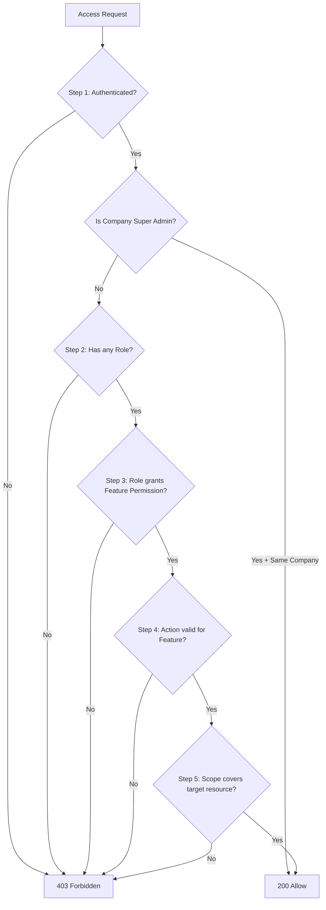
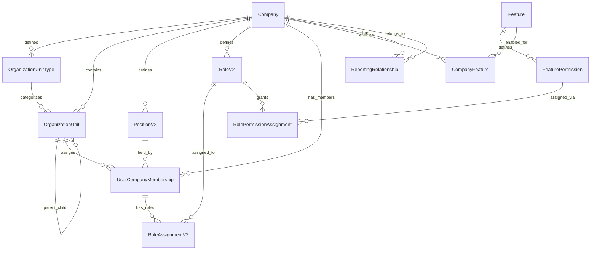

# Design Document: Scalable Permissions

## Overview

This design replaces the existing static RBAC permission system (3 scopes: SELF, TEAM, ORGANIZATION) with a fully dynamic, data-driven authorization system. The new system supports arbitrary organizational structures, independent reporting hierarchies, feature self-registration, and six permission scopes with tree-traversal-based resolution.

The architecture centers on an **Authorization Engine** that evaluates access through a deterministic 5-step pipeline, a **Scope Resolution** algorithm that traverses organization unit trees for BRANCH scope, and a **Feature Registry** pattern enabling modules to self-register permissions at runtime.

### Key Design Decisions

| Decision | Rationale |
|----------|-----------|
| Replace `Department` with generic `OrganizationUnit` + `OrganizationUnitType` | Supports any org model (tribes, squads, chapters, etc.) without schema changes |
| Separate reporting hierarchy from org unit membership | Enables matrix organizations and cross-functional teams |
| 6 permission scopes (OWN → GLOBAL) | Granular data boundary control vs. previous 3 |
| Redis cache with `permissions:v2:{companyId}:{userId}` key pattern | Namespace isolation + fast invalidation per company |
| Feature self-registration via decorators | New modules integrate without authorization code changes |
| Position does NOT grant permissions | Clean separation of career structure from access control |

---

## Architecture

### High-Level Component Diagram



### Authorization Engine — 5-Step Evaluation Flow



### Module Structure

```
apps/api/src/authorization/
├── authorization.module.ts
├── authorization.guard.ts          # PermissionGuard v2
├── authorization.engine.ts         # 5-step evaluation
├── authorization.decorator.ts      # @RequireFeaturePermission()
├── scope-resolver/
│   ├── scope-resolver.service.ts   # Core scope resolution
│   ├── scope-resolver.types.ts     # Scope enum, interfaces
│   └── scope-resolver.cache.ts     # Hierarchy cache management
├── feature-registry/
│   ├── feature-registry.service.ts # Registration + lookup
│   ├── feature-registry.decorator.ts # @RegisterFeature()
│   └── feature-registry.types.ts
├── permission-cache/
│   ├── permission-cache.service.ts # Redis caching
│   └── permission-cache.keys.ts    # Key pattern definitions
├── permission-serializer/
│   ├── permission-serializer.ts    # serialize/parse
│   └── permission-serializer.types.ts
├── dto/
│   ├── create-role.dto.ts
│   ├── assign-role.dto.ts
│   ├── create-org-unit-type.dto.ts
│   ├── create-org-unit.dto.ts
│   ├── create-position.dto.ts
│   ├── assign-permission.dto.ts
│   └── ...
├── admin/
│   ├── admin.module.ts
│   ├── org-unit-types.controller.ts
│   ├── org-units.controller.ts
│   ├── positions.controller.ts
│   ├── roles.controller.ts
│   ├── features.controller.ts
│   └── reporting.controller.ts
└── migration/
    ├── migration.service.ts
    └── migration.command.ts
```

---

## Components and Interfaces

### 1. Authorization Engine (`authorization.engine.ts`)

The core service that evaluates access requests through the 5-step pipeline.

```typescript
interface AccessRequest {
  userId: string;
  companyId: string;
  feature: string;           // e.g., "leave"
  permission: string;        // e.g., "approve"
  targetResourceOwnerId?: string;  // for scope evaluation
  targetResourceOrgUnitId?: string;
}

interface AccessDecision {
  allowed: boolean;
  deniedAtStep?: 1 | 2 | 3 | 4 | 5;
  effectiveScope?: PermissionScopeV2;
}

interface AuthorizationEngine {
  evaluate(request: AccessRequest): Promise<AccessDecision>;
  evaluateBatch(requests: AccessRequest[]): Promise<AccessDecision[]>;
}
```

**Evaluation Pseudocode:**

```
function evaluate(request: AccessRequest): AccessDecision {
  // Step 0: Super Admin bypass
  if (isSuperAdmin(request.userId, request.companyId)) {
    return { allowed: true, effectiveScope: COMPANY }
  }

  // Step 1: Authentication (handled by AuthGuard before this point)
  // If we reach here, user is authenticated

  // Step 2: Has at least one role?
  const userRoles = await getEffectivePermissions(request.userId, request.companyId)
  if (userRoles.length === 0) {
    return { allowed: false, deniedAtStep: 2 }
  }

  // Step 3: Does any role grant the required feature:permission?
  const matchingPermissions = userRoles.filter(p =>
    p.feature === request.feature && p.permission === request.permission
  )
  if (matchingPermissions.length === 0) {
    return { allowed: false, deniedAtStep: 3 }
  }

  // Step 4: Is the action valid for this feature?
  const featureExists = await featureRegistry.isValidAction(request.feature, request.permission)
  if (!featureExists) {
    return { allowed: false, deniedAtStep: 4 }
  }

  // Step 4b: Is the feature enabled for this company?
  const featureEnabled = await featureRegistry.isEnabledForCompany(request.feature, request.companyId)
  if (!featureEnabled) {
    return { allowed: false, deniedAtStep: 4 }
  }

  // Step 5: Scope resolution — take the broadest scope across all matching permissions
  const broadestScope = maxScope(matchingPermissions.map(p => p.scope))
  const scopeCoversTarget = await scopeResolver.resolve(
    broadestScope,
    request.userId,
    request.companyId,
    request.targetResourceOwnerId,
    request.targetResourceOrgUnitId
  )
  if (!scopeCoversTarget) {
    return { allowed: false, deniedAtStep: 5 }
  }

  return { allowed: true, effectiveScope: broadestScope }
}
```

### 2. Scope Resolver (`scope-resolver.service.ts`)

Resolves whether a target resource falls within the user's permitted scope boundary.

```typescript
enum PermissionScopeV2 {
  OWN = 'OWN',
  DIRECT_REPORTS = 'DIRECT_REPORTS',
  ORGANIZATION_UNIT = 'ORGANIZATION_UNIT',
  BRANCH = 'BRANCH',
  COMPANY = 'COMPANY',
  GLOBAL = 'GLOBAL',
}

// Scope level ordering for comparison
const SCOPE_LEVELS: Record<PermissionScopeV2, number> = {
  OWN: 1,
  DIRECT_REPORTS: 2,
  ORGANIZATION_UNIT: 3,
  BRANCH: 4,
  COMPANY: 5,
  GLOBAL: 6,
};

interface ScopeResolver {
  resolve(
    scope: PermissionScopeV2,
    actorUserId: string,
    actorCompanyId: string,
    targetResourceOwnerId?: string,
    targetResourceOrgUnitId?: string,
  ): Promise<boolean>;

  getUserIdsInScope(
    scope: PermissionScopeV2,
    actorUserId: string,
    actorCompanyId: string,
  ): Promise<string[]>;
}
```

**BRANCH Scope Resolution Algorithm:**

```
function resolveBranch(actorUserId, actorCompanyId, targetOrgUnitId): boolean {
  // 1. Get the actor's org unit
  const actorOrgUnitId = await getActorOrgUnit(actorUserId)
  if (!actorOrgUnitId) return false

  // 2. Check cache for the actor's branch (all descendant unit IDs)
  const cacheKey = `scope:branch:${actorCompanyId}:${actorOrgUnitId}`
  let branchUnitIds = await redis.smembers(cacheKey)

  if (branchUnitIds.length === 0) {
    // 3. Cache miss — compute descendants via recursive CTE
    branchUnitIds = await computeDescendants(actorOrgUnitId)
    // Include the actor's own unit
    branchUnitIds.push(actorOrgUnitId)
    // Cache with TTL
    await redis.sadd(cacheKey, ...branchUnitIds)
    await redis.expire(cacheKey, 600) // 10 minutes
  }

  // 4. Check if target's org unit is within the branch
  return branchUnitIds.includes(targetOrgUnitId)
}

// PostgreSQL recursive CTE for descendant computation
SQL: WITH RECURSIVE descendants AS (
  SELECT id FROM organization_units WHERE id = $actorOrgUnitId
  UNION ALL
  SELECT ou.id FROM organization_units ou
  JOIN descendants d ON ou.parent_id = d.id
  WHERE ou.archived_at IS NULL
)
SELECT id FROM descendants;
```

### 3. Feature Registry (`feature-registry.service.ts`)

Handles runtime registration and lookup of features and their permissions.

```typescript
interface FeatureDefinition {
  key: string;          // e.g., "leave"
  displayName: string;  // e.g., "Leave Management"
  description: string;
  permissions: FeaturePermissionDefinition[];
}

interface FeaturePermissionDefinition {
  key: string;          // e.g., "approve"
  displayName: string;  // e.g., "Approve Requests"
  description: string;
}

interface FeatureRegistry {
  register(definition: FeatureDefinition): Promise<void>;
  isValidAction(featureKey: string, permissionKey: string): Promise<boolean>;
  isEnabledForCompany(featureKey: string, companyId: string): Promise<boolean>;
  getAll(): Promise<FeatureDefinition[]>;
  getByKey(featureKey: string): Promise<FeatureDefinition | null>;
}
```

**Self-Registration Pattern (Decorator-based):**

```typescript
// In any feature module (e.g., leave.module.ts):
@RegisterFeature({
  key: 'leave',
  displayName: 'Leave Management',
  description: 'Employee leave request and approval workflow',
  permissions: [
    { key: 'view_own', displayName: 'View Own Requests', description: 'View own leave requests' },
    { key: 'submit_request', displayName: 'Submit Request', description: 'Submit a leave request' },
    { key: 'approve', displayName: 'Approve Requests', description: 'Approve leave requests' },
    { key: 'manage_policies', displayName: 'Manage Policies', description: 'Configure leave policies' },
  ],
})
@Module({ ... })
export class LeaveModule {}
```

At application startup, a `FeatureRegistryBootstrap` service scans all modules with the `@RegisterFeature` decorator and upserts their definitions into the database.

### 4. Permission Cache (`permission-cache.service.ts`)

```typescript
interface PermissionCacheService {
  getEffectivePermissions(companyId: string, userId: string): Promise<EffectivePermission[] | null>;
  setEffectivePermissions(companyId: string, userId: string, permissions: EffectivePermission[]): Promise<void>;
  invalidateUser(companyId: string, userId: string): Promise<void>;
  invalidateRole(companyId: string, roleId: string): Promise<void>;
  invalidateCompany(companyId: string): Promise<void>;
}
```

**Redis Key Patterns:**

| Key Pattern | Purpose | TTL |
|-------------|---------|-----|
| `permissions:v2:{companyId}:{userId}` | User's effective permissions | 5 min |
| `scope:branch:{companyId}:{orgUnitId}` | Org unit's descendant IDs (SET) | 10 min |
| `scope:reports:{companyId}:{userId}` | User's direct report IDs (SET) | 5 min |
| `feature:enabled:{companyId}` | Hash of feature → enabled status | 10 min |
| `auth:super_admin:{companyId}` | Set of super admin user IDs | 5 min |

**Invalidation Strategy:**

| Event | Keys Invalidated |
|-------|-----------------|
| Role permissions modified | All `permissions:v2:{companyId}:*` for users assigned that role |
| User role assignment changed | `permissions:v2:{companyId}:{userId}` |
| Org unit moved/restructured | `scope:branch:{companyId}:*` (all branch caches for company) |
| Reporting relationship changed | `scope:reports:{companyId}:{managerId}`, `scope:reports:{companyId}:{oldManagerId}` |
| Feature enabled/disabled | `feature:enabled:{companyId}` |
| Super admin role changed | `auth:super_admin:{companyId}` |

### 5. Permission Serializer (`permission-serializer.ts`)

```typescript
interface ParsedPermission {
  feature: string;
  permission: string;
  scope: PermissionScopeV2;
}

/**
 * Serializes a permission tuple to canonical string format.
 * Format: "feature:permission:scope" (all lowercase, alphanumeric + underscore)
 */
function serialize(feature: string, permission: string, scope: PermissionScopeV2): string {
  return `${feature}:${permission}:${scope.toLowerCase()}`;
}

/**
 * Parses a permission string into its component parts.
 * Validates format and each segment against known registries.
 */
function parse(permissionString: string): ParsedPermission {
  const segments = permissionString.split(':');
  if (segments.length !== 3) {
    throw new InvalidPermissionFormatError(
      `Expected exactly 3 colon-separated segments, got ${segments.length}`
    );
  }

  const [feature, permission, scopeStr] = segments;

  // Validate segment format: lowercase alphanumeric + underscore only
  const validSegment = /^[a-z0-9_]+$/;
  if (!validSegment.test(feature)) throw new InvalidPermissionFormatError(`Invalid feature key: ${feature}`);
  if (!validSegment.test(permission)) throw new InvalidPermissionFormatError(`Invalid permission key: ${permission}`);

  const scope = scopeStr.toUpperCase() as PermissionScopeV2;
  if (!Object.values(PermissionScopeV2).includes(scope)) {
    throw new InvalidPermissionFormatError(`Invalid scope value: ${scopeStr}`);
  }

  return { feature, permission, scope };
}
```

---

## Data Models

### New Prisma Schema (additions/replacements)

```prisma
// ─── New Enums ──────────────────────────────────────────────────────────────────

enum PermissionScopeV2 {
  OWN
  DIRECT_REPORTS
  ORGANIZATION_UNIT
  BRANCH
  COMPANY
  GLOBAL
}

// ─── Company (extends Organization) ─────────────────────────────────────────────

model Company {
  id          String   @id @default(cuid())
  name        String
  slug        String   @unique
  settings    Json?    @default("{}")
  createdAt   DateTime @default(now())
  updatedAt   DateTime @updatedAt

  // Relations
  organizationUnitTypes OrganizationUnitType[]
  organizationUnits     OrganizationUnit[]
  positions             PositionV2[]
  roles                 RoleV2[]
  users                 UserCompanyMembership[]
  features              CompanyFeature[]
  reportingRelationships ReportingRelationship[]

  // Legacy link (migration bridge)
  legacyOrganizationId String? @unique
}

// ─── Organization Unit Types ────────────────────────────────────────────────────

model OrganizationUnitType {
  id           String    @id @default(cuid())
  companyId    String
  name         String
  description  String?
  icon         String?
  color        String?
  displayOrder Int       @default(0)
  archivedAt   DateTime?
  createdAt    DateTime  @default(now())
  updatedAt    DateTime  @updatedAt

  company      Company   @relation(fields: [companyId], references: [id])
  units        OrganizationUnit[]

  @@unique([companyId, name])
  @@index([companyId, archivedAt])
}

// ─── Organization Units (replaces Department) ───────────────────────────────────

model OrganizationUnit {
  id         String    @id @default(cuid())
  companyId  String
  typeId     String
  name       String
  code       String?
  parentId   String?
  sortOrder  Int       @default(0)
  managerId  String?
  archivedAt DateTime?
  createdAt  DateTime  @default(now())
  updatedAt  DateTime  @updatedAt

  // Materialized path for fast ancestor/descendant queries
  path       String    @default("/")

  company    Company              @relation(fields: [companyId], references: [id])
  type       OrganizationUnitType @relation(fields: [typeId], references: [id])
  parent     OrganizationUnit?    @relation("OrgUnitHierarchy", fields: [parentId], references: [id])
  children   OrganizationUnit[]   @relation("OrgUnitHierarchy")

  members    UserCompanyMembership[] @relation("UserOrgUnit")

  @@index([companyId, parentId])
  @@index([companyId, typeId])
  @@index([companyId, path])
  @@index([managerId])
}

// ─── Positions (replaces existing Position, company-scoped) ─────────────────────

model PositionV2 {
  id                   String    @id @default(cuid())
  companyId            String
  name                 String
  description          String?
  careerLevel          Int?
  canHaveDirectReports Boolean   @default(false)
  archivedAt           DateTime?
  createdAt            DateTime  @default(now())
  updatedAt            DateTime  @updatedAt

  company    Company                @relation(fields: [companyId], references: [id])
  users      UserCompanyMembership[]

  @@unique([companyId, name])
  @@index([companyId, archivedAt])
}

// ─── Reporting Relationships (independent of org unit) ──────────────────────────

model ReportingRelationship {
  id         String   @id @default(cuid())
  companyId  String
  userId     String   @unique  // Each user has at most one manager
  managerId  String
  createdAt  DateTime @default(now())
  updatedAt  DateTime @updatedAt

  company    Company  @relation(fields: [companyId], references: [id])

  @@index([companyId, managerId])
  @@index([companyId, userId])
}

// ─── User-Company Membership (multi-tenant user context) ────────────────────────

model UserCompanyMembership {
  id              String    @id @default(cuid())
  userId          String
  companyId       String
  positionId      String?
  orgUnitId       String?
  isSuperAdmin    Boolean   @default(false)
  createdAt       DateTime  @default(now())
  updatedAt       DateTime  @updatedAt

  position        PositionV2?       @relation(fields: [positionId], references: [id])
  orgUnit         OrganizationUnit? @relation("UserOrgUnit", fields: [orgUnitId], references: [id])
  roleAssignments RoleAssignmentV2[]

  @@unique([userId, companyId])
  @@index([companyId, orgUnitId])
  @@index([companyId, isSuperAdmin])
}

// ─── Roles (replaces existing Role, company-scoped) ─────────────────────────────

model RoleV2 {
  id          String    @id @default(cuid())
  companyId   String
  name        String
  description String?
  isSystem    Boolean   @default(false) // For Company_Super_Admin role
  archivedAt  DateTime?
  createdAt   DateTime  @default(now())
  updatedAt   DateTime  @updatedAt

  company     Company   @relation(fields: [companyId], references: [id])
  permissions RolePermissionAssignment[]
  assignments RoleAssignmentV2[]

  @@unique([companyId, name])
  @@index([companyId, archivedAt])
}

// ─── Features (platform-level registry) ─────────────────────────────────────────

model Feature {
  id          String   @id @default(cuid())
  key         String   @unique
  displayName String
  description String?
  createdAt   DateTime @default(now())
  updatedAt   DateTime @updatedAt

  permissions FeaturePermission[]
  companies   CompanyFeature[]
}

model FeaturePermission {
  id           String    @id @default(cuid())
  featureId    String
  key          String
  displayName  String
  description  String?
  deprecatedAt DateTime?
  createdAt    DateTime  @default(now())
  updatedAt    DateTime  @updatedAt

  feature      Feature   @relation(fields: [featureId], references: [id])
  roleAssignments RolePermissionAssignment[]

  @@unique([featureId, key])
}

// ─── Company-Feature enablement ─────────────────────────────────────────────────

model CompanyFeature {
  id        String   @id @default(cuid())
  companyId String
  featureId String
  enabled   Boolean  @default(true)
  createdAt DateTime @default(now())
  updatedAt DateTime @updatedAt

  company   Company  @relation(fields: [companyId], references: [id])
  feature   Feature  @relation(fields: [featureId], references: [id])

  @@unique([companyId, featureId])
}

// ─── Role-Permission Assignment (the core tuple) ────────────────────────────────

model RolePermissionAssignment {
  id                  String            @id @default(cuid())
  roleId              String
  featurePermissionId String
  scope               PermissionScopeV2
  createdAt           DateTime          @default(now())

  role                RoleV2            @relation(fields: [roleId], references: [id])
  featurePermission   FeaturePermission @relation(fields: [featurePermissionId], references: [id])

  @@unique([roleId, featurePermissionId, scope])
  @@index([roleId])
  @@index([featurePermissionId])
}

// ─── Role Assignment (user ↔ role within company) ───────────────────────────────

model RoleAssignmentV2 {
  id           String   @id @default(cuid())
  membershipId String
  roleId       String
  assignedAt   DateTime @default(now())
  assignedBy   String?

  membership   UserCompanyMembership @relation(fields: [membershipId], references: [id])
  role         RoleV2                @relation(fields: [roleId], references: [id])

  @@unique([membershipId, roleId])
}
```

### Entity Relationship Diagram



---

## Correctness Properties

*A property is a characteristic or behavior that should hold true across all valid executions of a system — essentially, a formal statement about what the system should do. Properties serve as the bridge between human-readable specifications and machine-verifiable correctness guarantees.*

### Property 1: Tenant Isolation

*For any* two companies A and B, and any user U belonging to company A, evaluating any access request from U against any resource belonging to company B SHALL return denied, regardless of U's role assignments or permission scopes.

**Validates: Requirements 1.1, 1.3, 1.4, 1.5**

### Property 2: Circular Reference Detection — Organization Tree

*For any* organization unit tree and any proposed parent reassignment that would create a cycle (setting a descendant as an ancestor), the platform SHALL reject the operation, and the tree structure SHALL remain unchanged.

**Validates: Requirements 3.5**

### Property 3: Circular Reference Detection — Reporting Hierarchy

*For any* reporting hierarchy and any proposed manager assignment that would create a cycle (A reports to B reports to ... reports to A), the platform SHALL reject the operation, and the reporting structure SHALL remain unchanged.

**Validates: Requirements 5.4**

### Property 4: Scope Resolution — OWN

*For any* user U with OWN scope on a feature permission, and any resource R owned by a different user V (where V ≠ U), scope resolution SHALL return false (access denied).

**Validates: Requirements 9.2**

### Property 5: Scope Resolution — DIRECT_REPORTS

*For any* user U with DIRECT_REPORTS scope, the set of users accessible to U SHALL be exactly {U} ∪ {all users whose manager is U according to ReportingRelationship}, and no other users.

**Validates: Requirements 5.5, 9.3**

### Property 6: Scope Resolution — ORGANIZATION_UNIT

*For any* user U assigned to organization unit OU with ORGANIZATION_UNIT scope, the set of accessible users SHALL be exactly all users assigned to that same organization unit OU.

**Validates: Requirements 9.4**

### Property 7: Scope Resolution — BRANCH

*For any* user U assigned to organization unit OU with BRANCH scope, the set of accessible users SHALL be exactly all users assigned to OU or any of OU's recursive descendant organization units. Formally: accessible = users_in(OU) ∪ users_in(descendants(OU)).

**Validates: Requirements 9.5**

### Property 8: Scope Resolution — COMPANY

*For any* user U belonging to company C with COMPANY scope, the set of accessible users SHALL be exactly all users belonging to company C, and SHALL NOT include any user belonging to a different company.

**Validates: Requirements 9.6**

### Property 9: Multi-Role Union with Broadest Scope

*For any* user U with multiple roles granting the same feature permission P at different scopes S1, S2, ..., Sn, the effective scope for permission P SHALL be max(S1, S2, ..., Sn) where the ordering is OWN < DIRECT_REPORTS < ORGANIZATION_UNIT < BRANCH < COMPANY < GLOBAL.

**Validates: Requirements 6.5, 9.8**

### Property 10: Sequential Evaluation Determinism

*For any* access request, if step K in the 5-step evaluation fails, the request SHALL be denied regardless of what steps K+1 through 5 would evaluate to. The evaluation is short-circuit: a failure at any step produces denial without evaluating subsequent steps.

**Validates: Requirements 10.1, 10.2**

### Property 11: No Roles Deny All

*For any* user U with zero role assignments (who is not a Company Super Admin), all access requests from U SHALL be denied at step 2 of the evaluation.

**Validates: Requirements 10.5**

### Property 12: Super Admin Bypass

*For any* Company Super Admin user U in company C, and any feature F enabled for company C, and any valid permission P on feature F, the authorization evaluation SHALL return allowed.

**Validates: Requirements 10.8, 11.1**

### Property 13: Minimum One Super Admin Invariant

*For any* company C with exactly one Super Admin user U, any operation that would remove U's Super Admin status SHALL be rejected, ensuring the count of Super Admins never drops below 1.

**Validates: Requirements 11.3, 11.5**

### Property 14: Disabled Feature Denial

*For any* feature F that is disabled for company C, and any user U in company C (who is not a platform-level GLOBAL admin), all access requests for feature F SHALL be denied regardless of U's role assignments.

**Validates: Requirements 12.4**

### Property 15: Permission String Round-Trip

*For any* valid (feature, permission, scope) tuple T, `parse(serialize(T))` SHALL produce a value equivalent to T. Additionally, `serialize(parse(serialize(T)))` SHALL equal `serialize(T)`.

**Validates: Requirements 14.1, 14.2, 14.4, 14.5**

### Property 16: Invalid Permission String Rejection

*For any* string S that does not contain exactly two colon characters (i.e., does not split into exactly three segments), `parse(S)` SHALL throw an `InvalidPermissionFormatError`.

**Validates: Requirements 14.3**

---

## Error Handling

### Authorization Engine Errors

| Scenario | HTTP Status | Response | Action |
|----------|-------------|----------|--------|
| Not authenticated | 401 | `{ error: "Unauthorized" }` | Redirect to login |
| Permission denied (any step) | 403 | `{ error: "Forbidden" }` | Log denial with context |
| Feature not found | 403 | `{ error: "Forbidden" }` | Non-specific (security) |
| Cache unavailable | — | Fall back to DB | Log warning, continue |
| Invalid permission string | 400 | `{ error: "Bad Request", details: "..." }` | Return descriptive error |

### Error Design Principles

1. **Non-specific denial messages**: Authorization failures return generic 403 without revealing which step failed (security best practice — don't leak authorization topology).
2. **Internal logging is detailed**: Denied attempts are logged with: userId, companyId, feature, permission, targetResourceId, step that failed, timestamp.
3. **Cache degradation is transparent**: If Redis is down, the engine falls back to database queries. Response times may increase but functionality continues.
4. **Circular reference detection**: Returns 422 Unprocessable Entity with a clear message about which entities form the cycle.
5. **Validation errors**: DTOs validated via Zod schemas — invalid input returns 400 with field-level errors.

### Audit Trail

All administrative mutations (role changes, permission assignments, org unit modifications) create `AuditRecord` entries via the existing audit interceptor:

```typescript
{
  userId: "actor-id",
  entityType: "RoleV2" | "RolePermissionAssignment" | "OrganizationUnit" | ...,
  entityId: "affected-entity-id",
  operation: "CREATE" | "UPDATE" | "DELETE",
  diff: { before: {...}, after: {...} },
  timestamp: "2024-01-15T10:30:00Z"
}
```

---

## Testing Strategy

### Property-Based Testing

This feature is well-suited for property-based testing because:
- The authorization engine is a pure decision function with clear inputs/outputs
- Scope resolution involves universal invariants across arbitrary tree structures
- Permission serialization has explicit round-trip requirements
- The system has many universal properties that must hold across all valid inputs

**Library**: [fast-check](https://github.com/dubzzz/fast-check) (TypeScript PBT library)

**Configuration**:
- Minimum 100 iterations per property test
- Each test tagged with: `Feature: scalable-permissions, Property {N}: {description}`

**Property tests to implement** (one test per correctness property above):

| Property | Generator Strategy |
|----------|-------------------|
| 1: Tenant Isolation | Generate 2 companies with random users and resources, attempt cross-company access |
| 2: Circular Ref - Org Tree | Generate random trees, attempt to create cycles by setting descendants as parents |
| 3: Circular Ref - Reporting | Generate random DAGs, attempt to create cycles |
| 4-8: Scope Resolution | Generate random org trees with users distributed, evaluate scope boundaries |
| 9: Multi-Role Union | Generate random users with multiple roles at various scopes |
| 10: Sequential Evaluation | Generate requests with various failing steps, verify short-circuit |
| 11: No Roles Deny All | Generate users with empty role sets, verify all requests denied |
| 12: Super Admin Bypass | Generate super admin users, verify all valid requests allowed |
| 13: Min One Super Admin | Generate companies with exactly 1 super admin, attempt removal |
| 14: Disabled Feature | Generate disabled features, verify all requests denied |
| 15: Permission Round-Trip | Generate random valid (feature, permission, scope) tuples |
| 16: Invalid String Rejection | Generate strings without exactly 2 colons |

### Unit Tests (Example-Based)

- CRUD operations for all admin entities (org unit types, org units, positions, roles)
- Feature registration lifecycle
- Permission assignment validation
- Cache hit/miss scenarios
- Migration mapping correctness (SELF→OWN, TEAM→DIRECT_REPORTS, ORGANIZATION→COMPANY)

### Integration Tests

- Full authorization flow with database + Redis
- Cache invalidation timing (< 5 seconds)
- Recursive CTE performance with 10,000 org units
- Feature self-registration at application startup
- Migration utility end-to-end

### Performance Benchmarks

- Authorization evaluation < 50ms (cached)
- BRANCH scope resolution < 100ms for 10,000 units
- Hierarchy path resolution < 100ms for 10,000 units

---

## API Endpoints (Admin Panel)

### Organization Unit Types

| Method | Path | Description |
|--------|------|-------------|
| POST | `/api/v2/companies/:companyId/org-unit-types` | Create org unit type |
| GET | `/api/v2/companies/:companyId/org-unit-types` | List all (with filter for archived) |
| GET | `/api/v2/companies/:companyId/org-unit-types/:id` | Get one |
| PATCH | `/api/v2/companies/:companyId/org-unit-types/:id` | Update (name, description, icon, color, order) |
| POST | `/api/v2/companies/:companyId/org-unit-types/:id/archive` | Archive |
| POST | `/api/v2/companies/:companyId/org-unit-types/:id/restore` | Restore from archive |

### Organization Units

| Method | Path | Description |
|--------|------|-------------|
| POST | `/api/v2/companies/:companyId/org-units` | Create org unit |
| GET | `/api/v2/companies/:companyId/org-units` | List (flat, with optional `parentId` filter) |
| GET | `/api/v2/companies/:companyId/org-units/tree` | Get full hierarchy tree |
| GET | `/api/v2/companies/:companyId/org-units/:id` | Get one with children |
| PATCH | `/api/v2/companies/:companyId/org-units/:id` | Update (name, code, sortOrder) |
| POST | `/api/v2/companies/:companyId/org-units/:id/move` | Move to new parent (with cycle detection) |
| POST | `/api/v2/companies/:companyId/org-units/:id/archive` | Archive |
| POST | `/api/v2/companies/:companyId/org-units/:id/members` | Assign users to unit |
| DELETE | `/api/v2/companies/:companyId/org-units/:id/members/:userId` | Remove user from unit |

### Positions

| Method | Path | Description |
|--------|------|-------------|
| POST | `/api/v2/companies/:companyId/positions` | Create position |
| GET | `/api/v2/companies/:companyId/positions` | List all |
| PATCH | `/api/v2/companies/:companyId/positions/:id` | Update |
| POST | `/api/v2/companies/:companyId/positions/:id/archive` | Archive |
| DELETE | `/api/v2/companies/:companyId/positions/:id` | Delete (if unused) |

### Roles

| Method | Path | Description |
|--------|------|-------------|
| POST | `/api/v2/companies/:companyId/roles` | Create role |
| GET | `/api/v2/companies/:companyId/roles` | List all |
| GET | `/api/v2/companies/:companyId/roles/:id` | Get with permissions |
| PATCH | `/api/v2/companies/:companyId/roles/:id` | Update name/description |
| POST | `/api/v2/companies/:companyId/roles/:id/duplicate` | Duplicate role |
| POST | `/api/v2/companies/:companyId/roles/:id/archive` | Archive |
| DELETE | `/api/v2/companies/:companyId/roles/:id` | Delete (if unassigned) |
| POST | `/api/v2/companies/:companyId/roles/:id/permissions` | Add permission(s) to role |
| DELETE | `/api/v2/companies/:companyId/roles/:id/permissions/:permId` | Remove permission from role |
| POST | `/api/v2/companies/:companyId/roles/:id/permissions/bulk` | Bulk add/remove permissions |

### Role Assignments

| Method | Path | Description |
|--------|------|-------------|
| POST | `/api/v2/companies/:companyId/users/:userId/roles` | Assign role to user |
| GET | `/api/v2/companies/:companyId/users/:userId/roles` | Get user's roles |
| DELETE | `/api/v2/companies/:companyId/users/:userId/roles/:roleId` | Remove role from user |
| GET | `/api/v2/companies/:companyId/users/:userId/effective-permissions` | Get resolved permissions |

### Features

| Method | Path | Description |
|--------|------|-------------|
| GET | `/api/v2/features` | List all registered features (platform-wide) |
| GET | `/api/v2/features/:key` | Get feature with permissions |
| GET | `/api/v2/companies/:companyId/features` | List features with enabled status for company |
| PATCH | `/api/v2/companies/:companyId/features/:featureId` | Enable/disable feature for company |

### Reporting Hierarchy

| Method | Path | Description |
|--------|------|-------------|
| POST | `/api/v2/companies/:companyId/reporting` | Set manager for user |
| GET | `/api/v2/companies/:companyId/reporting/:userId` | Get user's manager |
| GET | `/api/v2/companies/:companyId/reporting/:userId/direct-reports` | Get direct reports |
| DELETE | `/api/v2/companies/:companyId/reporting/:userId` | Remove manager assignment |

---

## Migration Strategy

### Mapping Table

| Existing Concept | New Concept | Notes |
|-----------------|-------------|-------|
| `Organization` | `Company` | 1:1 mapping, add slug |
| `Department` (self-referencing) | `OrganizationUnit` + `OrganizationUnitType("Department")` | Convert hierarchy |
| `Tribe` | `OrganizationUnit` + `OrganizationUnitType("Tribe")` | Flatten into generic model |
| `Cluster` | `OrganizationUnit` + `OrganizationUnitType("Cluster")` | Flatten |
| `Squad` | `OrganizationUnit` + `OrganizationUnitType("Squad")` | Flatten |
| `Position` | `PositionV2` | Detach from department, scope to company |
| `Role` | `RoleV2` | Scope to company |
| `Permission` (action:resource) | `Feature` + `FeaturePermission` | Parse and re-register |
| `RolePermission` | `RolePermissionAssignment` | Add scope from RoleAssignment |
| `RoleAssignment` (SELF scope) | `RoleAssignmentV2` + permissions with OWN scope | Map scope |
| `RoleAssignment` (TEAM scope) | `RoleAssignmentV2` + permissions with DIRECT_REPORTS scope | Map scope |
| `RoleAssignment` (ORGANIZATION scope) | `RoleAssignmentV2` + permissions with COMPANY scope | Map scope |
| `PermissionScope.SELF` | `PermissionScopeV2.OWN` | Direct mapping |
| `PermissionScope.TEAM` | `PermissionScopeV2.DIRECT_REPORTS` | Direct mapping |
| `PermissionScope.ORGANIZATION` | `PermissionScopeV2.COMPANY` | Direct mapping |

### Migration Steps

1. **Create Company records** from existing `Organization` records
2. **Create OrganizationUnitTypes** — one per existing structure type (Department, Tribe, Cluster, Squad)
3. **Convert Departments** → OrganizationUnits preserving parent/child hierarchy
4. **Convert Tribes/Clusters/Squads** → OrganizationUnits with nesting (Tribe > Cluster > Squad)
5. **Create UserCompanyMembership** records linking users to companies
6. **Migrate Positions** → PositionV2 scoped to company (detach from department)
7. **Register Features** from existing permission `resource` values
8. **Create FeaturePermissions** from existing permission `action` values per feature
9. **Migrate Roles** → RoleV2 scoped to company
10. **Migrate RolePermissions** → RolePermissionAssignment with scope from original RoleAssignment
11. **Migrate RoleAssignments** → RoleAssignmentV2 (link to membership)
12. **Generate migration report** with counts and unmapped items

### Backward Compatibility

During the deprecation period, maintain the existing `/api/permissions/*` endpoints as thin wrappers that:
- Translate old scope names (SELF→OWN, TEAM→DIRECT_REPORTS, ORGANIZATION→COMPANY)
- Proxy to the new authorization engine
- Log usage for sunset tracking
