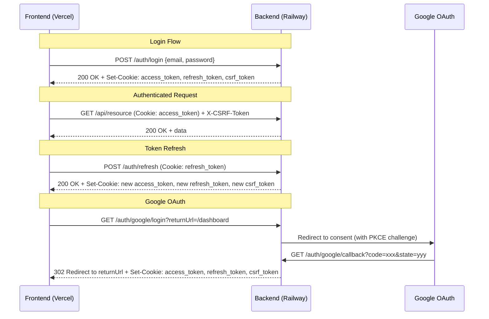
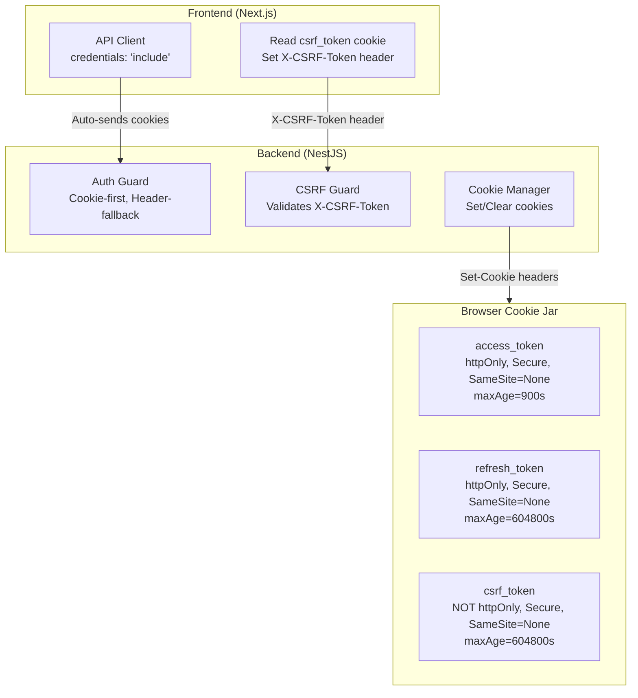

# Design Document: Secure Auth Cookies

## Overview

This design replaces the current localStorage-based JWT storage with httpOnly secure cookies, adding CSRF protection and Google OAuth via PKCE. The architecture addresses the cross-origin deployment constraint (Next.js on Vercel ↔ NestJS on Railway with different TLDs) by using `SameSite=None; Secure` cookies with proper CORS configuration.

The core changes span three layers:
1. **Backend Cookie Manager** — a utility service that sets/clears httpOnly cookies on responses
2. **Auth Guard Enhancement** — dual-mode token extraction (cookie-first, header-fallback)
3. **Frontend API Client** — switch to `credentials: 'include'` and CSRF header injection

### Key Design Decisions

| Decision | Choice | Rationale |
|----------|--------|-----------|
| Cookie transport | `SameSite=None; Secure` | Required for cross-origin (Vercel ↔ Railway on different TLDs) |
| CSRF strategy | Double-submit cookie pattern | Stateless, no server-side CSRF store needed |
| Token in response body | Removed | Tokens live only in httpOnly cookies; prevents XSS exfiltration |
| Auth guard mode | Cookie-first, header-fallback | Maintains backward compat for API keys and programmatic access |
| PKCE for Google OAuth | SHA-256 code challenge | Prevents authorization code interception in browser-based flows |
| Dev login | Backend endpoint sets cookies | Eliminates client-side mock tokens, uses same cookie flow as production |

## Architecture



### Cookie Architecture



## Components and Interfaces

### 1. CookieService (Backend)

A new injectable NestJS service responsible for all cookie operations.

**Location:** `apps/api/src/auth/cookie/cookie.service.ts`

```typescript
interface CookieOptions {
  httpOnly: boolean;
  secure: boolean;
  sameSite: 'strict' | 'lax' | 'none';
  maxAge: number; // seconds
  path: string;
  domain?: string;
}

interface CookieService {
  setAuthCookies(res: Response, accessToken: string, refreshToken: string): void;
  setCsrfCookie(res: Response, csrfToken: string): void;
  clearAuthCookies(res: Response): void;
  getAccessToken(req: Request): string | undefined;
  getRefreshToken(req: Request): string | undefined;
  getCookieOptions(cookieType: 'access' | 'refresh' | 'csrf'): CookieOptions;
}
```

**Environment-adaptive behavior:**
- `isLocalhost()` → `sameSite: 'lax'`, `secure: false`
- Production → `sameSite: 'none'`, `secure: true`
- Cross-origin TLDs → `domain` attribute omitted (browser scopes to the setting origin)

### 2. CsrfGuard (Backend)

A new NestJS guard that validates CSRF tokens on state-changing requests.

**Location:** `apps/api/src/auth/csrf/csrf.guard.ts`

```typescript
interface CsrfGuard extends CanActivate {
  canActivate(context: ExecutionContext): boolean;
}
```

**Logic:**
1. If request method is GET, HEAD, or OPTIONS → skip
2. If no cookies present on request (API key auth) → skip
3. Extract `X-CSRF-Token` header value
4. Extract `csrf_token` cookie value
5. Compare using timing-safe equality → 403 if mismatch or missing

### 3. Updated AuthGuard (Backend)

**Location:** `apps/api/src/auth/auth.guard.ts` (modified)

Token extraction order:
1. Read `access_token` cookie via `CookieService.getAccessToken(req)`
2. If absent, fall back to `Authorization: Bearer <token>` header
3. If token starts with `strata_` → API key validation (existing logic)
4. Otherwise → JWT verification

The `dev-mock-token` bypass is removed.

### 4. Updated AuthController (Backend)

**Location:** `apps/api/src/auth/auth.controller.ts` (modified)

New/modified endpoints:

| Endpoint | Method | Description |
|----------|--------|-------------|
| `/auth/login` | POST | Validates credentials, sets auth cookies, returns `{ success: true }` |
| `/auth/refresh` | POST | Reads refresh token from cookie, rotates, sets new cookies |
| `/auth/logout` | POST | Clears cookies, deletes refresh token from DB |
| `/auth/me` | GET | Returns user profile from cookie JWT |
| `/auth/dev-login` | POST | Sets dev user cookies (non-production only) |
| `/auth/google/login` | GET | Initiates Google OAuth with PKCE |
| `/auth/google/callback` | GET | Handles Google callback, sets cookies, redirects |

### 5. Updated API Client (Frontend)

**Location:** `apps/web/src/lib/api-client.ts` (modified)

Key changes:
- All `fetch` calls include `credentials: 'include'`
- Remove `Authorization` header injection for standard requests
- Read `csrf_token` from `document.cookie` and set `X-CSRF-Token` header on POST/PUT/PATCH/DELETE
- On 401: call `/auth/refresh` with `credentials: 'include'`, retry original request
- On refresh 401: redirect to `/login`

### 6. Updated Auth Store (Frontend)

**Location:** `apps/web/src/lib/auth.ts` (modified)

Key changes:
- Remove all `localStorage` read/write for tokens
- `isAuthenticated` derived from `/auth/me` response on mount
- `login()` calls backend, success determined by response status (cookies set automatically)
- `devLogin()` calls `/auth/dev-login` with `credentials: 'include'`
- `logout()` calls `/auth/logout` with `credentials: 'include'`

### 7. Google OAuth Controller (Backend)

**Location:** `apps/api/src/auth/oidc/google.controller.ts` (new)

Reuses the existing `OidcService` infrastructure with additions for:
- PKCE: generates `code_verifier` (43-128 char random string), derives `code_challenge` via SHA-256
- Stores `code_verifier` in Redis alongside existing SSO state
- Passes `code_challenge` and `code_challenge_method=S256` in authorization URL
- On callback: includes `code_verifier` in token exchange request
- Validates ID token signature against Google JWKS (`https://www.googleapis.com/oauth2/v3/certs`)

## Data Models

### Cookie Schema

| Cookie Name | httpOnly | Secure | SameSite | MaxAge | Path | Domain |
|-------------|----------|--------|----------|--------|------|--------|
| `access_token` | ✓ | ✓ (prod) | `none` (prod) / `lax` (local) | 900s | `/` | omitted |
| `refresh_token` | ✓ | ✓ (prod) | `none` (prod) / `lax` (local) | 604800s | `/auth` | omitted |
| `csrf_token` | ✗ | ✓ (prod) | `none` (prod) / `lax` (local) | 604800s | `/` | omitted |

**Note:** The `refresh_token` cookie path is restricted to `/auth` so it is only sent on auth-related requests (login, refresh, logout), reducing exposure surface.

### SSO State (Extended for PKCE)

```typescript
interface SSOState {
  organizationId: string;
  returnUrl: string;
  nonce: string;
  codeVerifier?: string; // Added for PKCE flows
}
```

### Session Endpoint Response

```typescript
interface MeResponse {
  id: string;
  email: string;
  name: string;
  roles: string[];
}
```

### Environment Variables (New/Modified)

| Variable | Purpose | Example |
|----------|---------|---------|
| `GOOGLE_CLIENT_ID` | Google OAuth client ID | `123456.apps.googleusercontent.com` |
| `GOOGLE_CLIENT_SECRET` | Google OAuth client secret | `GOCSPX-xxxxx` |
| `GOOGLE_CALLBACK_URL` | Google OAuth redirect URI | `https://strataapi-production-8f73.up.railway.app/auth/google/callback` |
| `CORS_ORIGIN` | Allowed frontend origin | `https://strata-web-xi.vercel.app` |
| `COOKIE_SECURE` | Override cookie secure flag | `true` (auto-detected from env) |

## Correctness Properties

*A property is a characteristic or behavior that should hold true across all valid executions of a system—essentially, a formal statement about what the system should do. Properties serve as the bridge between human-readable specifications and machine-verifiable correctness guarantees.*

### Property 1: Cookie attributes correctness

*For any* token value (access or refresh), calling the cookie-setting function SHALL produce a cookie with `httpOnly=true`, `secure=true` (in production), and `sameSite='none'` (in production), and the resulting cookie string SHALL contain these attributes.

**Validates: Requirements 1.1, 1.2, 1.5**

### Property 2: Logout clears all auth cookies

*For any* authenticated session (regardless of how the user logged in), calling the logout cookie-clearing function SHALL produce Set-Cookie headers for `access_token`, `refresh_token`, and `csrf_token` with `maxAge` ≤ 0 (expired).

**Validates: Requirements 1.7, 10.3**

### Property 3: Auth guard token extraction priority

*For any* request carrying both a valid JWT in the `access_token` cookie and a different valid JWT in the `Authorization: Bearer` header, the auth guard SHALL use the cookie token (the decoded `user.sub` on the request SHALL match the cookie token's subject, not the header token's subject).

**Validates: Requirements 2.1, 2.2**

### Property 4: Auth guard rejects invalid tokens

*For any* expired, malformed, or tampered JWT placed in the `access_token` cookie (with no valid Authorization header fallback), the auth guard SHALL throw an UnauthorizedException resulting in HTTP 401.

**Validates: Requirements 2.4**

### Property 5: Session endpoint returns correct user profile

*For any* valid JWT payload containing `sub` and `email` claims, the `/auth/me` endpoint SHALL return a response body containing matching `id` (equal to `sub`) and `email` fields.

**Validates: Requirements 2.3, 6.1**

### Property 6: CSRF enforcement on state-changing requests

*For any* request with method POST, PUT, PATCH, or DELETE that carries an `access_token` cookie, if the `X-CSRF-Token` header is missing or does not match the `csrf_token` cookie value, the CSRF guard SHALL reject the request with HTTP 403.

**Validates: Requirements 4.2, 4.3**

### Property 7: CSRF bypass for non-cookie authentication

*For any* request authenticated via API key (Authorization header with `strata_` prefix) that does NOT carry an `access_token` cookie, the CSRF guard SHALL allow the request regardless of whether `X-CSRF-Token` is present.

**Validates: Requirements 4.4**

### Property 8: PKCE code challenge derivation

*For any* generated PKCE code verifier string (43–128 characters, unreserved URI characters), the derived code challenge SHALL equal the base64url encoding (without padding) of the SHA-256 hash of the code verifier.

**Validates: Requirements 5.2**

### Property 9: Token rotation invariant

*For any* valid refresh token stored in the database, calling the refresh operation SHALL delete the original token from the database AND create exactly one new refresh token record with a different token value and a fresh expiry time in the future.

**Validates: Requirements 7.2, 7.3**

### Property 10: Refresh with invalid token clears cookies

*For any* refresh request where the `refresh_token` cookie contains a value not present in the database (or is missing), the auth service SHALL respond with HTTP 401 AND the response SHALL include Set-Cookie headers that clear all auth cookies.

**Validates: Requirements 7.4**

### Property 11: Environment-adaptive cookie configuration

*For any* environment where the server origin is NOT localhost, the cookie options SHALL have `secure=true` and `sameSite='none'`. Conversely, for any localhost environment, the cookie options SHALL have `secure=false` and `sameSite='lax'`. In both cases, when frontend and backend are on different top-level domains, the `domain` attribute SHALL be omitted.

**Validates: Requirements 9.2, 9.3, 9.5**

### Property 12: Logout deletes refresh token from database

*For any* logout request carrying a valid `refresh_token` cookie, after the logout operation completes, querying the database for that token value SHALL return no results.

**Validates: Requirements 10.2**

## Error Handling

| Scenario | HTTP Status | Response | Cookies |
|----------|-------------|----------|---------|
| Invalid credentials on login | 401 | `{ message: "Invalid email or password" }` | None set |
| Account locked | 429 | `{ message: "Account locked..." }` | None set |
| Missing/invalid access token cookie | 401 | `{ message: "Missing authentication token" }` | None |
| Expired access token cookie | 401 | `{ message: "Invalid or expired token" }` | None |
| Missing/invalid refresh token | 401 | `{ message: "Invalid refresh token" }` | Clear all auth cookies |
| Expired refresh token | 401 | `{ message: "Refresh token has expired" }` | Clear all auth cookies |
| Missing CSRF token on POST/PUT/PATCH/DELETE | 403 | `{ message: "CSRF token missing or invalid" }` | None |
| CSRF token mismatch | 403 | `{ message: "CSRF token missing or invalid" }` | None |
| Dev login in production | 404 | Route not found | None |
| Google OAuth state expired | 400 | Redirect to `/login?error=...` | None |
| Google OAuth user not provisioned | 400 | Redirect to `/login?error=...` | None |

### Frontend Error Recovery

1. **401 on any API call** → silently call `/auth/refresh` → retry original request
2. **401 on refresh** → clear auth store → redirect to `/login`
3. **403 CSRF** → re-read CSRF cookie → retry once (cookie may have been refreshed)
4. **Network error** → show error toast, no auth state change

## Testing Strategy

### Property-Based Tests (fast-check)

The project will use [fast-check](https://github.com/dubzzz/fast-check) for property-based testing in TypeScript/Jest.

Each property test runs a minimum of **100 iterations** and is tagged with a comment referencing the design property.

**Feature: secure-auth-cookies, Property {N}: {title}**

Properties suitable for PBT:
- Property 1: Cookie attributes correctness — generate random token strings, verify cookie output
- Property 2: Logout clears cookies — generate random session states, verify clearing
- Property 3: Auth guard extraction priority — generate JWT pairs, verify cookie wins
- Property 4: Auth guard rejects invalid tokens — generate invalid JWTs (expired, bad signature, malformed)
- Property 6: CSRF enforcement — generate random methods × CSRF presence combinations
- Property 7: CSRF bypass for API keys — generate API key requests without cookies
- Property 8: PKCE derivation — generate random code verifiers, verify SHA-256 relationship
- Property 9: Token rotation — generate refresh scenarios, verify DB state invariant
- Property 10: Refresh invalid clears cookies — generate invalid tokens, verify clear behavior
- Property 11: Environment-adaptive config — generate environment configs, verify cookie options
- Property 12: Logout DB cleanup — generate tokens, verify deletion

### Unit Tests (Jest)

Specific examples and edge cases:
- Cookie maxAge values are exactly 900 and 604800
- Dev login only available when `NODE_ENV !== 'production'`
- `dev-mock-token` bypass removed from auth guard
- `/auth/me` returns 401 without cookie
- Frontend calls `/auth/me` on mount
- API client includes `credentials: 'include'`
- Logout without refresh cookie still returns 200

### Integration Tests

- Full login → authenticated request → refresh → logout flow
- Google OAuth initiation → callback → cookie setting → redirect
- Cross-origin CORS preflight with credentials
- CSRF token lifecycle (issue → validate → refresh → re-validate)

### Test Organization

```
apps/api/src/auth/__tests__/
  cookie.service.spec.ts          # Property tests for cookie logic
  csrf.guard.spec.ts              # Property tests for CSRF validation
  auth.guard.cookie.spec.ts       # Property tests for dual-mode guard
  auth.controller.cookie.spec.ts  # Integration tests for cookie endpoints
  google-oauth.spec.ts            # Integration tests for Google flow
apps/web/src/lib/__tests__/
  api-client.cookie.spec.ts       # Property tests for client credential handling
  auth.store.spec.ts              # Unit tests for auth store behavior
```
