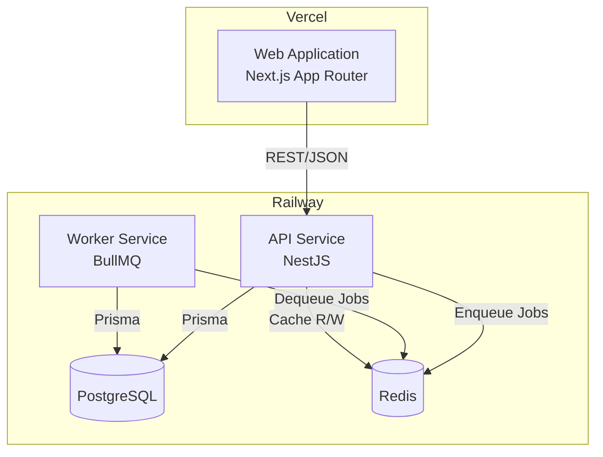
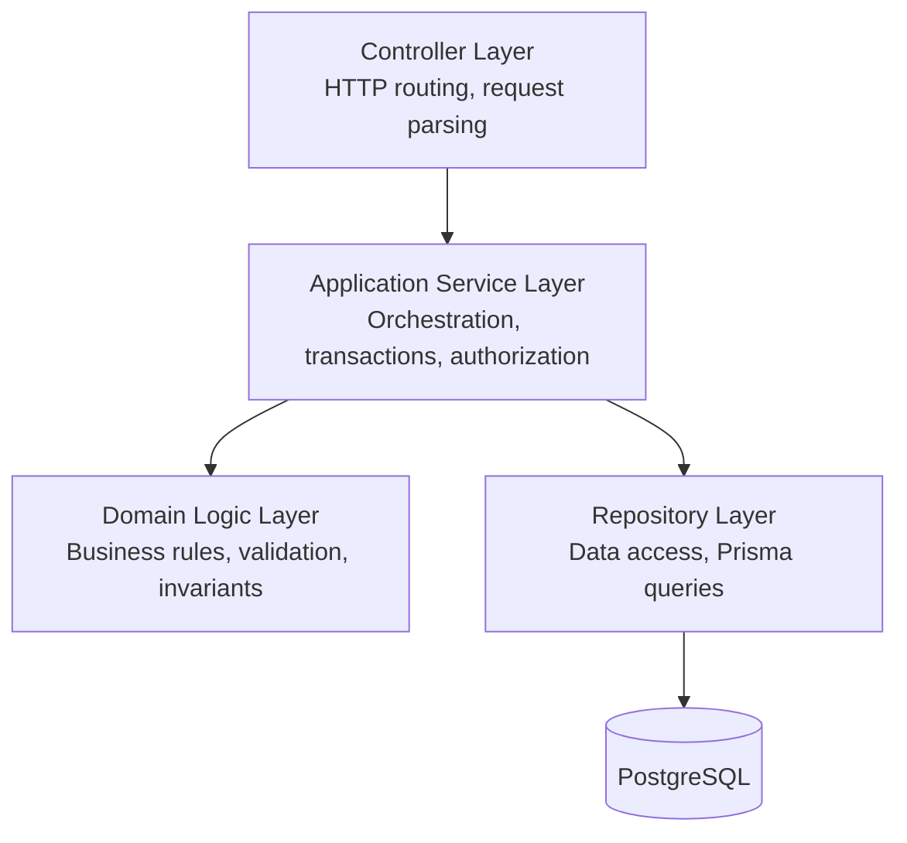
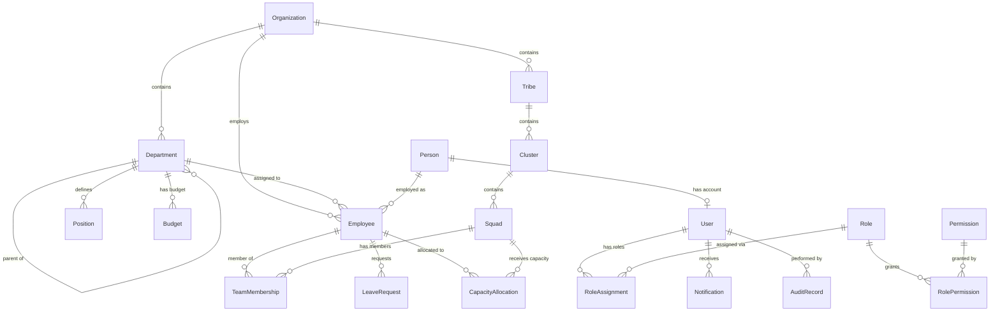

# Technical Design Document: Strata Platform

## Overview

Strata is an enterprise workforce management platform built as a TypeScript monorepo. The system manages organizational hierarchies, employees, capacity planning, budgeting, leave, engineering team structures, and reporting. It follows a layered architecture with a clear separation between the frontend (Next.js), backend API (NestJS), and background worker (BullMQ).

### Key Design Decisions

1. **Monorepo with shared packages** — Zod schemas, TypeScript types, and utility functions are shared between apps via internal packages, ensuring validation logic is never duplicated.
2. **Backend as source of truth** — All business rules live in the API service. The frontend performs optimistic validation using shared schemas but never enforces rules independently.
3. **Event-sourced audit trail** — Every domain mutation produces an immutable Audit_Record, enabling full historical reconstruction.
4. **Layered backend architecture** — Controller → Application Service → Domain Logic → Repository → Database. Domain logic is framework-agnostic and testable in isolation.
5. **Background job processing** — Resource-intensive operations (reports, bulk imports, notifications) are offloaded to BullMQ queues processed by the Worker service, keeping the API responsive.
6. **Modern enterprise UI/UX** — Dark mode as first-class citizen, Framer Motion animations, command palette navigation, progressive disclosure, skeleton loading, and card-based layouts for a data-dense yet readable interface.

### Technology Stack

| Layer | Technology |
|-------|-----------|
| Frontend | Next.js 14 (App Router), React 18, TypeScript, Tailwind CSS, Material UI, Framer Motion, xyflow/react |
| Backend | NestJS, TypeScript, Prisma ORM, PostgreSQL, Zod |
| Caching/Queues | Redis, BullMQ |
| Auth | JWT (access + refresh tokens), bcrypt |
| Build | pnpm workspaces, Turborepo |
| Hosting | Vercel (web), Railway (api, worker, PostgreSQL, Redis) |

---

## Architecture

### System Architecture Diagram



### Backend Layered Architecture



### Monorepo Structure

```
strata/
├── apps/
│   ├── web/              # Next.js frontend
│   ├── api/              # NestJS backend
│   └── worker/           # BullMQ job processor
├── packages/
│   ├── ui/               # Shared React components (design system)
│   ├── database/         # Prisma schema and client
│   ├── auth/             # Auth utilities (JWT, hashing)
│   ├── validation/       # Shared Zod schemas
│   ├── shared-types/     # TypeScript type definitions
│   ├── config/           # Shared configuration
│   └── utils/            # Common utility functions
├── turbo.json
├── pnpm-workspace.yaml
└── package.json
```

### Domain Module Structure (Backend)

Each domain module in the API follows:

```
src/modules/{domain}/
├── {domain}.controller.ts       # HTTP endpoints
├── {domain}.service.ts          # Application service (orchestration)
├── {domain}.domain.ts           # Pure domain logic (business rules)
├── {domain}.repository.ts       # Prisma data access
├── {domain}.module.ts           # NestJS module definition
├── dto/                         # Request/Response DTOs
│   ├── create-{entity}.dto.ts
│   └── update-{entity}.dto.ts
└── __tests__/                   # Unit and property tests
```

### Frontend Architecture (App Router)

```
apps/web/src/
├── app/                          # Next.js App Router pages
│   ├── (auth)/                   # Auth group (login, forgot-password)
│   ├── (dashboard)/              # Authenticated layout group
│   │   ├── layout.tsx            # AppShell with sidebar + header
│   │   ├── page.tsx              # Dashboard home
│   │   ├── people/
│   │   ├── employees/
│   │   ├── org-chart/
│   │   ├── engineering/
│   │   ├── capacity/
│   │   ├── budgets/
│   │   ├── leave/
│   │   ├── reports/
│   │   ├── audit/
│   │   └── settings/
│   ├── globals.css
│   └── providers.tsx             # Theme, Auth, Query providers
├── components/
│   ├── layout/                   # AppShell, Sidebar, Header, Breadcrumbs
│   ├── navigation/               # CommandPalette, SideNav, MobileNav
│   ├── data-display/             # DataTable, StatCards, Charts
│   ├── feedback/                 # Toast, Skeleton, EmptyState, ErrorBoundary
│   ├── forms/                    # FormBuilder, InputFields, Dropdowns
│   └── overlays/                 # Modals, Drawers, CommandPalette
├── hooks/                        # Custom React hooks
├── lib/                          # API client, utilities
├── stores/                       # Zustand stores (theme, notifications, sidebar)
└── styles/                       # Tailwind config extensions
```

---

## Components and Interfaces

### API Service Modules

#### Auth Module
- **AuthController** — `POST /auth/login`, `POST /auth/refresh`, `POST /auth/logout`
- **AuthService** — Credential validation, token issuance, refresh rotation, account lockout
- **AuthGuard** — JWT validation guard applied globally
- **PermissionGuard** — Checks Permission + Scope for each endpoint

#### People Module
- **PeopleController** — CRUD endpoints for Person records
- **PeopleService** — Validation orchestration, audit record creation
- **PeopleDomain** — Person validation rules (required fields, email format, date of birth constraints)

#### Employees Module
- **EmployeesController** — CRUD, status transitions, query endpoints
- **EmployeesService** — UIN generation, status machine transitions, audit
- **EmployeesDomain** — UIN uniqueness enforcement, status transition validation, termination rules

#### Organizations Module
- **OrganizationsController** — Department and Position CRUD
- **OrganizationsService** — Hierarchy management, circular reference detection
- **OrganizationsDomain** — Depth validation, deletion constraints

#### Engineering Module
- **EngineeringController** — Tribe/Cluster/Squad CRUD, Team Membership management
- **EngineeringService** — Hierarchy enforcement, capacity allocation orchestration
- **EngineeringDomain** — Hierarchy validation, capacity sum constraints

#### Capacity Module
- **CapacityController** — Allocation CRUD, capacity overview queries
- **CapacityService** — Allocation enforcement, audit creation
- **CapacityDomain** — Percentage validation (1-100), total capacity constraint (≤100%)

#### Budgeting Module
- **BudgetingController** — Budget CRUD, variance queries
- **BudgetingService** — Budget creation, spend calculation
- **BudgetingDomain** — Non-negative amount validation, variance computation

#### Leave Management Module
- **LeaveController** — Leave request CRUD, status transitions
- **LeaveService** — Overlap detection, notification triggering, status machine
- **LeaveDomain** — Date validation, overlap detection, valid transition rules

#### Permissions Module
- **PermissionsController** — Role CRUD, assignment management
- **PermissionsService** — Role assignment, cache invalidation
- **PermissionsDomain** — Scope resolution, permission evaluation logic

#### Audit Module
- **AuditController** — Query endpoints (read-only)
- **AuditService** — Record creation, paginated querying
- **AuditInterceptor** — NestJS interceptor that automatically captures entity changes

#### Reports Module
- **ReportsController** — Report request, listing, download endpoints
- **ReportsService** — Job enqueueing, report storage management
- **ReportGenerator** (Worker) — Headcount, capacity, budget, leave report processors

#### Notifications Module
- **NotificationsController** — Query, mark-as-read endpoints
- **NotificationsService** — Notification creation, delivery enqueueing
- **NotificationProcessor** (Worker) — Delivery processing from queue

#### Search Module
- **SearchController** — Full-text search endpoint
- **SearchService** — Query construction, result aggregation across entities

### Frontend Key Components

#### Layout & Navigation
- **AppShell** — Root layout with collapsible sidebar, sticky header, breadcrumbs, and content area with generous padding
- **ThemeProvider** — Light/dark theme switching with system preference detection and localStorage persistence
- **CommandPalette** — Global ⌘K/Ctrl+K quick navigation with fuzzy search across all entities and actions
- **Sidebar** — Collapsible navigation with icon-only mode, section grouping, active state indicators, and smooth Framer Motion collapse animation
- **Breadcrumbs** — Contextual breadcrumb trail with entity names, supporting click-to-navigate
- **NotificationBadge** — Animated unread count badge in header with dropdown panel
- **MobileNav** — Bottom tab navigation on mobile breakpoints with gesture support

#### Domain Pages
- **DashboardPage** — Overview with stat cards (headcount, capacity utilization, pending leave, budget variance), recent activity feed, and quick actions
- **PeoplePage** — DataTable with search/filter, inline quick-edit, and slide-over detail panel
- **EmployeesPage** — Employee listing with status badges, capacity indicators, and bulk actions
- **OrgChartPage** — Interactive xyflow/react visualization with minimap, custom node cards, and detail drawer
- **EngineeringPage** — Tribe/Cluster/Squad hierarchy with expandable tree view and drag-drop reordering
- **CapacityPage** — Allocation overview with stacked progress bars, heatmap, and allocation editor drawer
- **BudgetPage** — Budget vs. actual comparison with sparklines, variance indicators, and drill-down by department
- **LeavePage** — Leave request form with calendar visualization, approval workflow cards, and team absence timeline
- **ReportsPage** — Report listing cards with status badges, generation progress indicators, and download actions
- **AuditPage** — Searchable audit log with timeline view, diff viewer modal, and entity-linked navigation

#### Shared Components (packages/ui)
- **DataTable** — Paginated, sortable, filterable table with column resizing, row selection, skeleton loading rows, and empty state illustrations
- **SearchInput** — Debounced search (300ms) with typeahead suggestions, highlighted matching terms, and clear button
- **FormBuilder** — Zod-schema-driven form generation with inline validation, animated error messages, and field-level loading states
- **StatCard** — Metric display card with label, value, trend indicator, sparkline, and subtle hover elevation
- **ConfirmDialog** — Accessible confirmation modal with Framer Motion scale entrance
- **Toast** — Stacked toast notifications (success, error, info, warning) with auto-dismiss and progress indicator
- **Skeleton** — Content-aware skeleton loading components (table rows, cards, text blocks, avatars)
- **EmptyState** — Illustrated empty state with contextual action buttons
- **Badge** — Status badges with semantic colors and optional pulse animation for live states
- **Drawer** — Slide-over panel from right edge for detail views and forms, with Framer Motion slide animation
- **Avatar** — User avatar with fallback initials, online indicator, and size variants
- **ProgressBar** — Animated progress/capacity bar with color thresholds (green < 70%, yellow < 90%, red ≥ 90%)

### Worker Service Processors

| Processor | Queue Name | Responsibilities |
|-----------|-----------|-----------------|
| ReportProcessor | `reports` | Generate headcount, capacity, budget, leave reports |
| NotificationProcessor | `notifications` | Deliver notifications to users |
| ImportProcessor | `imports` | Process bulk data imports |

---

## UI/UX Design System

### Design Principles

1. **Data-dense but readable** — Enterprise users need information density. Use compact spacing within cards but generous whitespace between sections.
2. **Progressive disclosure** — Show summary first, details on demand. Expand/collapse sections, drawers for detail views, and multi-level navigation.
3. **Dark mode first-class** — Not an afterthought. Design color tokens, contrast ratios, and component states for both themes simultaneously.
4. **Motion with purpose** — Framer Motion animations provide spatial context (where things come from), confirm actions (toast appearance), and reduce perceived latency (skeleton → content transitions).
5. **Keyboard-first, mouse-friendly** — Command palette, keyboard shortcuts, focus management. All actions reachable without a mouse.

### Color System (CSS Custom Properties)

```css
/* Light theme */
--background: 0 0% 100%;
--foreground: 222.2 84% 4.9%;
--card: 0 0% 100%;
--card-foreground: 222.2 84% 4.9%;
--primary: 221.2 83.2% 53.3%;
--primary-foreground: 210 40% 98%;
--secondary: 210 40% 96.1%;
--muted: 210 40% 96.1%;
--muted-foreground: 215.4 16.3% 46.9%;
--destructive: 0 84.2% 60.2%;
--border: 214.3 31.8% 91.4%;
--ring: 221.2 83.2% 53.3%;

/* Dark theme */
--background: 222.2 84% 4.9%;
--foreground: 210 40% 98%;
--card: 222.2 84% 7%;
--card-foreground: 210 40% 98%;
--primary: 217.2 91.2% 59.8%;
--primary-foreground: 222.2 47.4% 11.2%;
--secondary: 217.2 32.6% 17.5%;
--muted: 217.2 32.6% 17.5%;
--muted-foreground: 215 20.2% 65.1%;
--destructive: 0 62.8% 30.6%;
--border: 217.2 32.6% 17.5%;
--ring: 224.3 76.3% 48%;
```

### Spacing and Layout Tokens

| Token | Value | Usage |
|-------|-------|-------|
| `--space-page` | 32px (2rem) | Page-level padding |
| `--space-section` | 24px (1.5rem) | Between major sections |
| `--space-card` | 16px (1rem) | Internal card padding |
| `--space-compact` | 8px (0.5rem) | Tight element spacing |
| `--radius-sm` | 6px | Buttons, inputs |
| `--radius-md` | 8px | Cards, panels |
| `--radius-lg` | 12px | Modals, drawers |
| `--radius-full` | 9999px | Avatars, badges |

### Animation Patterns (Framer Motion)

```typescript
// Page transition
export const pageTransition = {
  initial: { opacity: 0, y: 8 },
  animate: { opacity: 1, y: 0 },
  exit: { opacity: 0, y: -8 },
  transition: { duration: 0.2, ease: "easeOut" }
};

// Staggered list items
export const staggerContainer = {
  animate: { transition: { staggerChildren: 0.05 } }
};
export const staggerItem = {
  initial: { opacity: 0, y: 4 },
  animate: { opacity: 1, y: 0 }
};

// Drawer slide
export const drawerVariants = {
  hidden: { x: "100%" },
  visible: { x: 0, transition: { type: "spring", damping: 25, stiffness: 300 } },
  exit: { x: "100%", transition: { duration: 0.2 } }
};

// Toast entrance
export const toastVariants = {
  initial: { opacity: 0, y: 50, scale: 0.95 },
  animate: { opacity: 1, y: 0, scale: 1 },
  exit: { opacity: 0, scale: 0.95, transition: { duration: 0.15 } }
};

// Skeleton pulse (CSS-based for performance)
// Uses Tailwind's animate-pulse with custom timing

// Card hover elevation
export const cardHover = {
  whileHover: { y: -2, boxShadow: "0 8px 25px -5px rgba(0,0,0,0.1)" },
  transition: { type: "spring", stiffness: 400, damping: 25 }
};

// Collapse/expand sections
export const collapseVariants = {
  open: { height: "auto", opacity: 1 },
  closed: { height: 0, opacity: 0, overflow: "hidden" }
};
```

### Navigation Patterns

#### Command Palette (⌘K / Ctrl+K)
- Global search across all entities (people, employees, departments, squads)
- Quick actions: "Create employee", "View org chart", "Generate report"
- Recent items section
- Keyboard-navigable with arrow keys and Enter
- Fuzzy matching via client-side search index
- Renders in portal overlay with backdrop blur

#### Sidebar Navigation
- Two modes: expanded (labels visible) and collapsed (icons only)
- Section groups: Overview, People, Organization, Engineering, Finance, System
- Active item highlight with left border accent
- Notification count badges on relevant items
- Smooth collapse animation (200ms ease-in-out)
- Persisted collapse state in localStorage

#### Breadcrumbs
- Auto-generated from route segments
- Entity names resolved via React Query cache
- Truncation with ellipsis for deep paths
- Each segment is clickable for navigation

### Loading States

#### Skeleton Components
Each page has a matching skeleton layout that mirrors the content structure:

```typescript
// Example: EmployeeTable skeleton
function EmployeeTableSkeleton() {
  return (
    <div className="space-y-3">
      {/* Header skeleton */}
      <div className="flex justify-between items-center">
        <Skeleton className="h-8 w-48" />
        <Skeleton className="h-9 w-32 rounded-md" />
      </div>
      {/* Filter bar skeleton */}
      <div className="flex gap-2">
        <Skeleton className="h-9 w-64 rounded-md" />
        <Skeleton className="h-9 w-32 rounded-md" />
        <Skeleton className="h-9 w-32 rounded-md" />
      </div>
      {/* Table rows skeleton */}
      {Array.from({ length: 8 }).map((_, i) => (
        <div key={i} className="flex items-center gap-4 p-3">
          <Skeleton className="h-10 w-10 rounded-full" />
          <Skeleton className="h-4 w-40" />
          <Skeleton className="h-4 w-24" />
          <Skeleton className="h-5 w-16 rounded-full" />
        </div>
      ))}
    </div>
  );
}
```

#### Loading Strategy
- **Initial page load**: Full skeleton matching page layout
- **Data refresh**: Subtle loading indicator in header (thin progress bar)
- **Mutations**: Optimistic UI updates with rollback on error
- **Background fetches**: No visible loading state (stale-while-revalidate)

### Toast Notification System

```typescript
interface ToastConfig {
  variant: "success" | "error" | "info" | "warning";
  title: string;
  description?: string;
  duration?: number; // Default: 5000ms, error: 8000ms
  action?: { label: string; onClick: () => void };
}
```

- Stacked in bottom-right corner
- Maximum 3 visible simultaneously
- Auto-dismiss with progress indicator
- Hover pauses auto-dismiss timer
- Swipe-to-dismiss on touch devices
- Semantic icons per variant
- Action button for undo/retry operations

### Card-Based Layouts

Cards are the primary content container:

```
┌─────────────────────────────────────────────┐
│  [Icon] Title                    [Actions ⋮] │
│                                              │
│  Primary metric / content                    │
│                                              │
│  ─────────────────────────────────────────── │
│  Secondary info  │  Trend  │  Sparkline      │
└─────────────────────────────────────────────┘
```

- **StatCards** — KPI tiles on dashboards (2x2 or 4x1 grid)
- **EntityCards** — Preview cards in grid views (person, squad)
- **ActionCards** — Leave requests, reports with status and actions
- Consistent border-radius (8px), padding (16px), and shadow elevation
- Hover state: subtle Y-translation (-2px) and shadow increase

### Responsive Design Strategy

| Breakpoint | Layout | Navigation |
|-----------|--------|------------|
| < 640px (mobile) | Single column, stacked cards | Bottom tab bar |
| 640-1024px (tablet) | Two-column where appropriate | Collapsed sidebar (icons) |
| 1024-1440px (desktop) | Full layout with sidebar | Expanded sidebar |
| > 1440px (wide) | Max-width container (1400px) centered | Expanded sidebar |

- DataTable collapses to card list on mobile
- Drawers become full-screen modals on mobile
- Org chart uses pinch-to-zoom on touch devices
- Command palette adapts to full-screen on mobile

### Accessibility Implementation

- **Focus management**: Focus trapped in modals/drawers, restored on close
- **Skip navigation**: Skip-to-content link visible on focus
- **ARIA labels**: All interactive elements labeled, live regions for dynamic content
- **Reduced motion**: Respects `prefers-reduced-motion` — disables all Framer Motion animations
- **Color contrast**: Minimum 4.5:1 for text, 3:1 for large text and UI components in both themes
- **Screen reader**: Announce route changes, toast notifications, loading states via aria-live

---

## Data Models

### Core Entity Relationships



### Prisma Schema (Key Models)

```prisma
model Person {
  id          String     @id @default(cuid())
  fullName    String
  dateOfBirth DateTime
  email       String
  phone       String?
  address     String?
  createdAt   DateTime   @default(now())
  updatedAt   DateTime   @updatedAt
  employees   Employee[]
  user        User?
}

model Employee {
  id               String              @id @default(cuid())
  uin              String
  personId         String
  organizationId   String
  departmentId     String?
  positionId       String?
  startDate        DateTime
  endDate          DateTime?
  status           EmploymentStatus    @default(ACTIVE)
  createdAt        DateTime            @default(now())
  updatedAt        DateTime            @updatedAt

  person           Person              @relation(fields: [personId], references: [id])
  organization     Organization        @relation(fields: [organizationId], references: [id])
  department       Department?         @relation(fields: [departmentId], references: [id])
  position         Position?           @relation(fields: [positionId], references: [id])
  teamMemberships  TeamMembership[]
  capacityAllocations CapacityAllocation[]
  leaveRequests    LeaveRequest[]

  @@unique([uin, organizationId])
}

enum EmploymentStatus {
  ACTIVE
  ON_LEAVE
  TERMINATED
  SUSPENDED
}

model Organization {
  id          String       @id @default(cuid())
  name        String
  createdAt   DateTime     @default(now())
  updatedAt   DateTime     @updatedAt
  departments Department[]
  employees   Employee[]
  tribes      Tribe[]
}

model Department {
  id               String       @id @default(cuid())
  name             String
  description      String?
  parentId         String?
  organizationId   String
  createdAt        DateTime     @default(now())
  updatedAt        DateTime     @updatedAt

  parent           Department?  @relation("DepartmentHierarchy", fields: [parentId], references: [id])
  children         Department[] @relation("DepartmentHierarchy")
  organization     Organization @relation(fields: [organizationId], references: [id])
  positions        Position[]
  employees        Employee[]
  budgets          Budget[]
}

model Position {
  id             String     @id @default(cuid())
  title          String
  level          Int
  description    String?
  departmentId   String
  createdAt      DateTime   @default(now())
  updatedAt      DateTime   @updatedAt

  department     Department @relation(fields: [departmentId], references: [id])
  employees      Employee[]
}

model Tribe {
  id             String       @id @default(cuid())
  name           String
  organizationId String
  createdAt      DateTime     @default(now())
  updatedAt      DateTime     @updatedAt

  organization   Organization @relation(fields: [organizationId], references: [id])
  clusters       Cluster[]
}

model Cluster {
  id        String   @id @default(cuid())
  name      String
  tribeId   String
  createdAt DateTime @default(now())
  updatedAt DateTime @updatedAt

  tribe     Tribe    @relation(fields: [tribeId], references: [id])
  squads    Squad[]
}

model Squad {
  id        String   @id @default(cuid())
  name      String
  clusterId String
  createdAt DateTime @default(now())
  updatedAt DateTime @updatedAt

  cluster   Cluster  @relation(fields: [clusterId], references: [id])
  memberships TeamMembership[]
  allocations CapacityAllocation[]
}

model TeamMembership {
  id         String   @id @default(cuid())
  employeeId String
  squadId    String
  role       String?
  startDate  DateTime @default(now())
  endDate    DateTime?
  createdAt  DateTime @default(now())
  updatedAt  DateTime @updatedAt

  employee   Employee @relation(fields: [employeeId], references: [id])
  squad      Squad    @relation(fields: [squadId], references: [id])

  @@unique([employeeId, squadId])
}

model CapacityAllocation {
  id         String   @id @default(cuid())
  employeeId String
  squadId    String
  percentage Int
  createdAt  DateTime @default(now())
  updatedAt  DateTime @updatedAt

  employee   Employee @relation(fields: [employeeId], references: [id])
  squad      Squad    @relation(fields: [squadId], references: [id])

  @@unique([employeeId, squadId])
}

model Budget {
  id           String   @id @default(cuid())
  departmentId String
  fiscalPeriod String
  amount       Decimal  @db.Decimal(15, 2)
  createdAt    DateTime @default(now())
  updatedAt    DateTime @updatedAt

  department   Department @relation(fields: [departmentId], references: [id])
}

model LeaveRequest {
  id         String      @id @default(cuid())
  employeeId String
  type       LeaveType
  startDate  DateTime
  endDate    DateTime
  reason     String?
  status     LeaveStatus @default(PENDING)
  createdAt  DateTime    @default(now())
  updatedAt  DateTime    @updatedAt

  employee   Employee    @relation(fields: [employeeId], references: [id])
}

enum LeaveType {
  ANNUAL
  SICK
  PERSONAL
  PARENTAL
  UNPAID
}

enum LeaveStatus {
  PENDING
  APPROVED
  REJECTED
  CANCELLED
}

model User {
  id             String           @id @default(cuid())
  email          String           @unique
  passwordHash   String
  personId       String           @unique
  isLocked       Boolean          @default(false)
  lockedUntil    DateTime?
  failedAttempts Int              @default(0)
  createdAt      DateTime         @default(now())
  updatedAt      DateTime         @updatedAt

  person         Person           @relation(fields: [personId], references: [id])
  roleAssignments RoleAssignment[]
  notifications  Notification[]
  auditRecords   AuditRecord[]
  refreshTokens  RefreshToken[]
}

model RefreshToken {
  id        String   @id @default(cuid())
  token     String   @unique
  userId    String
  expiresAt DateTime
  createdAt DateTime @default(now())

  user      User     @relation(fields: [userId], references: [id])
}

model Role {
  id          String           @id @default(cuid())
  name        String           @unique
  description String?
  createdAt   DateTime         @default(now())
  updatedAt   DateTime         @updatedAt

  permissions RolePermission[]
  assignments RoleAssignment[]
}

model Permission {
  id       String           @id @default(cuid())
  action   String
  resource String
  createdAt DateTime        @default(now())

  roles    RolePermission[]

  @@unique([action, resource])
}

model RolePermission {
  id           String     @id @default(cuid())
  roleId       String
  permissionId String

  role         Role       @relation(fields: [roleId], references: [id])
  permission   Permission @relation(fields: [permissionId], references: [id])

  @@unique([roleId, permissionId])
}

model RoleAssignment {
  id     String         @id @default(cuid())
  userId String
  roleId String
  scope  PermissionScope

  user   User           @relation(fields: [userId], references: [id])
  role   Role           @relation(fields: [roleId], references: [id])

  @@unique([userId, roleId, scope])
}

enum PermissionScope {
  SELF
  TEAM
  ORGANIZATION
}

model Notification {
  id        String           @id @default(cuid())
  userId    String
  message   String
  type      NotificationType
  priority  NotificationPriority @default(NORMAL)
  isRead    Boolean          @default(false)
  createdAt DateTime         @default(now())
  readAt    DateTime?

  user      User             @relation(fields: [userId], references: [id])
}

enum NotificationType {
  LEAVE_REQUEST
  LEAVE_APPROVED
  LEAVE_REJECTED
  REPORT_READY
  SYSTEM_ALERT
  JOB_FAILED
}

enum NotificationPriority {
  LOW
  NORMAL
  HIGH
  URGENT
}

model AuditRecord {
  id          String   @id @default(cuid())
  userId      String
  entityType  String
  entityId    String
  operation   AuditOperation
  diff        Json
  timestamp   DateTime @default(now())

  user        User     @relation(fields: [userId], references: [id])

  @@index([entityType, entityId])
  @@index([userId])
  @@index([timestamp])
}

enum AuditOperation {
  CREATE
  UPDATE
  DELETE
}
```

### Redis Data Structures

| Key Pattern | Type | Purpose | TTL |
|------------|------|---------|-----|
| `permissions:{userId}` | Hash | Cached permission evaluations | 5 min |
| `session:{userId}` | String | Active session metadata | 15 min |
| `ratelimit:login:{email}` | String (counter) | Failed login attempt tracking | 15 min |
| `cache:dept:{orgId}` | String (JSON) | Department tree cache | 10 min |
| `cache:capacity:{employeeId}` | String (JSON) | Employee capacity summary | 2 min |

### BullMQ Queue Configuration

| Queue | Concurrency | Retry | Backoff |
|-------|------------|-------|---------|
| `reports` | 3 | 3 attempts | Exponential (1s, 4s, 16s) |
| `notifications` | 10 | 3 attempts | Exponential (500ms, 2s, 8s) |
| `imports` | 2 | 3 attempts | Exponential (2s, 8s, 32s) |

---

## Correctness Properties

*A property is a characteristic or behavior that should hold true across all valid executions of a system—essentially, a formal statement about what the system should do. Properties serve as the bridge between human-readable specifications and machine-verifiable correctness guarantees.*

### Property 1: Domain Object Serialization Round-Trip

*For any* valid domain object (Person, Employee, Department, Position, Tribe, Cluster, Squad, LeaveRequest, Budget, Notification), serializing it to JSON and then parsing it with the corresponding Zod schema SHALL produce an object equivalent to the original.

**Validates: Requirements 18.5**

### Property 2: Schema Validation Rejects Invalid Payloads with Field Errors

*For any* request payload that violates a Zod schema (missing required fields, wrong types, or containing unknown fields), the API SHALL return a 400 response containing an array of field-level error messages identifying each invalid field.

**Validates: Requirements 18.1, 18.2, 18.4**

### Property 3: UIN Uniqueness and Immutability

*For any* set of Employees within a single Organization, all UIN values SHALL be unique; and *for any* update operation on an Employee record, the UIN field SHALL remain unchanged from its originally assigned value.

**Validates: Requirements 2.2**

### Property 4: Employee Creation Requires Valid Person

*For any* Employee creation request where the referenced personId does not correspond to an existing Person record, the API SHALL reject the request with a descriptive error.

**Validates: Requirements 2.3**

### Property 5: Employee Filter Correctness

*For any* Employee query with filter criteria (department, position, status, date range), all returned Employee records SHALL match every specified filter criterion, and no Employee matching all criteria SHALL be excluded from the results.

**Validates: Requirements 2.5**

### Property 6: Employee Termination Soft-Delete

*For any* active Employee that is terminated, the system SHALL retain the Employee record with status TERMINATED and an end date set, and the record SHALL remain retrievable by its identifier.

**Validates: Requirements 2.6**

### Property 7: Department Hierarchy Depth

*For any* valid department hierarchy with a depth of up to 10 levels, the system SHALL accept all department creation operations without error.

**Validates: Requirements 3.2**

### Property 8: Department Circular Reference Detection

*For any* Department update that would create a circular parent reference (where a Department becomes a descendant of itself), the system SHALL reject the operation with a descriptive error.

**Validates: Requirements 3.3**

### Property 9: Department Deletion Constraint

*For any* Department containing one or more active Employees, a delete operation SHALL be rejected, and the response SHALL include the list of affected Employees.

**Validates: Requirements 3.5**

### Property 10: Engineering Hierarchy Enforcement

*For any* Squad creation without a valid parent Cluster, or any Cluster creation without a valid parent Tribe, the system SHALL reject the request with a descriptive error indicating the hierarchy violation.

**Validates: Requirements 5.1, 5.2**

### Property 11: Capacity Allocation Bounds

*For any* CapacityAllocation creation or update, the percentage value SHALL be an integer between 1 and 100 inclusive; values outside this range SHALL be rejected.

**Validates: Requirements 5.4, 6.1**

### Property 12: Total Capacity Constraint

*For any* Employee, the sum of all CapacityAllocation percentages across all Squads SHALL not exceed 100; any new allocation that would cause the total to exceed 100 SHALL be rejected with a descriptive error.

**Validates: Requirements 5.5, 6.2**

### Property 13: Budget Non-Negative Amount

*For any* Budget creation or update with a negative amount value, the system SHALL reject the request with a descriptive error.

**Validates: Requirements 7.2**

### Property 14: Budget Actual Spend Calculation

*For any* Department with associated Employee compensation data and a Budget record, the calculated actual spend SHALL equal the sum of compensation values for all active Employees in that Department during the fiscal period.

**Validates: Requirements 7.3**

### Property 15: Leave Request Overlap Detection

*For any* Employee with an existing approved leave request, a new leave request whose date range overlaps with the existing approved request SHALL be rejected with a descriptive error.

**Validates: Requirements 8.2**

### Property 16: Leave Status Machine Validity

*For any* leave request status transition, only the transitions PENDING→APPROVED, PENDING→REJECTED, and APPROVED→CANCELLED SHALL succeed; all other transitions SHALL be rejected, and the response SHALL include the list of valid transitions from the current state.

**Validates: Requirements 8.4, 8.5**

### Property 17: Permission Scope Evaluation

*For any* User action request, the system SHALL grant access if and only if the User has a RoleAssignment with a Permission matching the action and a Scope that covers the target entity; otherwise SHALL return 403 Forbidden.

**Validates: Requirements 9.2, 9.3**

### Property 18: Audit Record on Every Mutation

*For any* create, update, or delete operation on a domain entity, the system SHALL produce an AuditRecord containing the acting userId, timestamp, entityType, entityId, operation type, and a diff of changed fields.

**Validates: Requirements 10.1, 10.2, 1.3, 2.4, 6.3**

### Property 19: Audit Query Pagination Bound

*For any* audit record query, the response SHALL contain at most 100 records per page regardless of the total matching record count.

**Validates: Requirements 10.3**

### Property 20: Notification Filter Correctness

*For any* notification query with filters (read status, type, date range), all returned notifications SHALL match every specified filter criterion.

**Validates: Requirements 12.5**

### Property 21: Password Hash Verification Round-Trip

*For any* password string, hashing with bcrypt and then verifying the original password against the hash SHALL return true, and verifying any different password SHALL return false.

**Validates: Requirements 13.1**

### Property 22: Token Expiration Bounds

*For any* successful authentication, the issued JWT access token SHALL have an expiration claim no greater than 15 minutes from issuance, and the refresh token SHALL have an expiration no greater than 7 days from issuance.

**Validates: Requirements 13.2**

### Property 23: Invalid Token Rejection

*For any* request bearing a malformed, tampered, or expired JWT access token, the system SHALL return a 401 Unauthorized response.

**Validates: Requirements 13.3**

### Property 24: Account Lockout Threshold

*For any* email address, if 5 or more failed login attempts occur within a 15-minute window, the system SHALL lock the account for 30 minutes, rejecting subsequent login attempts even with correct credentials during the lockout period.

**Validates: Requirements 13.5**

### Property 25: Search and Filter Correctness

*For any* combined search query and filter criteria, all returned results SHALL contain the search term in at least one searchable field AND satisfy all specified filter criteria; no record matching both conditions SHALL be excluded.

**Validates: Requirements 14.1, 14.3**

### Property 26: Cache Invalidation Freshness

*For any* cached data entry, after the underlying data is modified and the cache is invalidated, the next read request SHALL return the updated data rather than stale cached data.

**Validates: Requirements 16.4**

---

## Error Handling

### Error Response Format

All API errors follow a consistent JSON structure:

```typescript
interface ApiError {
  statusCode: number;
  error: string;
  message: string;
  details?: FieldError[];
  timestamp: string;
  path: string;
  requestId: string;
}

interface FieldError {
  field: string;
  message: string;
  value?: unknown;
}
```

### HTTP Status Code Strategy

| Status | Usage |
|--------|-------|
| 400 Bad Request | Validation failures (Zod schema, business rule violations) |
| 401 Unauthorized | Missing, expired, or invalid authentication token |
| 403 Forbidden | Authenticated but insufficient permissions/scope |
| 404 Not Found | Entity does not exist |
| 409 Conflict | Uniqueness violations (duplicate UIN, overlapping leave) |
| 422 Unprocessable Entity | Semantically invalid (circular reference, capacity overflow) |
| 429 Too Many Requests | Rate limit exceeded (login lockout) |
| 500 Internal Server Error | Unhandled exceptions |

### Domain-Specific Error Handling

| Domain | Error Condition | Response |
|--------|----------------|----------|
| Employee | UIN already exists in org | 409 with existing UIN info |
| Employee | Person not found | 400 with field error on personId |
| Department | Circular parent reference | 422 with cycle path |
| Department | Has active employees on delete | 409 with employee list |
| Capacity | Total exceeds 100% | 422 with current total and remaining |
| Leave | Overlapping approved request | 409 with conflicting dates |
| Leave | Invalid status transition | 422 with valid transitions list |
| Auth | Account locked | 429 with lockout remaining duration |
| Budget | Negative amount | 400 with field error on amount |

### Frontend Error Handling

- **Network errors**: Toast notification with retry action
- **Validation errors (400)**: Inline field-level error messages with animated appearance (Framer Motion)
- **Auth errors (401)**: Redirect to login with return URL preserved
- **Permission errors (403)**: In-page error state with explanation of required permissions
- **Not found (404)**: Custom 404 page with navigation suggestions
- **Server errors (500)**: Full-page error boundary with incident ID for support

### Global Exception Filter

A NestJS exception filter catches all unhandled errors, logs them with correlation IDs (request ID), and returns sanitized error responses (no stack traces or internal details in production).

### Retry and Resilience

- Background jobs: 3 retries with exponential backoff (configured per queue)
- Redis connection: Automatic reconnection with backoff
- Database connections: Prisma connection pool with configurable limits
- API client (frontend): Automatic retry for 5xx errors with exponential backoff via React Query

---

## Testing Strategy

### Testing Pyramid

```
         ╱╲
        ╱ E2E ╲         — Few: Critical user flows (Playwright)
       ╱────────╲
      ╱Integration╲     — Moderate: API endpoints, DB queries
     ╱──────────────╲
    ╱  Property-Based  ╲  — Many: Domain invariants (100+ iterations)
   ╱────────────────────╲
  ╱    Unit (Example)     ╲ — Many: Specific cases, edge cases
 ╱────────────────────────────╲
```

### Test Framework Configuration

| Layer | Tool | Location |
|-------|------|----------|
| Unit + Property | Vitest + fast-check | `apps/api/src/**/__tests__/` |
| Integration | Vitest + Supertest | `apps/api/src/**/__tests__/integration/` |
| Component | Vitest + React Testing Library | `apps/web/src/**/__tests__/` |
| E2E | Playwright | `apps/web/e2e/` |
| Accessibility | axe-core + Playwright | `apps/web/e2e/a11y/` |
| Visual Regression | Playwright screenshot comparison | `apps/web/e2e/visual/` |

### Property-Based Testing (fast-check)

**Library:** [fast-check](https://github.com/dubzzz/fast-check) for TypeScript property-based testing.

**Configuration:**
- Minimum 100 iterations per property test
- Each test tagged with: `Feature: strata-platform, Property {N}: {title}`
- Custom arbitraries for domain objects (Person, Employee, Department, etc.)
- Shared generators in `packages/validation/__tests__/arbitraries/`

**Property tests cover:**
- Serialization round-trips (Property 1)
- Schema validation behavior (Property 2)
- Domain invariants: UIN uniqueness, capacity constraints, hierarchy rules (Properties 3-12)
- State machine transitions: leave status, employment status (Property 16)
- Permission evaluation logic (Property 17)
- Audit record generation (Properties 18-19)
- Authentication security rules (Properties 21-24)
- Search correctness (Property 25)
- Cache freshness (Property 26)

### Unit Testing (Example-Based)

Unit tests complement property tests for:
- Specific concrete examples demonstrating correct behavior
- Integration points between modules
- Error message content verification
- UI component rendering and interaction
- Edge cases not covered by property generators
- Accessibility compliance checks (axe-core)

### Integration Testing

- API endpoint tests using Supertest with a test PostgreSQL database (Docker)
- Redis cache integration tests
- BullMQ job processing integration tests
- Database migration and seeding tests
- Full authentication flow tests (login, refresh, lockout)

### Frontend-Specific Testing

- **Component tests**: React Testing Library for all shared UI components
- **Accessibility tests**: axe-core automated checks on all page components
- **Theme tests**: Verify color contrast in both light and dark modes
- **Animation tests**: Verify reduced-motion preference disables animations
- **E2E flows**: Playwright for critical user journeys (login, create employee, submit leave, generate report)

### Coverage Targets

| Type | Target |
|------|--------|
| Domain logic (pure functions) | 95% |
| Application services | 85% |
| Controllers | 80% |
| Frontend components | 75% |
| Overall | 80% |
