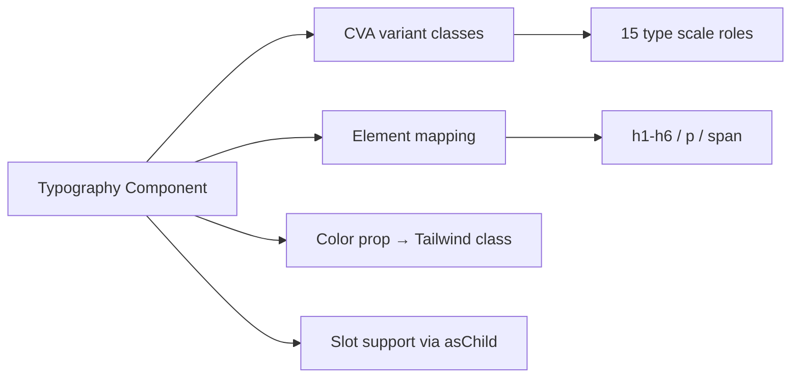

# Design Document: Typography & Deep Audit

## Overview

This design covers three coordinated efforts for the `@strata/mui` component library:

1. **Typography Component** — A new `Typography` component implementing all 15 M3 type scale roles using CVA (class-variance-authority) with the same patterns established across the library (forwardRef, `cn()` merging, Slot support).

2. **Deep Audit** — A systematic pass across all 36+ components to correct deviations from M3 Expressive specs in: spacing/sizing, shape, color roles, elevation, state layers, cursor states, motion/easing, z-index, type scale usage, Tailwind v4 canonical classes, touch targets, transition specificity, disabled states, overflow/truncation, focus rings, icon sizing, density variants, ripple absence, scrim opacity, and component composability.

3. **Sidebar Animation Fix** — Correcting the docs site collapsible sidebar so expand transitions are as smooth as collapse (eliminating the current "snap open" behavior).

### Key Research Findings

- **M3 Type Scale**: 15 roles across 5 categories × 3 sizes. Values are well-established: display (57/45/36px), headline (32/28/24px), title (22/16/14px), body (16/14/12px), label (14/12/11px). Font weights: display/headline/body use 400, title/label use 500. ([M3 Typography Specs](https://m3.material.io/styles/typography/type-scale-tokens))
- **M3 Motion Easing**: Three main curves already in `theme.css` — standard `cubic-bezier(0.2, 0, 0, 1)` for enter, accelerate `cubic-bezier(0.4, 0, 1, 1)` for exit, emphasized `cubic-bezier(0, 0, 0, 1)` for large-scale. ([MD3 Easing Reference](https://gist.github.com/rootEnginear/eecd07922aee588b84a9ed390ab5d553))
- **Existing Library Patterns**: All components use CVA + `cn()` from `tailwind-merge`, `React.forwardRef`, `"use client"` directive, and the `Icon` component for icons. State layers via `::before` pseudo-element with `bg-[hsl(var(--token)/opacity)]`. No ripple effects.
- **Sidebar Issue**: The collapsible sections use `grid-rows-[1fr]/grid-rows-[0fr]` with `transition-[grid-template-rows,opacity]`. The "snap open" happens because content height isn't pre-known — needs explicit handling for the expand direction.

## Architecture

### Typography Component

The Typography component is a thin styling wrapper — no complex behavior, state, or external dependencies. It maps a `variant` prop to the correct CSS classes for each of the 15 type roles, renders the semantically appropriate HTML element, and forwards all props/refs.



### Deep Audit Strategy

The audit follows a **systematic per-component pass** rather than a per-dimension pass. Each component is audited against all 20 dimensions in a single visit, reducing context-switching and ensuring coherent changes.

```mermaid
graph TD
    A[Audit Checklist] --> B[Per-Component Pass]
    B --> C[Spacing & Sizing]
    B --> D[Shape / Border Radius]
    B --> E[Colors & Background]
    B --> F[Elevation & Shadow]
    B --> G[State Layers]
    B --> H[Cursor States]
    B --> I[Motion & Easing]
    B --> J[Z-Index]
    B --> K[Type Scale Usage]
    B --> L[Tailwind v4 Canonical]
    B --> M[Touch Targets]
    B --> N[Transition Specificity]
    B --> O[Disabled States]
    B --> P[Overflow & Truncation]
    B --> Q[Focus Rings]
    B --> R[Icon Sizing]
    B --> S[Density Variants]
    B --> T[No Ripple]
    B --> U[Scrim Opacity]
    B --> V[Composability]
```



**Audit Order** (by complexity/dependency):
1. Buttons (foundation — other components reference these)
2. Icon, Badge, Divider (simple, reused)
3. Chip, Switch, Checkbox, Radio, Slider (controls)
4. Tabs, List, Menu (navigation/lists)
5. Card, Toolbar, App Bar (containers)
6. Dialog, Sheets, Snackbar, Tooltip (overlays)
7. Search, Text Field (inputs)
8. Navigation Bar, Navigation Rail (navigation)
9. Carousel, Pickers, Indicators (complex)

### Sidebar Fix

The fix uses CSS `grid-template-rows` animation (already in place) but adds `will-change` and ensures the `0fr → 1fr` transition is triggered properly. The issue is that `grid-rows-[0fr]` to `grid-rows-[1fr]` animates smoothly in modern browsers, but the content inside needs `min-height: 0` on the overflow container and the transition timing must match in both directions.

## Components and Interfaces

### Typography Component API

```typescript
import { cva, type VariantProps } from "class-variance-authority";

// The 15 M3 type scale roles
type TypographyVariant =
  | "display-large" | "display-medium" | "display-small"
  | "headline-large" | "headline-medium" | "headline-small"
  | "title-large" | "title-medium" | "title-small"
  | "body-large" | "body-medium" | "body-small"
  | "label-large" | "label-medium" | "label-small";

// M3 color token names for text color
type TypographyColor =
  | "surface-foreground"        // default
  | "surface-variant-foreground"
  | "primary"
  | "secondary"
  | "tertiary"
  | "error"
  | "primary-container-foreground"
  | "secondary-container-foreground"
  | "tertiary-container-foreground";

interface TypographyProps extends React.HTMLAttributes<HTMLElement> {
  /** M3 type scale role. Default: "body-medium" */
  variant?: TypographyVariant;
  /** Override the rendered HTML element */
  as?: React.ElementType;
  /** Text color from M3 color tokens. Default: "surface-foreground" */
  color?: TypographyColor;
  /** Render as child element (Radix Slot pattern) */
  asChild?: boolean;
  /** Additional class names (merged via cn/tailwind-merge) */
  className?: string;
  /** React ref forwarded to the root element */
  ref?: React.Ref<HTMLElement>;
}
```

### Element Mapping

Each variant maps to a default HTML element:

| Category | Variant | Default Element |
|----------|---------|-----------------|
| Display | display-large | `<h1>` |
| Display | display-medium | `<h2>` |
| Display | display-small | `<h3>` |
| Headline | headline-large | `<h2>` |
| Headline | headline-medium | `<h3>` |
| Headline | headline-small | `<h4>` |
| Title | title-large | `<h5>` |
| Title | title-medium | `<h6>` |
| Title | title-small | `<h6>` |
| Body | body-large | `<p>` |
| Body | body-medium | `<p>` |
| Body | body-small | `<p>` |
| Label | label-large | `<span>` |
| Label | label-medium | `<span>` |
| Label | label-small | `<span>` |

### CVA Variant Definitions (Type Scale Values)

```typescript
const typographyVariants = cva("", {
  variants: {
    variant: {
      "display-large":  "text-[57px] leading-[64px] font-normal tracking-[-0.25px]",
      "display-medium": "text-[45px] leading-[52px] font-normal tracking-normal",
      "display-small":  "text-[36px] leading-[44px] font-normal tracking-normal",
      "headline-large": "text-[32px] leading-[40px] font-normal tracking-normal",
      "headline-medium":"text-[28px] leading-[36px] font-normal tracking-normal",
      "headline-small": "text-[24px] leading-[32px] font-normal tracking-normal",
      "title-large":    "text-[22px] leading-[28px] font-normal tracking-normal",
      "title-medium":   "text-[16px] leading-[24px] font-medium tracking-[0.15px]",
      "title-small":    "text-[14px] leading-[20px] font-medium tracking-[0.1px]",
      "body-large":     "text-[16px] leading-[24px] font-normal tracking-[0.5px]",
      "body-medium":    "text-[14px] leading-[20px] font-normal tracking-[0.25px]",
      "body-small":     "text-[12px] leading-[16px] font-normal tracking-[0.4px]",
      "label-large":    "text-[14px] leading-[20px] font-medium tracking-[0.1px]",
      "label-medium":   "text-[12px] leading-[16px] font-medium tracking-[0.5px]",
      "label-small":    "text-[11px] leading-[16px] font-medium tracking-[0.5px]",
    },
    color: {
      "surface-foreground": "text-surface-foreground",
      "surface-variant-foreground": "text-surface-variant-foreground",
      "primary": "text-primary",
      "secondary": "text-secondary",
      "tertiary": "text-tertiary",
      "error": "text-error",
      "primary-container-foreground": "text-primary-container-foreground",
      "secondary-container-foreground": "text-secondary-container-foreground",
      "tertiary-container-foreground": "text-tertiary-container-foreground",
    },
  },
  defaultVariants: {
    variant: "body-medium",
    color: "surface-foreground",
  },
});
```

### Deep Audit — Canonical Corrections Reference

Key corrections to be applied across components:

| Dimension | Pattern to Find | Correct Replacement |
|-----------|----------------|---------------------|
| State layers | `hover:bg-[hsl(var(--on-surface)/0.08)]` | Keep (correct pattern for state layers on non-themed surfaces) |
| Shape | `rounded-[9999px]` | `rounded-full` |
| Shape | `rounded-[28px]` | `rounded-[28px]` (no Tailwind equivalent — keep) |
| Shape | `rounded-[12px]` | `rounded-xl` (12px = Tailwind xl) |
| Shape | `rounded-[8px]` | `rounded-lg` (8px = Tailwind lg) |
| Sizing | `h-[40px]` | `h-10` |
| Sizing | `h-[48px]` | `h-12` |
| Sizing | `h-[56px]` | `h-14` |
| Motion | `ease-in`, `ease-out` | Replace with M3 cubic-bezier equivalents |
| Motion | `ease` | Replace with `ease-[cubic-bezier(0.2,0,0,1)]` |
| Transition | `transition-all` | `transition-colors` / `transition-opacity` / `transition-transform` (specific) |
| Disabled | `disabled:opacity-50` | `disabled:opacity-[0.38]` |
| Cursor | missing cursor on interactive | Add `cursor-pointer` |

### Sidebar Animation Fix

Current code (line ~170 in `layout.tsx`):
```tsx
<div className={`grid transition-[grid-template-rows,opacity] duration-200 
  ease-[cubic-bezier(0.2,0,0,1)] ${
  isExpanded ? "grid-rows-[1fr] opacity-100" : "grid-rows-[0fr] opacity-0"
}`}>
  <div className="overflow-hidden">
```

The fix ensures the inner container has `min-h-0` (implicit with overflow-hidden in grid) and the transition duration is sufficient (250ms) for both directions. The easing is already correct. The issue may be that the browser's grid animation needs the content to have been rendered at least once. Solution: use explicit `[grid-template-rows:0fr]` and `[grid-template-rows:1fr]` with a longer transition duration (250ms) and ensure content doesn't have `display:none` interfering.

## Data Models

### Type Scale Configuration

The type scale is purely a CSS mapping — no runtime data model. The CVA variants encode all values at build time via Tailwind classes.

```typescript
// Map of variant → default HTML element tag
const ELEMENT_MAP: Record<TypographyVariant, keyof React.JSX.IntrinsicElements> = {
  "display-large": "h1",
  "display-medium": "h2",
  "display-small": "h3",
  "headline-large": "h2",
  "headline-medium": "h3",
  "headline-small": "h4",
  "title-large": "h5",
  "title-medium": "h6",
  "title-small": "h6",
  "body-large": "p",
  "body-medium": "p",
  "body-small": "p",
  "label-large": "span",
  "label-medium": "span",
  "label-small": "span",
};
```

### Audit Checklist Data Model

Each component audit is tracked as:

```typescript
interface AuditItem {
  component: string;           // e.g., "Button"
  file: string;                // e.g., "mui/src/buttons/button.tsx"
  dimensions: {
    spacing: "pass" | "fix";
    shape: "pass" | "fix";
    color: "pass" | "fix";
    elevation: "pass" | "fix";
    stateLayers: "pass" | "fix";
    cursor: "pass" | "fix";
    motion: "pass" | "fix";
    zIndex: "pass" | "fix" | "n/a";
    typeScale: "pass" | "fix";
    tailwindCanonical: "pass" | "fix";
    touchTarget: "pass" | "fix";
    transitionSpecificity: "pass" | "fix";
    disabled: "pass" | "fix";
    overflow: "pass" | "fix" | "n/a";
    focusRing: "pass" | "fix";
    iconSizing: "pass" | "fix" | "n/a";
    density: "pass" | "fix" | "n/a";
    noRipple: "pass" | "fix";
    scrim: "pass" | "fix" | "n/a";
    composability: "pass" | "fix" | "n/a";
  };
}
```

### Motion Constants

```typescript
// M3 Expressive Motion Tokens
const M3_MOTION = {
  easing: {
    standard: "cubic-bezier(0.2, 0, 0, 1)",      // enter/expand
    accelerate: "cubic-bezier(0.4, 0, 1, 1)",    // exit/collapse  
    emphasized: "cubic-bezier(0, 0, 0, 1)",       // large-scale emphasized
  },
  duration: {
    short: "100ms",   // state changes (hover, focus, press)
    medium: "200ms",  // content transitions
    long: "300ms",    // layout shifts, navigation
    extraLong: "500ms", // full-screen transitions
  },
} as const;
```

## Correctness Properties

*A property is a characteristic or behavior that should hold true across all valid executions of a system — essentially, a formal statement about what the system should do. Properties serve as the bridge between human-readable specifications and machine-verifiable correctness guarantees.*

### Property 1: Typography variant produces correct type scale classes

*For any* variant from the set of 15 M3 type scale roles, the Typography component SHALL produce a className string containing the exact font-size (`text-[Xpx]`), line-height (`leading-[Xpx]`), font-weight (`font-normal` or `font-medium`), and letter-spacing (`tracking-[X]`) classes matching the official M3 type scale lookup table.

**Validates: Requirements 1.1, 1.2**

### Property 2: Typography variant renders correct default HTML element

*For any* variant from the set of 15 M3 type scale roles, when no `as` prop is provided, the Typography component SHALL render the semantically correct HTML element (display→h1/h2/h3, headline→h2/h3/h4, title→h5/h6, body→p, label→span). When an `as` prop is provided with any valid HTML element type, the rendered tag SHALL be the `as` value while the type scale classes remain unchanged.

**Validates: Requirements 1.4, 1.5**

### Property 3: Typography color prop maps to correct text color class

*For any* valid color prop value from the set of M3 color tokens (surface-foreground, primary, secondary, tertiary, error, etc.), the Typography component SHALL include the corresponding `text-{color}` Tailwind class in its rendered className. When no color prop is specified, the default SHALL be `text-surface-foreground`.

**Validates: Requirements 1.6**

### Property 4: Typography forwards arbitrary HTML attributes

*For any* set of standard HTML attributes (id, data-*, aria-*, role, etc.) passed to the Typography component, all attributes SHALL appear on the rendered DOM element unchanged.

**Validates: Requirements 1.7**

### Property 5: Typography className merges without overriding base styles

*For any* additional className string passed to the Typography component, the output className SHALL contain both the base variant classes and the custom class, with tailwind-merge correctly resolving conflicts (custom wins over base for conflicting utilities).

**Validates: Requirements 2.3**

### Property 6: Interactive components apply correct state layer opacities

*For any* interactive component in the library (buttons, chips, tabs, switches, checkboxes, radio, menu items, list items, navigation items), the rendered class list SHALL include state layer rules at 8% opacity for hover, 10% for focus-visible, and 10% for active/pressed state.

**Validates: Requirements 7.1, 7.2, 7.3**

### Property 7: Interactive components display cursor-pointer when enabled

*For any* interactive component in the library rendered in its default (enabled) state, the rendered class list SHALL include `cursor-pointer`.

**Validates: Requirements 8.1**

### Property 8: Disabled components apply M3 disabled treatment

*For any* component that supports a disabled prop, when rendered with `disabled={true}`, the class list SHALL include `opacity-[0.38]` (or `disabled:opacity-[0.38]`), `pointer-events-none`, and `cursor-not-allowed`, and SHALL NOT include hover/focus/active state layer classes that would trigger on the disabled element.

**Validates: Requirements 8.2, 16.1, 16.4, 16.5**

### Property 9: Interactive components show focus-visible ring

*For any* interactive component in the library, the rendered class list SHALL include `focus-visible:ring-2` (or equivalent focus ring class) ensuring keyboard focus is visible while mouse/touch focus is not.

**Validates: Requirements 18.1, 18.2**

### Property 10: Button size variants produce correct heights

*For any* size variant in the set {xs, s, m, l, xl}, the Button component SHALL render with the height class corresponding to M3 Expressive specifications: xs=h-8 (32px), s=h-10 (40px), m=h-12 (48px), l=h-14 (56px), xl=h-16 (64px).

**Validates: Requirements 20.2**

## Error Handling

### Typography Component

| Scenario | Handling |
|----------|----------|
| Invalid `variant` value | TypeScript compile error (union type enforced). At runtime with JS consumers, falls back to `body-medium` default via CVA `defaultVariants`. |
| Invalid `as` prop element | TypeScript generic constraint. At runtime, React will attempt to render the string as an element — standard React behavior. |
| Invalid `color` value | TypeScript compile error. At runtime, CVA ignores unknown variants and applies default. |
| `ref` type mismatch | TypeScript error at call site. The component uses a generic ref type that adapts to the rendered element. |
| Missing children | Component renders an empty element — valid HTML, no error thrown. |

### Deep Audit

| Scenario | Handling |
|----------|----------|
| Component has no equivalent in M3 spec | Mark dimension as "n/a" in audit checklist; skip that dimension. |
| Tailwind v4 has no canonical class for a value | Keep bracket notation (e.g., `rounded-[28px]`); document as intentional. |
| Conflicting M3 spec interpretations | Defer to the Material Web Components reference implementation as authoritative. |

### Sidebar Fix

| Scenario | Handling |
|----------|----------|
| Browser doesn't support `grid-template-rows` animation | Graceful degradation — content appears/disappears instantly (no smooth animation, but functional). The `prefers-reduced-motion` rule already handles this. |
| JavaScript disabled | Sidebar categories would be in their default state (expanded or collapsed based on SSR). Navigation still works. |

## Testing Strategy

### Unit Tests (Example-Based)

Unit tests cover specific scenarios, integration points, and edge cases:

- **Typography defaults**: Renders `<p>` with body-medium styles when no props given.
- **Typography `as` override**: Renders `<section>` when `as="section"` passed.
- **Typography ref forwarding**: ref.current points to correct DOM element.
- **Audit spot-checks**: For each corrected component, one test verifying a key corrected dimension (e.g., Button uses `h-10` not `h-[40px]`).
- **Sidebar animation**: Verify the transition classes are present in both expanded and collapsed states.
- **No ripple verification**: Static grep/snapshot confirming no ripple keyframes exist.
- **Scrim opacity**: Dialog overlay renders with correct opacity class.
- **Composability**: Dialog renders `IconButton` for close, `Button` for actions.

### Property-Based Tests

Property-based testing validates universal invariants across generated inputs. Uses **fast-check** as the PBT library for TypeScript/React.

**Configuration:**
- Minimum 100 iterations per property test
- Each test tagged with design document property reference

**Tests to implement:**

1. **Feature: typography-and-deep-audit, Property 1: Typography variant produces correct type scale classes**
   - Generator: random variant from the 15-value union
   - Assertion: rendered className includes exact classes from lookup table

2. **Feature: typography-and-deep-audit, Property 2: Typography variant renders correct default HTML element**
   - Generator: random variant × optional random `as` element
   - Assertion: rendered element tag matches expected (default mapping or `as` override)

3. **Feature: typography-and-deep-audit, Property 3: Typography color prop maps to correct text color class**
   - Generator: random color from valid set (+ undefined for default)
   - Assertion: rendered className includes correct `text-{color}` class

4. **Feature: typography-and-deep-audit, Property 4: Typography forwards arbitrary HTML attributes**
   - Generator: random set of HTML attributes (id, data-testid, aria-label, role)
   - Assertion: all attributes appear on rendered element

5. **Feature: typography-and-deep-audit, Property 5: Typography className merges without overriding base styles**
   - Generator: random variant + random non-conflicting Tailwind class
   - Assertion: output contains both base variant class and custom class

6. **Feature: typography-and-deep-audit, Property 6: Interactive components apply correct state layer opacities**
   - Generator: random interactive component from library
   - Assertion: rendered classes include 0.08 hover, 0.10 focus, 0.10 active opacity patterns

7. **Feature: typography-and-deep-audit, Property 7: Interactive components display cursor-pointer when enabled**
   - Generator: random interactive component
   - Assertion: class list includes `cursor-pointer`

8. **Feature: typography-and-deep-audit, Property 8: Disabled components apply M3 disabled treatment**
   - Generator: random component with disabled support, rendered disabled
   - Assertion: classes include opacity-[0.38], pointer-events-none

9. **Feature: typography-and-deep-audit, Property 9: Interactive components show focus-visible ring**
   - Generator: random interactive component
   - Assertion: classes include focus-visible ring pattern

10. **Feature: typography-and-deep-audit, Property 10: Button size variants produce correct heights**
    - Generator: random size from {xs, s, m, l, xl}
    - Assertion: rendered height class matches spec lookup table

### Integration Tests

- Dark mode toggle: Typography color updates when `.dark` class toggles.
- Theme token override: Custom CSS variables propagate to Typography rendering.
- Docs site sidebar: Expand/collapse transitions fire in both directions (manual/visual test).

### Test Tools

- **Testing Library**: `@testing-library/react` for rendering and assertions
- **PBT Library**: `fast-check` for property-based testing
- **Test Runner**: `vitest` (already standard in the ecosystem)
- **Snapshot**: Vitest inline snapshots for audit regression checks

