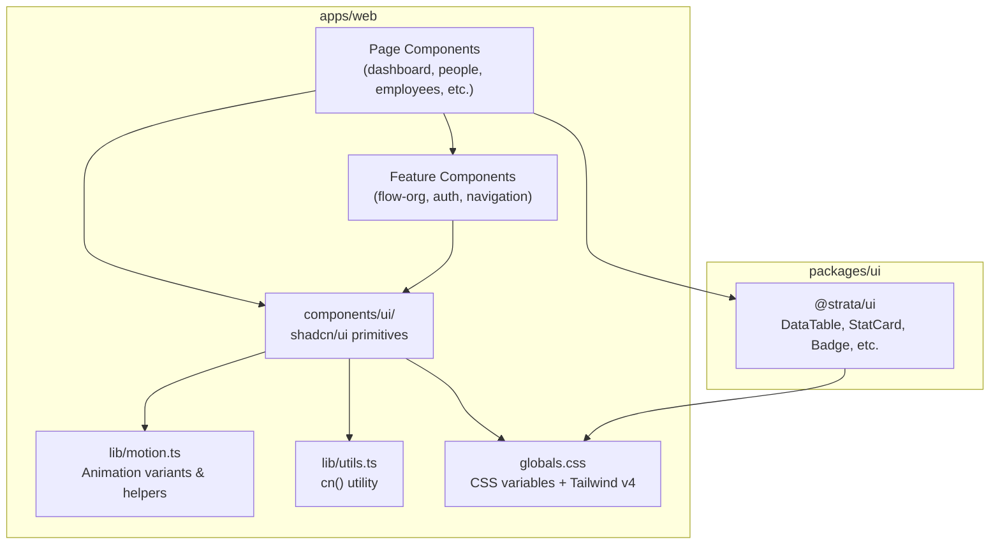
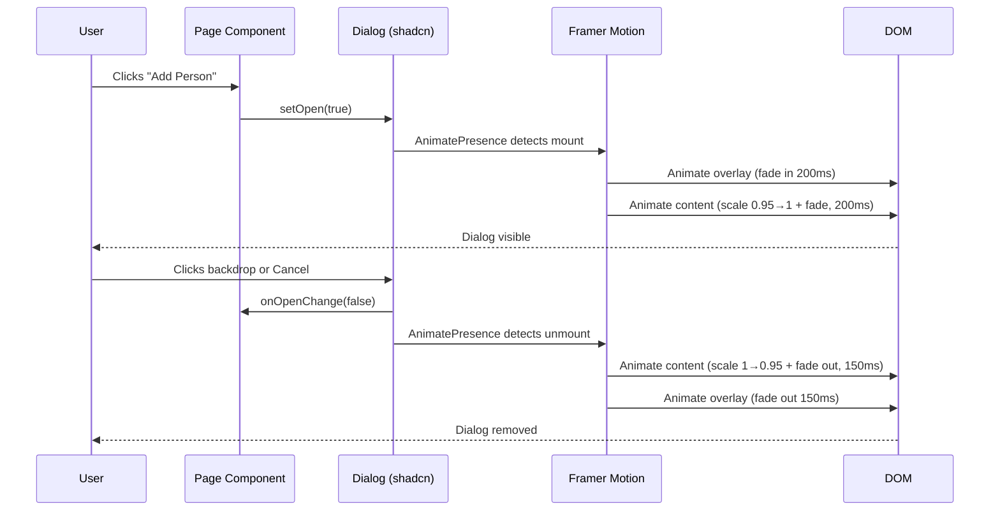
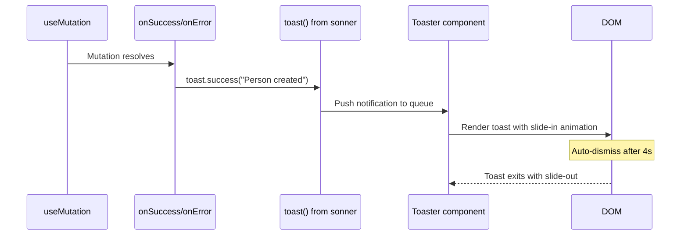

# Design Document: UI Component System (shadcn/ui + Framer Motion)

## Overview

This feature introduces shadcn/ui as the foundational component library for the Strata web application, replacing all raw HTML elements (`<button>`, `<input>`, `<select>`, custom modal overlays) with accessible, composable, and consistently styled primitives. The system integrates Framer Motion (via the `motion` package already installed) to provide polished entrance/exit animations for dialogs, page transitions, skeleton loading states, and interactive hover effects.

The approach leverages shadcn/ui's "copy-paste" model — components are installed directly into `apps/web/src/components/ui/` as owned source code rather than opaque node_modules. This pairs perfectly with the existing Tailwind CSS v4 setup using CSS variables already defined in `globals.css`. A `cn()` utility (built on the existing `tailwind-merge` dependency) provides conditional class merging throughout.

## Architecture



## Sequence Diagrams

### Dialog Open/Close with Animation



### Toast Notification Flow



## Components and Interfaces

### Component 1: `cn()` Utility

**Purpose**: Merge Tailwind classes with conflict resolution, enabling conditional styling.

**Interface**:
```typescript
// apps/web/src/lib/utils.ts
import { type ClassValue, clsx } from "clsx";
import { twMerge } from "tailwind-merge";

export function cn(...inputs: ClassValue[]): string {
  return twMerge(clsx(inputs));
}
```

**Responsibilities**:
- Merge multiple class strings with Tailwind conflict resolution
- Support conditional classes via clsx syntax
- Used by every shadcn/ui component

### Component 2: Motion Variants Module

**Purpose**: Centralized animation configuration respecting reduced-motion preferences.

**Interface**:
```typescript
// apps/web/src/lib/motion.ts
import type { Variants, Transition } from "motion/react";

export const dialogOverlayVariants: Variants;
export const dialogContentVariants: Variants;
export const pageTransitionVariants: Variants;
export const skeletonShimmerVariants: Variants;
export const buttonHoverVariants: Variants;
export const dropdownVariants: Variants;
export const sheetVariants: Variants;

export const defaultTransition: Transition;
export const springTransition: Transition;
```

**Responsibilities**:
- Define reusable animation variants for all component types
- Provide consistent timing across the app
- Disable animations when `prefers-reduced-motion` is active

### Component 3: shadcn/ui Primitives (installed in `components/ui/`)

**Purpose**: Accessible, styled base components replacing raw HTML.

| Component | Replaces | Key Features |
|-----------|----------|--------------|
| `Button` | `<button>` with inline styles | Variants: default, destructive, outline, secondary, ghost, link. Sizes: sm, default, lg, icon |
| `Input` | `<input>` with inline styles | Consistent focus ring, error state support |
| `Label` | `<label>` with inline styles | Pairs with Input for accessibility |
| `Select` | `<select>` with inline styles | Radix-based, keyboard accessible, custom styling |
| `Dialog` | Custom modal overlays | Focus trap, ESC close, backdrop click, animated |
| `Sheet` | Sidebar/mobile panels | Side drawer with overlay, responsive |
| `Card` | `<div>` with border/bg | Header, content, footer composition |
| `Badge` | Complements `@strata/ui` Badge | Additional variants for shadcn ecosystem |
| `Table` | Raw `<table>` styling | Header, body, row, cell primitives |
| `Tabs` | Custom tab implementations | Keyboard accessible, animated indicator |
| `DropdownMenu` | Custom dropdown menus | Radix-based, nested menus, keyboard nav |
| `Avatar` | Complements `@strata/ui` Avatar | Fallback initials, image loading |
| `Skeleton` | `animate-pulse` divs | Consistent loading states with shimmer |
| `Separator` | `<hr>` / border-b divs | Horizontal and vertical variants |
| `Sonner/Toaster` | No existing toast system | Success/error/info toasts on mutations |

### Component 4: Animated Dialog Wrapper

**Purpose**: Wraps shadcn Dialog with Framer Motion for entrance/exit animations.

**Interface**:
```typescript
// apps/web/src/components/ui/animated-dialog.tsx
import { type ComponentProps } from "react";
import { Dialog } from "./dialog";

interface AnimatedDialogProps extends ComponentProps<typeof Dialog> {
  /** Override default animation variants */
  contentVariants?: Variants;
}

export function AnimatedDialog(props: AnimatedDialogProps): JSX.Element;
export function AnimatedDialogContent(
  props: ComponentProps<typeof DialogContent>
): JSX.Element;
```

**Responsibilities**:
- Scale + fade entrance on open
- Scale + fade exit on close
- Backdrop fade animation
- Respects reduced motion preference

## Data Models

### Motion Variant Types

```typescript
// Animation configuration for dialog components
interface DialogAnimationConfig {
  overlay: {
    initial: { opacity: number };
    animate: { opacity: number };
    exit: { opacity: number };
    transition: { duration: number };
  };
  content: {
    initial: { opacity: number; scale: number; y: number };
    animate: { opacity: number; scale: number; y: number };
    exit: { opacity: number; scale: number; y: number };
    transition: { duration: number; ease: string };
  };
}

// Toast notification types
interface ToastConfig {
  position: "top-right" | "top-center" | "bottom-right" | "bottom-center";
  duration: number; // ms, default 4000
  richColors: boolean;
  closeButton: boolean;
}

// Button variant configuration
type ButtonVariant = "default" | "destructive" | "outline" | "secondary" | "ghost" | "link";
type ButtonSize = "default" | "sm" | "lg" | "icon";
```

**Validation Rules**:
- Animation durations must be between 0 and 500ms
- Scale values must be between 0.9 and 1.1 for subtle effects
- Toast duration minimum 2000ms, maximum 10000ms
- All animations must degrade gracefully with `prefers-reduced-motion`

## Algorithmic Pseudocode

### Component Migration Algorithm

```typescript
/**
 * ALGORITHM: migratePageToShadcn
 * 
 * For each page in the application:
 * 1. Identify all raw HTML elements that have shadcn equivalents
 * 2. Replace elements while preserving event handlers and state
 * 3. Replace custom modal overlays with Dialog component
 * 4. Add toast notifications to mutation success/error callbacks
 * 5. Verify accessibility attributes are preserved
 */

// Preconditions:
// - shadcn/ui components are installed in components/ui/
// - cn() utility is available at @/lib/utils
// - Sonner is configured in the root layout

// Postconditions:
// - No raw <button>, <input>, <select> elements remain (except inside shadcn primitives)
// - All dialogs use Dialog/AnimatedDialog component
// - All mutations show toast on success/error
// - Accessibility (aria-*, role, focus management) is maintained or improved
```

### Animation Initialization with Reduced Motion

```typescript
/**
 * ALGORITHM: resolveAnimationVariants
 * INPUT: variants (Variants), reducedMotion (boolean)
 * OUTPUT: effectiveVariants (Variants)
 * 
 * Preconditions:
 *   - variants is a valid Framer Motion Variants object
 *   - reducedMotion reflects user's prefers-reduced-motion setting
 * 
 * Postconditions:
 *   - If reducedMotion is true, all durations are 0 and transforms are identity
 *   - If reducedMotion is false, original variants are returned unchanged
 */
function resolveAnimationVariants(
  variants: Variants,
  reducedMotion: boolean
): Variants {
  if (!reducedMotion) return variants;
  
  // Strip all motion — instant state changes only
  return Object.fromEntries(
    Object.entries(variants).map(([key, value]) => [
      key,
      typeof value === "object"
        ? { ...value, transition: { duration: 0 } }
        : value,
    ])
  );
}
```

## Key Functions with Formal Specifications

### Function 1: `cn()`

```typescript
function cn(...inputs: ClassValue[]): string
```

**Preconditions:**
- Each input is a string, undefined, null, boolean, or object (clsx format)

**Postconditions:**
- Returns a single space-separated class string
- Conflicting Tailwind classes are resolved (last wins)
- Falsy values are excluded
- No duplicate classes in output

**Loop Invariants:** N/A

### Function 2: `AnimatedDialog`

```typescript
function AnimatedDialog({ children, open, onOpenChange, ...props }): JSX.Element
```

**Preconditions:**
- `open` is a boolean controlling visibility
- `onOpenChange` is a callback for close events
- Dialog content is provided as children

**Postconditions:**
- When `open` transitions false→true: content animates in (scale 0.95→1, opacity 0→1)
- When `open` transitions true→false: content animates out (scale 1→0.95, opacity 1→0)
- Focus is trapped within dialog when open
- ESC key triggers onOpenChange(false)
- Backdrop click triggers onOpenChange(false)
- When `prefers-reduced-motion` is active, transitions are instant

**Loop Invariants:** N/A

### Function 3: `toast()` integration with mutations

```typescript
function handleMutationResult<T>(
  mutation: UseMutationResult<T, Error>,
  options: { successMessage: string; errorMessage?: string }
): void
```

**Preconditions:**
- mutation is a TanStack Query mutation result
- successMessage is a non-empty string

**Postconditions:**
- On success: `toast.success(successMessage)` is called
- On error: `toast.error(errorMessage ?? error.message)` is called
- Toast appears in configured position with slide-in animation
- Toast auto-dismisses after configured duration

**Loop Invariants:** N/A

## Example Usage

### Button Migration

```typescript
// BEFORE: Raw HTML button
<button
  type="button"
  onClick={openAdd}
  className="rounded-md bg-primary px-4 py-2 text-sm font-medium text-primary-foreground hover:bg-primary/90 transition-colors"
>
  Add Person
</button>

// AFTER: shadcn Button
import { Button } from "@/components/ui/button";

<Button onClick={openAdd}>
  Add Person
</Button>
```

### Dialog Migration

```typescript
// BEFORE: Custom modal overlay
{showAddDialog && (
  <div className="fixed inset-0 z-50 flex items-center justify-center bg-black/50">
    <div className="bg-card border border-border rounded-lg p-6 w-full max-w-md shadow-xl">
      <h2 className="text-lg font-semibold mb-4">Add Person</h2>
      <form onSubmit={handleAdd}>...</form>
    </div>
  </div>
)}

// AFTER: Animated shadcn Dialog
import {
  Dialog, DialogContent, DialogHeader, DialogTitle, DialogFooter
} from "@/components/ui/dialog";
import { AnimatedDialogContent } from "@/components/ui/animated-dialog";

<Dialog open={showAddDialog} onOpenChange={setShowAddDialog}>
  <AnimatedDialogContent className="sm:max-w-md">
    <DialogHeader>
      <DialogTitle>Add Person</DialogTitle>
    </DialogHeader>
    <form onSubmit={handleAdd}>...</form>
    <DialogFooter>
      <Button variant="outline" onClick={() => setShowAddDialog(false)}>
        Cancel
      </Button>
      <Button type="submit" disabled={createMutation.isPending}>
        {createMutation.isPending ? "Saving..." : "Save"}
      </Button>
    </DialogFooter>
  </AnimatedDialogContent>
</Dialog>
```

### Select Migration

```typescript
// BEFORE: Raw HTML select
<select
  value={statusFilter}
  onChange={(e) => setStatusFilter(e.target.value)}
  className="h-9 rounded-sm border border-border bg-background px-3 text-sm..."
>
  {statusOptions.map((opt) => (
    <option key={opt} value={opt}>{opt}</option>
  ))}
</select>

// AFTER: shadcn Select
import {
  Select, SelectContent, SelectItem, SelectTrigger, SelectValue
} from "@/components/ui/select";

<Select value={statusFilter} onValueChange={setStatusFilter}>
  <SelectTrigger className="w-[180px]">
    <SelectValue placeholder="All Statuses" />
  </SelectTrigger>
  <SelectContent>
    {statusOptions.map((opt) => (
      <SelectItem key={opt} value={opt}>
        {opt === "ALL" ? "All Statuses" : opt.replace("_", " ")}
      </SelectItem>
    ))}
  </SelectContent>
</Select>
```

### Toast Integration

```typescript
// AFTER: Toast notifications on mutations
import { toast } from "sonner";

const createMutation = useCreatePerson();

const handleAdd = (e: React.FormEvent) => {
  e.preventDefault();
  createMutation.mutate(formData, {
    onSuccess: () => {
      toast.success("Person created successfully");
      setShowAddDialog(false);
      resetForm();
    },
    onError: (error) => {
      toast.error(error.message || "Failed to create person");
    },
  });
};
```

### Motion Variants

```typescript
// apps/web/src/lib/motion.ts
import type { Variants, Transition } from "motion/react";

export const dialogOverlayVariants: Variants = {
  hidden: { opacity: 0 },
  visible: { opacity: 1 },
};

export const dialogContentVariants: Variants = {
  hidden: { opacity: 0, scale: 0.95, y: -10 },
  visible: { opacity: 1, scale: 1, y: 0 },
  exit: { opacity: 0, scale: 0.95, y: 10 },
};

export const pageTransitionVariants: Variants = {
  initial: { opacity: 0, y: 8 },
  enter: { opacity: 1, y: 0 },
  exit: { opacity: 0, y: -8 },
};

export const skeletonShimmerVariants: Variants = {
  initial: { backgroundPosition: "-200% 0" },
  animate: { backgroundPosition: "200% 0" },
};

export const dropdownVariants: Variants = {
  hidden: { opacity: 0, scale: 0.95, y: -4 },
  visible: { opacity: 1, scale: 1, y: 0 },
  exit: { opacity: 0, scale: 0.95, y: -4 },
};

export const sheetVariants: Variants = {
  hidden: { x: "-100%" },
  visible: { x: 0 },
  exit: { x: "-100%" },
};

export const defaultTransition: Transition = {
  duration: 0.2,
  ease: [0.4, 0, 0.2, 1],
};

export const springTransition: Transition = {
  type: "spring",
  stiffness: 500,
  damping: 30,
};
```

## Correctness Properties

*A property is a characteristic or behavior that should hold true across all valid executions of a system — essentially, a formal statement about what the system should do. Properties serve as the bridge between human-readable specifications and machine-verifiable correctness guarantees.*

### Property 1: cn() Tailwind class conflict resolution

*For any* two Tailwind utility classes that target the same CSS property (e.g., `bg-red-500` and `bg-blue-500`), `cn(classA, classB)` SHALL produce an output string containing only the last class's value for that utility, with no duplicates or conflicts remaining.

**Validates: Requirement 2.3**

### Property 2: className prop passthrough

*For any* shadcn/ui component and any valid className string, rendering the component with that className prop SHALL result in those classes appearing in the rendered DOM element's class attribute (merged via cn()).

**Validates: Requirement 2.5**

### Property 3: Reduced motion disables all animation durations

*For any* animation Variants object in the Motion_System, when `prefers-reduced-motion: reduce` is active (reducedMotion = true), `resolveAnimationVariants(variants, true)` SHALL produce a Variants object where all transition durations are 0.

**Validates: Requirements 3.7**

### Property 4: Animation variants use only GPU-composited properties

*For any* animation variant defined in the Motion_System exports, the animated properties SHALL be limited to `opacity`, `scale`, `x`, `y`, `rotate`, and `backgroundPosition` (all GPU-composited via `transform`), and SHALL NOT animate `width`, `height`, `margin`, `padding`, `top`, `left`, or other layout-triggering properties.

**Validates: Requirement 3.8**

### Property 5: Dialog focus trap containment

*For any* open Dialog containing N focusable elements, pressing Tab from the last focusable element SHALL cycle focus back to the first focusable element, and pressing Shift+Tab from the first SHALL cycle to the last — focus never escapes the Dialog boundary.

**Validates: Requirement 6.1**

### Property 6: Dialog focus round-trip

*For any* Dialog triggered by a button element, when the Dialog opens focus SHALL move to the first focusable element inside, and when the Dialog closes focus SHALL return to the original trigger element.

**Validates: Requirements 6.2, 6.3**

### Property 7: Theme color contrast compliance

*For any* (foreground, background) color token pair designated for text rendering in the Theme_System (e.g., on-surface/surface, on-primary/primary), the computed contrast ratio SHALL be at least 4.5:1 for normal text and 3:1 for large text, in both light and dark modes.

**Validates: Requirement 6.6**

### Property 8: Error state accessibility attributes

*For any* Input component rendered in an error state with an associated error message, the input element SHALL have `aria-invalid="true"` and `aria-describedby` referencing the ID of the error message element.

**Validates: Requirement 6.7**

### Property 9: Light/dark mode token parity

*For any* color token defined in the `:root` selector of the Theme_System, a corresponding token with the same name SHALL be defined in the `.dark` selector, ensuring complete theme coverage across both modes.

**Validates: Requirement 1.3**

### Property 10: Responsive dialog sizing

*For any* Dialog component in the application, the dialog content SHALL have responsive width classes that render full-width (with minimal margins) at viewport widths below 640px and constrained width (max-w-md or max-w-lg) at viewport widths 640px and above.

**Validates: Requirement 7.4**

### Property 11: Minimum touch target size

*For any* interactive element (Button, link, Select trigger, menu item) rendered on a mobile viewport, the element's effective touch area SHALL be at least 44×44 CSS pixels.

**Validates: Requirement 7.5**

## Error Handling

### Error Scenario 1: Component Import Failures

**Condition**: shadcn component import fails at build time (missing peer dependency)
**Response**: Build error with clear message pointing to missing Radix primitive
**Recovery**: Install missing `@radix-ui/*` package; shadcn CLI handles this automatically during `add`

### Error Scenario 2: CSS Variable Mismatch

**Condition**: shadcn component references CSS variable not defined in `globals.css`
**Response**: Component renders with browser default styling (visible regression)
**Recovery**: Add missing variables to `globals.css` theme block. Required additions: `--accent`, `--accent-foreground`, `--popover`, `--popover-foreground`, `--destructive-foreground`, `--input`, `--secondary-foreground`

### Error Scenario 3: Animation Jank on Low-End Devices

**Condition**: Dialog animation causes frame drops on mobile
**Response**: Janky visual experience
**Recovery**: Motion variants use `transform` and `opacity` only (GPU-composited properties). The `will-change` hint is applied during animation. Reduced motion media query provides instant fallback.

### Error Scenario 4: Toast Overflow

**Condition**: Multiple rapid mutations create toast stack overflow
**Response**: Sonner handles queuing internally — max visible toasts configurable (default: 3)
**Recovery**: Configure `visibleToasts` prop on `<Toaster>`. Oldest toasts auto-dismiss.

## Testing Strategy

### Unit Testing Approach

- Test each shadcn component renders correctly with all variant/size combinations
- Test `cn()` utility produces correct merged output
- Test Button disabled state prevents click handlers
- Test Dialog focus trap behavior
- Test Select keyboard navigation (arrow keys, enter, escape)

### Property-Based Testing Approach

**Property Test Library**: fast-check

- **cn() merge correctness**: For any two conflicting Tailwind classes, `cn(a, b)` always produces a string containing only `b`'s value for that utility
- **Dialog state consistency**: For any sequence of open/close operations, dialog `open` state always matches DOM visibility
- **Animation variant resolution**: For any variants + reducedMotion input, output durations are always 0 when reducedMotion is true

### Integration Testing Approach

- Test full page renders with migrated components (no console errors)
- Test mutation → toast flow end-to-end
- Test Dialog form submission → close → data refresh cycle
- Test mobile responsive behavior (Sheet for sidebar)
- Visual regression testing with Playwright screenshots

## Performance Considerations

- **Bundle size**: shadcn components are tree-shakeable (only used components are bundled). Radix primitives add ~2-5KB per component (gzipped).
- **Animation performance**: All animations use `transform` and `opacity` only — these are GPU-composited and don't trigger layout/paint.
- **Sonner**: ~3KB gzipped, loaded only in root layout.
- **Import strategy**: Each shadcn component is a separate file — Next.js code-splits per-page automatically.
- **`clsx` addition**: ~228 bytes gzipped (required by cn() alongside existing tailwind-merge).

## Security Considerations

- shadcn Dialog uses Radix's focus trap preventing focus escape to background content (prevents interaction with hidden elements)
- No user input is rendered via `dangerouslySetInnerHTML` in any component
- Toast messages must be sanitized (plain text only, no HTML injection)
- Form inputs in Dialog maintain same validation as current implementation

## Dependencies

| Package | Version | Purpose |
|---------|---------|---------|
| `clsx` | `^2.1.0` | Conditional class construction (pairs with existing tailwind-merge) |
| `@radix-ui/react-dialog` | `^1.1.0` | Dialog primitive (headless, accessible) |
| `@radix-ui/react-select` | `^2.1.0` | Select primitive |
| `@radix-ui/react-dropdown-menu` | `^2.1.0` | Dropdown menu primitive |
| `@radix-ui/react-tabs` | `^1.1.0` | Tabs primitive |
| `@radix-ui/react-avatar` | `^1.1.0` | Avatar with fallback |
| `@radix-ui/react-label` | `^2.1.0` | Accessible label |
| `@radix-ui/react-separator` | `^1.1.0` | Visual separator |
| `@radix-ui/react-slot` | `^1.1.0` | Polymorphic component support (asChild) |
| `sonner` | `^2.0.0` | Toast notifications |
| `class-variance-authority` | `^0.7.0` | Variant management for Button/Badge |
| `lucide-react` | `^0.460.0` | Icon library (used by shadcn components) |

**Note**: `tailwind-merge` and `motion` (framer-motion) are already installed. No new animation library needed.

## Page Migration Map

| Page | Elements to Migrate | Components Used |
|------|--------------------|-----------------| 
| `/login` | 5 buttons, 4 inputs | Button, Input, Label, Separator |
| `/dashboard` | 3 quick-action buttons, skeleton loading | Button, Card, Skeleton |
| `/people` | 2 action buttons, 5 inputs per form, 3 dialogs | Button, Input, Label, Dialog, Table |
| `/employees` | 2 action buttons, 6 inputs, 1 select, 3 dialogs | Button, Input, Label, Select, Dialog, Table |
| `/settings/roles` | 3 buttons, 2 inputs, 1 select, 1 modal | Button, Input, Label, Select, Dialog, Table |
| `/settings/org-structure` | CRUD buttons, inputs, dialogs | Button, Input, Dialog |
| `/settings/positions` | CRUD buttons, inputs, dialogs | Button, Input, Dialog |
| `/settings/features` | Buttons, inputs | Button, Input |
| `/audit` | Filter selects, action buttons | Button, Select, Table |
| `/budgets` | Buttons, inputs, cards | Button, Input, Card |
| `/calendar` | Buttons, navigation | Button, Card |
| `/capacity` | Buttons, progress display | Button, Card |
| `/engineering` | Buttons, cards | Button, Card |
| `/reports` | Buttons, selects | Button, Select |
| Layout (Sidebar) | Toggle button | Button (ghost variant) |
| Layout (Header) | Notification dropdown | DropdownMenu, Button, Avatar |
| Navigation (Mobile) | Bottom nav → Sheet on "More" | Sheet |
| Navigation (Command) | Already custom — enhance with animations | N/A (keep as-is) |

## File Structure

```
apps/web/src/
├── components/
│   └── ui/                    # shadcn/ui components (NEW)
│       ├── button.tsx
│       ├── input.tsx
│       ├── label.tsx
│       ├── select.tsx
│       ├── dialog.tsx
│       ├── animated-dialog.tsx  # Motion-enhanced wrapper
│       ├── sheet.tsx
│       ├── card.tsx
│       ├── badge.tsx
│       ├── table.tsx
│       ├── tabs.tsx
│       ├── dropdown-menu.tsx
│       ├── avatar.tsx
│       ├── skeleton.tsx
│       ├── separator.tsx
│       └── sonner.tsx          # Toaster configuration
├── lib/
│   ├── utils.ts               # cn() utility (NEW)
│   └── motion.ts              # Animation variants (NEW)
└── app/
    └── layout.tsx             # Add <Toaster /> here
```
